- [Tổng quan](#tổng-quan)
- [Các lựa chọn phổ biến hiện nay](#các-lựa-chọn-phổ-biến-hiện-nay)
  - [Mermaid](#mermaid)
  - [PlantUML](#plantuml)
  - [D2](#d2)
  - [Structurizr DSL](#structurizr-dsl)
  - [Graphviz (DOT)](#graphviz-dot)
  - [So sánh nhanh](#so-sánh-nhanh)
  - [Nên chọn công cụ nào?](#nên-chọn-công-cụ-nào)
- [Quick Reference / Tham chiếu nhanh](#quick-reference--tham-chiếu-nhanh)
  - [Cách dùng cơ bản](#cách-dùng-cơ-bản)
  - [Flowchart cheat sheet](#flowchart-cheat-sheet)
  - [Chú thích, theme và style](#chú-thích-theme-và-style)
- [12 loại diagram thường dùng](#12-loại-diagram-thường-dùng)
  - [1. Flowchart – Lưu đồ](#1-flowchart--lưu-đồ)
  - [2. Sequence Diagram – Biểu đồ tuần tự](#2-sequence-diagram--biểu-đồ-tuần-tự)
  - [3. Class Diagram – Biểu đồ lớp](#3-class-diagram--biểu-đồ-lớp)
  - [4. State Diagram – Biểu đồ trạng thái](#4-state-diagram--biểu-đồ-trạng-thái)
  - [5. ER Diagram – Biểu đồ thực thể quan hệ](#5-er-diagram--biểu-đồ-thực-thể-quan-hệ)
  - [6. Gantt – Kế hoạch dự án](#6-gantt--kế-hoạch-dự-án)
  - [7. Pie Chart – Biểu đồ tròn](#7-pie-chart--biểu-đồ-tròn)
  - [8. Mindmap – Sơ đồ tư duy](#8-mindmap--sơ-đồ-tư-duy)
  - [9. Timeline – Dòng thời gian](#9-timeline--dòng-thời-gian)
  - [10. Git Graph – Biểu đồ nhánh Git](#10-git-graph--biểu-đồ-nhánh-git)
  - [11. User Journey – Hành trình người dùng](#11-user-journey--hành-trình-người-dùng)
  - [12. XY Chart – Biểu đồ cột và đường](#12-xy-chart--biểu-đồ-cột-và-đường)
- [Kết luận](#kết-luận)
- [Resources / Tài nguyên](#resources--tài-nguyên)

# Tổng quan

Khi viết tài liệu kỹ thuật, ta thường cần hình minh họa: lưu đồ, sơ đồ tuần tự, sơ đồ CSDL, kế hoạch dự án... Cách truyền thống là vẽ bằng draw.io, Visio hay PowerPoint rồi xuất ra ảnh. Cách này có vài điểm yếu:

- File ảnh **không diff được** trong Git, khó review khi sơ đồ thay đổi.
- Sửa một chữ cũng phải mở lại công cụ vẽ, xuất lại ảnh, thay ảnh trong bài.
- Hình dễ **lỗi thời** so với code và tài liệu.

**Diagrams as Code** giải quyết vấn đề này: sơ đồ được mô tả bằng văn bản, lưu cùng mã nguồn, và công cụ tự vẽ ra hình. **Mermaid** là lựa chọn phổ biến nhất vì cú pháp đơn giản, chạy ngay trên trình duyệt (JavaScript) và được nhiều nền tảng hỗ trợ sẵn như GitHub, GitLab, Notion, Obsidian, Azure DevOps Wiki...

Ví dụ nhỏ nhất, bạn viết:

```text
flowchart LR
    Code --> Build --> Test --> Deploy
```

và nhận được:

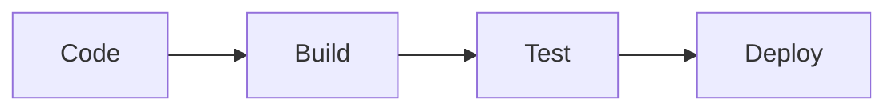

Blog này đã được tích hợp Mermaid, nên mọi diagram trong bài đều là mã văn bản được vẽ lại ngay khi trang tải.

# Các lựa chọn phổ biến hiện nay

## Mermaid

- Cú pháp giống Markdown, dễ học, chỉ cần vài phút là vẽ được lưu đồ đầu tiên.
- Chạy bằng JavaScript, không cần cài server hay Java.
- Được hỗ trợ sẵn trong GitHub, GitLab, Notion, Obsidian, Docusaurus, MkDocs (qua plugin)...
- Hỗ trợ nhiều loại sơ đồ: flowchart, sequence, class, state, ER, gantt, pie, mindmap, timeline, gitGraph, C4 (thử nghiệm)...
- Hạn chế: khả năng tinh chỉnh bố cục không sâu, sơ đồ lớn dễ rối.

## PlantUML

- Lâu đời, rất mạnh với sơ đồ UML: use case, component, deployment, activity...
- Cần Java (và Graphviz cho một số loại sơ đồ), hoặc dùng server PlantUML có sẵn.
- Nhiều tùy chọn hơn Mermaid, thư viện icon và stdlib phong phú (AWS, Azure, C4...).
- Hạn chế: cú pháp dài dòng hơn, GitHub không render trực tiếp.

## D2

- Ngôn ngữ mới (do Terrastruct phát triển), cú pháp gọn và hiện đại, hình ảnh đẹp mặc định.
- Hỗ trợ animation, icon, theme, sơ đồ nhiều lớp (layers), nhiều layout engine (như dagre, ELK).
- Là một chương trình dòng lệnh riêng, xuất ra SVG/PNG.
- Hạn chế: hệ sinh thái và mức độ hỗ trợ trên các nền tảng còn ít hơn Mermaid, PlantUML.

## Structurizr DSL

- Dành riêng cho mô hình **C4** (System Context, Container, Component, Code) của Simon Brown.
- Mô tả **một mô hình kiến trúc** duy nhất rồi sinh ra nhiều view khác nhau, nên các view luôn nhất quán.
- Hạn chế: chỉ tập trung vào kiến trúc phần mềm, không dùng cho flowchart hay ER.

## Graphviz (DOT)

- Công cụ nền tảng cho nhiều công cụ khác (PlantUML dùng nó để bố trí), cú pháp DOT.
- Rất hợp với đồ thị lớn, cây phụ thuộc, sơ đồ sinh tự động từ chương trình.
- Hạn chế: chỉ có đồ thị node-edge, không có sequence, gantt, pie...

Ngoài ra còn có [Kroki](https://kroki.io), một dịch vụ gom nhiều ngôn ngữ (Mermaid, PlantUML, D2, Graphviz, Structurizr...) sau một API duy nhất, hữu ích khi muốn dùng nhiều công cụ trong cùng một hệ thống tài liệu.

## So sánh nhanh

| Tiêu chí | Mermaid | PlantUML | D2 | Structurizr DSL | Graphviz |
| --- | --- | --- | --- | --- | --- |
| Độ dễ học | Rất dễ | Trung bình | Dễ | Trung bình | Trung bình |
| Cần cài đặt | Không (chạy trong trình duyệt) | Java hoặc server | CLI | Server hoặc CLI | CLI |
| Render sẵn trên GitHub | Có | Không | Không | Không | Không |
| Số loại sơ đồ | Nhiều | Rất nhiều | Chủ yếu sơ đồ khối | Chỉ C4 | Chỉ đồ thị |
| Điểm mạnh | Tiện, phổ biến | UML đầy đủ | Đẹp, hiện đại | Mô hình kiến trúc C4 | Đồ thị lớn, tự sinh |

## Nên chọn công cụ nào?

- Viết tài liệu, README, blog, wiki và muốn nhanh gọn: chọn **Mermaid**.
- Cần UML chuẩn và chi tiết, hoặc dự án đã dùng sẵn: chọn **PlantUML**.
- Muốn sơ đồ kiến trúc đẹp, tùy biến nhiều: thử **D2**.
- Quản lý kiến trúc theo C4 cho hệ thống lớn: chọn **Structurizr DSL**.
- Vẽ đồ thị phụ thuộc tự động từ code: chọn **Graphviz**.

Phần còn lại của bài tập trung vào Mermaid.

# Quick Reference / Tham chiếu nhanh

## Cách dùng cơ bản

Trong Markdown, đặt mã Mermaid vào khối code có ngôn ngữ `mermaid`:

````markdown
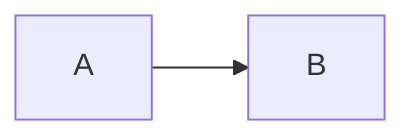
````

Trên GitHub, GitLab, Obsidian, Notion... bạn chỉ cần viết như trên là có hình. Với trang web tự dựng (như blog Jekyll này), cần nhúng thư viện Mermaid vào trang và gọi `mermaid.run()`.

Dòng đầu tiên của mỗi khối là **từ khóa loại sơ đồ**:

| Từ khóa | Loại sơ đồ |
| --- | --- |
| `flowchart` | Lưu đồ |
| `sequenceDiagram` | Tuần tự |
| `classDiagram` | Lớp |
| `stateDiagram-v2` | Trạng thái |
| `erDiagram` | Thực thể quan hệ |
| `gantt` | Kế hoạch dự án |
| `pie` | Biểu đồ tròn |
| `mindmap` | Sơ đồ tư duy |
| `timeline` | Dòng thời gian |
| `gitGraph` | Nhánh Git |
| `journey` | Hành trình người dùng |
| `xychart-beta` | Biểu đồ cột và đường |

## Flowchart cheat sheet

**Hướng vẽ:** `TD` hoặc `TB` (trên xuống), `BT` (dưới lên), `LR` (trái sang phải), `RL` (phải sang trái).

**Hình dạng node:**

| Cú pháp | Hình |
| --- | --- |
| `A[Chữ nhật]` | Hình chữ nhật |
| `A(Bo tròn)` | Chữ nhật bo góc |
| `A([Sân vận động])` | Bắt đầu / kết thúc |
| `A[[Chương trình con]]` | Subroutine |
| `A[(Database)]` | Cơ sở dữ liệu |
| `A((Tròn))` | Hình tròn |
| `A{Điều kiện}` | Hình thoi (quyết định) |

**Loại mũi tên:**

| Cú pháp | Ý nghĩa |
| --- | --- |
| `A --> B` | Mũi tên |
| `A --- B` | Đường nối không mũi tên |
| `A -.-> B` | Mũi tên nét đứt |
| `A ==> B` | Mũi tên đậm |

Muốn gắn nhãn lên mũi tên, đặt nhãn giữa hai dấu gạch đứng: `A -->|Nhãn| B`, hoặc viết `A -- Nhãn --> B`.

**Nhóm bằng subgraph:**

```text
flowchart LR
    subgraph Frontend
        A[React] --> B[API Client]
    end
    subgraph Backend
        C[API] --> D[(DB)]
    end
    B --> C
```

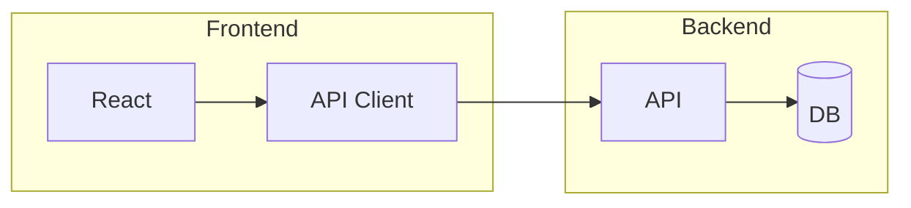

## Chú thích, theme và style

- Chú thích: dòng bắt đầu bằng `%%`, Mermaid sẽ bỏ qua.
- Đổi theme (`default`, `dark`, `forest`, `neutral`, `base`) bằng khối cấu hình ở đầu sơ đồ:

```text
---
config:
  theme: forest
---
flowchart LR
    A --> B
```

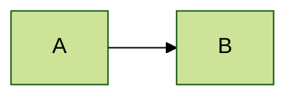

- Tô màu từng node bằng `style` hoặc dùng `classDef`:

```text
flowchart LR
    A[Thành công]:::ok --> B[Thất bại]:::fail
    classDef ok fill:#d4edda,stroke:#28a745,color:#155724
    classDef fail fill:#f8d7da,stroke:#dc3545,color:#721c24
```

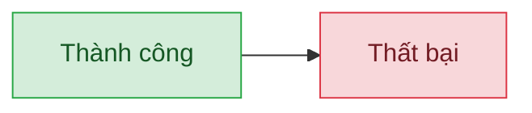

Nếu nhãn chứa ký tự đặc biệt (ngoặc, dấu hai chấm...), đặt nhãn trong dấu nháy kép: `A["Nhãn (có ngoặc)"]`.

# 12 loại diagram thường dùng

Mỗi mục dưới đây có mã nguồn và kết quả để bạn so sánh.

### 1. Flowchart – Lưu đồ

Loại phổ biến nhất: mô tả quy trình, thuật toán, luồng quyết định.

Mã nguồn:

```text
flowchart TD
    A([Bắt đầu]) --> B[Nhận đơn hàng]
    B --> C{Còn hàng?}
    C -->|Có| D[Đóng gói]
    C -->|Không| E[Báo khách hàng]
    D --> F[(Lưu CSDL)]
    E --> F
    F --> G([Kết thúc])
```

Kết quả:

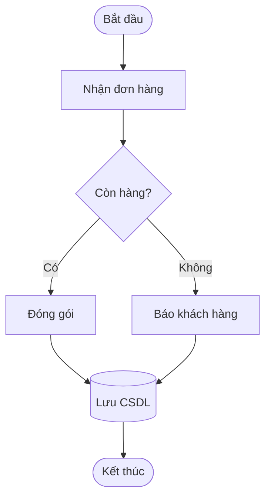

### 2. Sequence Diagram – Biểu đồ tuần tự

Thể hiện thứ tự thông điệp giữa các thành phần (API, microservice, người dùng...).

Mã nguồn:

```text
sequenceDiagram
    autonumber
    participant U as Người dùng
    participant W as Web App
    participant A as API
    participant D as Database
    U->>W: Đăng nhập
    W->>A: POST /login
    A->>D: Kiểm tra tài khoản
    D-->>A: OK
    A-->>W: JWT token
    W-->>U: Vào trang chủ
    Note over A,D: Mật khẩu đã được hash
```

Kết quả:

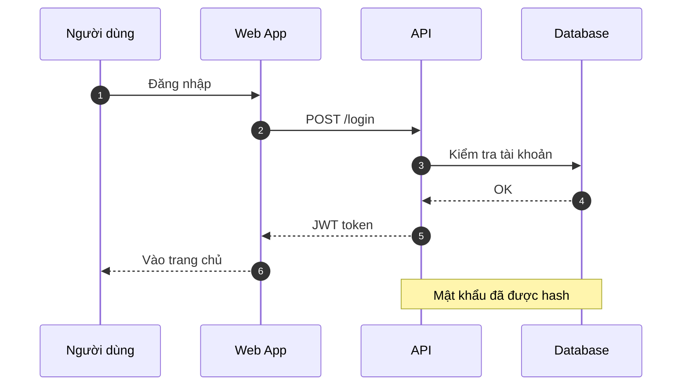

### 3. Class Diagram – Biểu đồ lớp

Mô hình hóa lớp, thuộc tính, phương thức và quan hệ (kế thừa, kết hợp...).

Mã nguồn:

```text
classDiagram
    class Animal {
        +String name
        +int age
        +eat() void
    }
    class Dog {
        +bark() void
    }
    class Cat {
        +meow() void
    }
    Animal <|-- Dog
    Animal <|-- Cat
```

Kết quả:

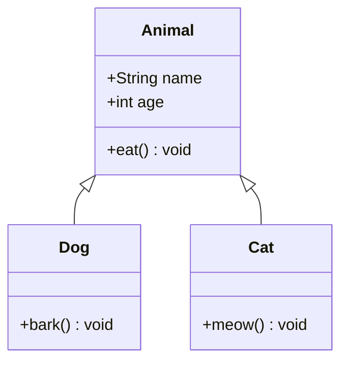

### 4. State Diagram – Biểu đồ trạng thái

Máy trạng thái hữu hạn: vòng đời đơn hàng, kết nối mạng, workflow duyệt...

Mã nguồn:

```text
stateDiagram-v2
    [*] --> Moi
    Moi --> DangXuLy: Xác nhận
    DangXuLy --> DaGiao: Giao thành công
    DangXuLy --> Huy: Khách hủy
    DaGiao --> [*]
    Huy --> [*]
```

Kết quả:

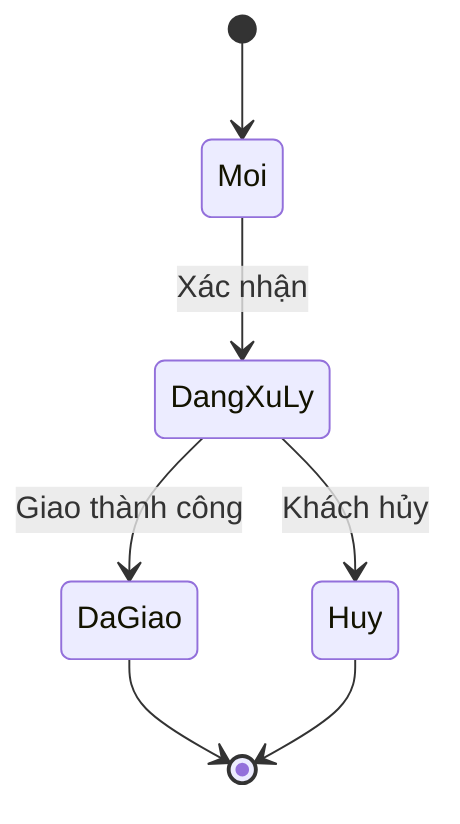

### 5. ER Diagram – Biểu đồ thực thể quan hệ

Thiết kế cơ sở dữ liệu: bảng, cột, khóa và quan hệ giữa các bảng.

Mã nguồn:

```text
erDiagram
    KHACH_HANG ||--o{ DON_HANG : dat
    DON_HANG ||--|{ CHI_TIET : gom
    SAN_PHAM ||--o{ CHI_TIET : thuoc
    KHACH_HANG {
        int id PK
        string ten
        string email
    }
    DON_HANG {
        int id PK
        int khach_hang_id FK
        date ngay_dat
    }
```

Kết quả:

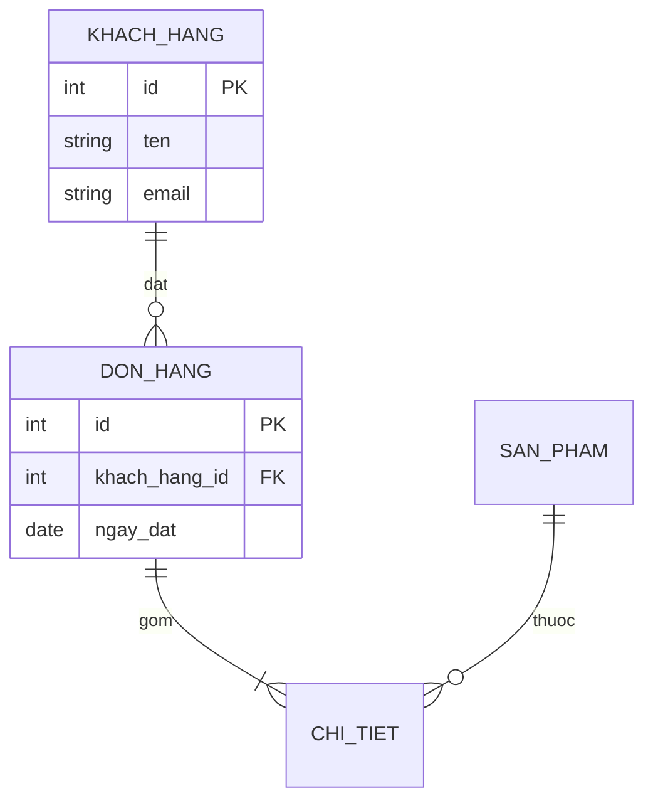

### 6. Gantt – Kế hoạch dự án

Lập tiến độ, các mốc và phụ thuộc giữa công việc.

Mã nguồn:

```text
gantt
    title Kế hoạch dự án
    dateFormat YYYY-MM-DD
    section Phân tích
        Thu thập yêu cầu :done, a1, 2026-11-02, 7d
        Thiết kế          :active, a2, after a1, 5d
    section Phát triển
        Lập trình         :a3, after a2, 14d
        Kiểm thử          :a4, after a3, 7d
    section Triển khai
        Go-live           :milestone, after a4, 0d
```

Kết quả:

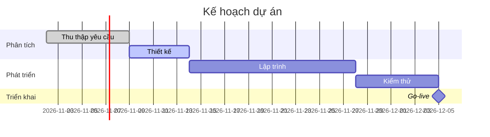

### 7. Pie Chart – Biểu đồ tròn

Biểu đồ tỷ lệ đơn giản, chỉ cần khai báo nhãn và giá trị.

Mã nguồn:

```text
pie showData
    title Thời gian làm việc trong tuần
    "Lập trình" : 45
    "Họp" : 20
    "Review code" : 20
    "Học tập" : 15
```

Kết quả:

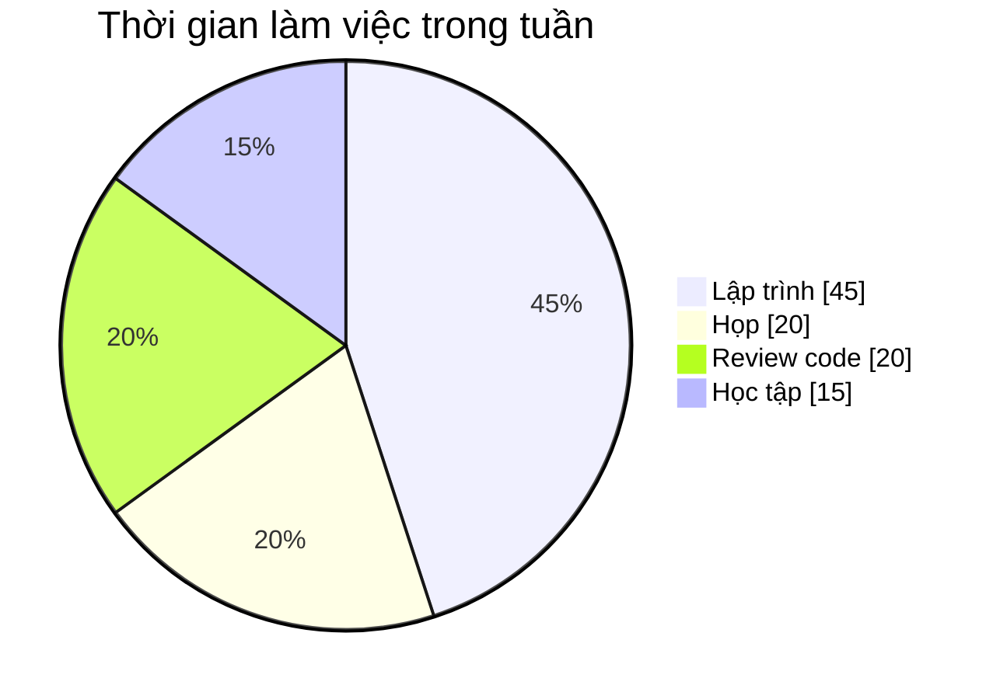

### 8. Mindmap – Sơ đồ tư duy

Brainstorm, tóm tắt kiến thức theo dạng cây phân cấp bằng thụt lề.

Mã nguồn:

```text
mindmap
  root((Mermaid))
    Diagram
      Flowchart
      Sequence
      ER
    Chart
      Pie
      XY
      Gantt
    Nơi dùng
      GitHub
      GitLab
      Obsidian
```

Kết quả:

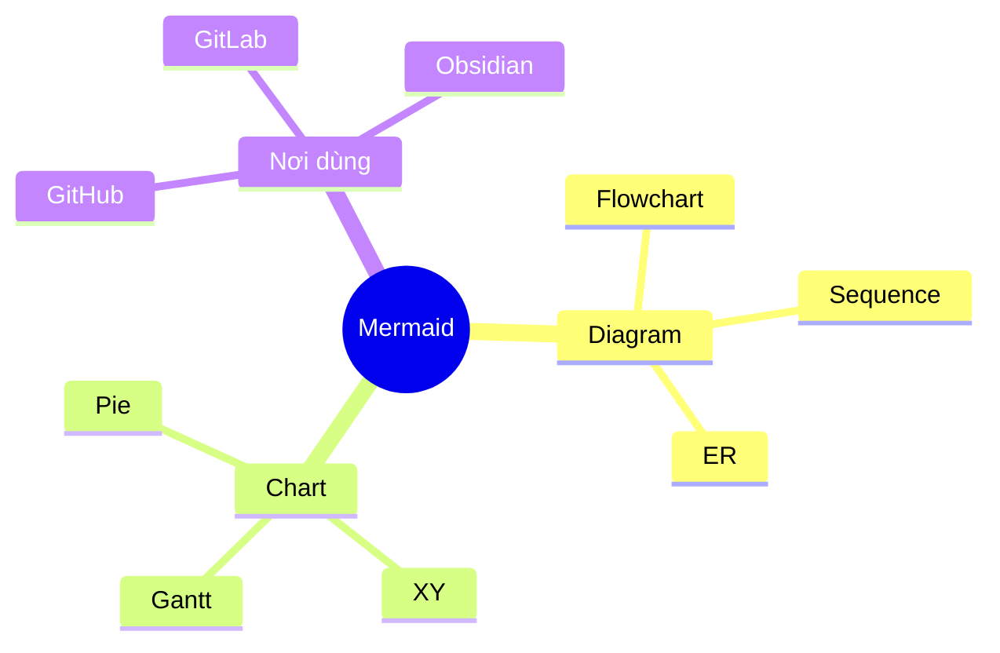

### 9. Timeline – Dòng thời gian

Trình bày các sự kiện, lịch sử phát triển theo mốc thời gian.

Mã nguồn:

```text
timeline
    title Lộ trình học Mermaid
    Tuần 1 : Flowchart : Sequence
    Tuần 2 : Class : State : ER
    Tuần 3 : Gantt : Pie : XY Chart
    Tuần 4 : Tích hợp vào blog và tài liệu
```

Kết quả:

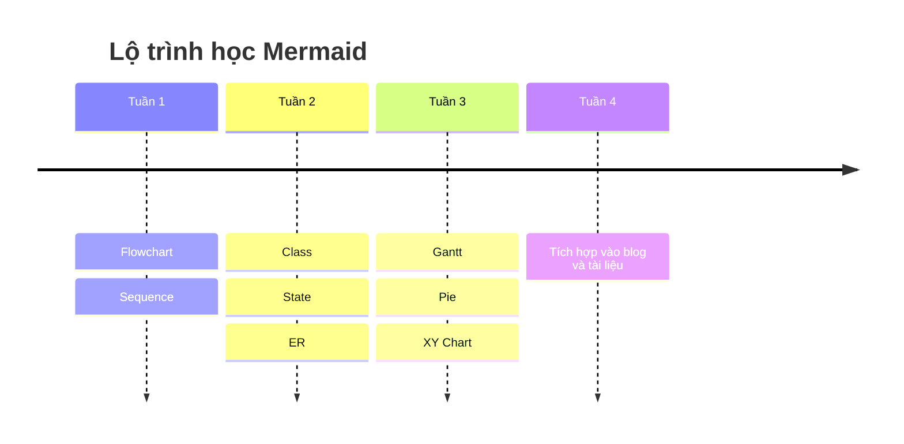

### 10. Git Graph – Biểu đồ nhánh Git

Minh họa nhánh, commit, merge — hữu ích khi giải thích quy trình Git.

Mã nguồn:

```text
gitGraph
    commit id: "init"
    branch develop
    checkout develop
    commit id: "feature A"
    commit id: "feature B"
    checkout main
    merge develop tag: "v1.0"
    commit id: "hotfix"
```

Kết quả:

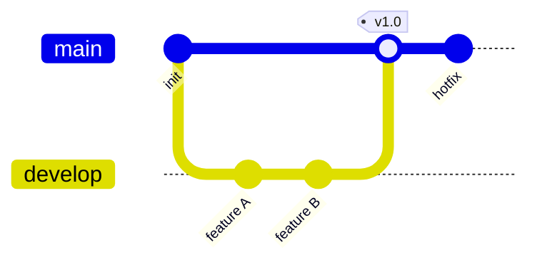

### 11. User Journey – Hành trình người dùng

Mô tả các bước trải nghiệm và mức độ hài lòng (điểm 1–5) của người dùng.

Mã nguồn:

```text
journey
    title Một ngày của lập trình viên
    section Buổi sáng
      Uống cà phê: 5: Dev
      Daily meeting: 3: Dev, PM
    section Buổi chiều
      Viết code: 4: Dev
      Fix bug: 2: Dev
    section Buổi tối
      Về nhà: 5: Dev
```

Kết quả:

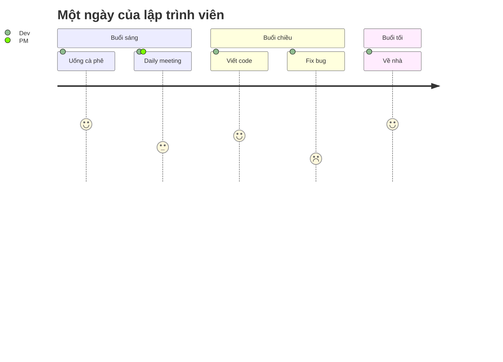

### 12. XY Chart – Biểu đồ cột và đường

Biểu đồ cột/đường theo trục X–Y. Hiện còn ở dạng beta nên cú pháp có thể thay đổi.

Mã nguồn:

```text
xychart-beta
    title "Doanh thu theo quý (triệu đồng)"
    x-axis [Q1, Q2, Q3, Q4]
    y-axis "Doanh thu" 0 --> 600
    bar [120, 250, 410, 520]
    line [120, 250, 410, 520]
```

Kết quả:

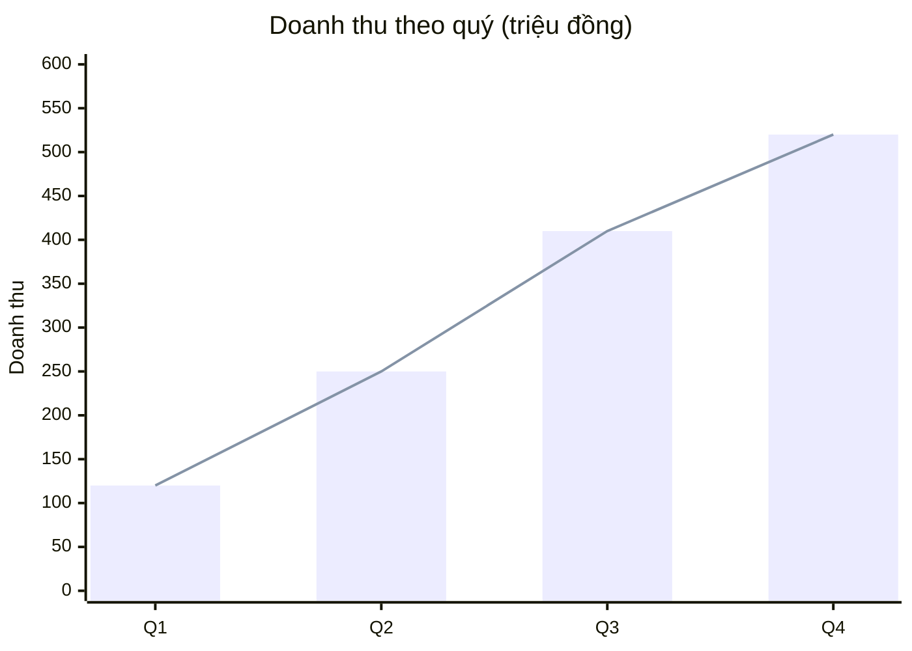

# Kết luận

- Diagrams as Code giúp sơ đồ **nằm cùng code**, review được qua pull request và ít bị lỗi thời.
- **Mermaid** là lựa chọn mặc định hợp lý cho tài liệu, README và blog nhờ cú pháp dễ, không cần cài đặt và được GitHub, GitLab, Obsidian... hỗ trợ sẵn.
- Khi cần UML đầy đủ, kiến trúc C4 hoặc đồ thị lớn, hãy cân nhắc **PlantUML**, **Structurizr DSL**, **D2** hay **Graphviz**.
- Mẹo nhỏ: viết sơ đồ nhỏ, mỗi sơ đồ chỉ kể một câu chuyện. Sơ đồ quá lớn nên được tách thành nhiều sơ đồ hoặc dùng `subgraph`.
- Mermaid cho phép thử trực tiếp trên [Mermaid Live Editor](https://mermaid.live), rất tiện để chỉnh sửa trước khi đưa vào tài liệu.

# Resources / Tài nguyên

- Mermaid
  - [Trang chủ và tài liệu Mermaid](https://mermaid.js.org)
  - [Mermaid Live Editor](https://mermaid.live)
  - [Mermaid trên GitHub](https://github.com/mermaid-js/mermaid)
  - [Viblo – tag Mermaid](https://viblo.asia/tags/mermaid)
  - [GitHub Docs – Creating diagrams](https://docs.github.com/en/get-started/writing-on-github/working-with-advanced-formatting/creating-diagrams)
- Các công cụ khác
  - [PlantUML](https://plantuml.com)
  - [D2](https://d2lang.com)
  - [Structurizr DSL](https://docs.structurizr.com/dsl)
  - [C4 model](https://c4model.com)
  - [Graphviz](https://graphviz.org)
  - [Kroki](https://kroki.io)
