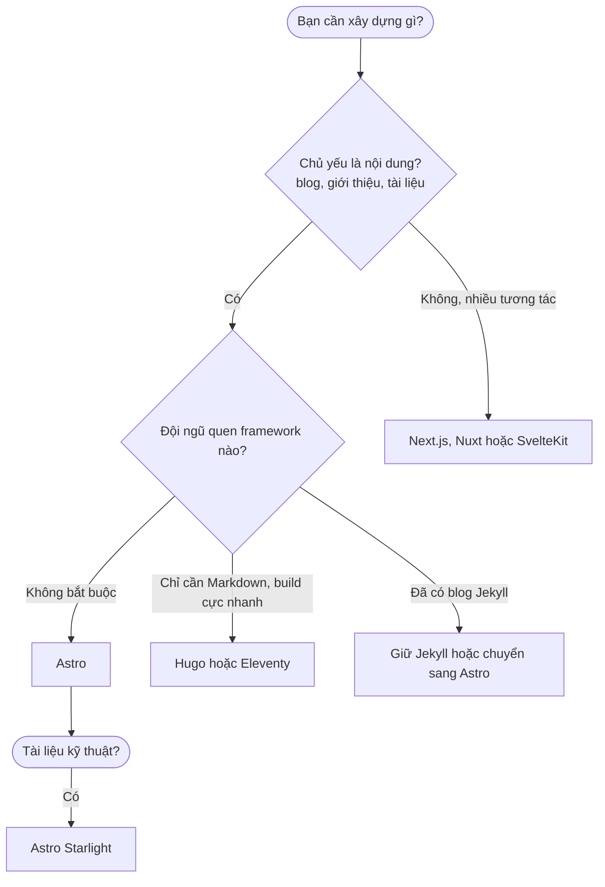
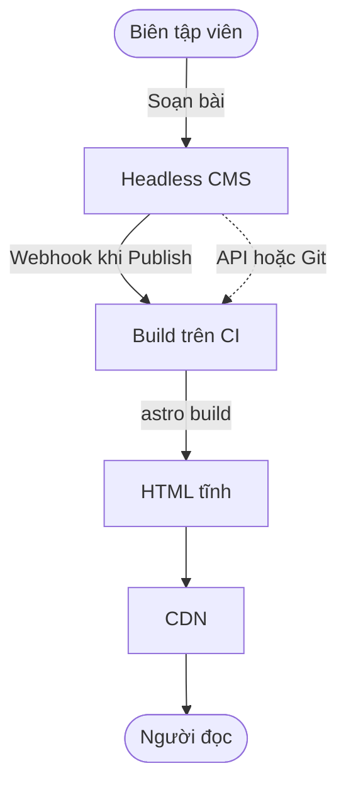
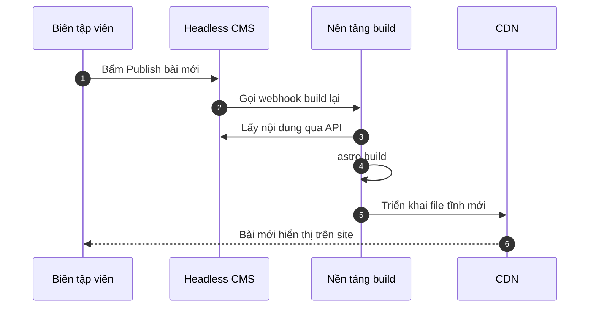
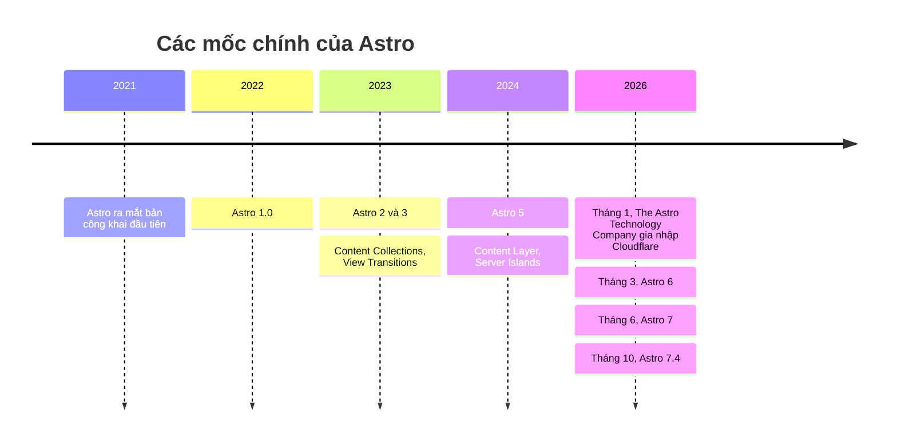
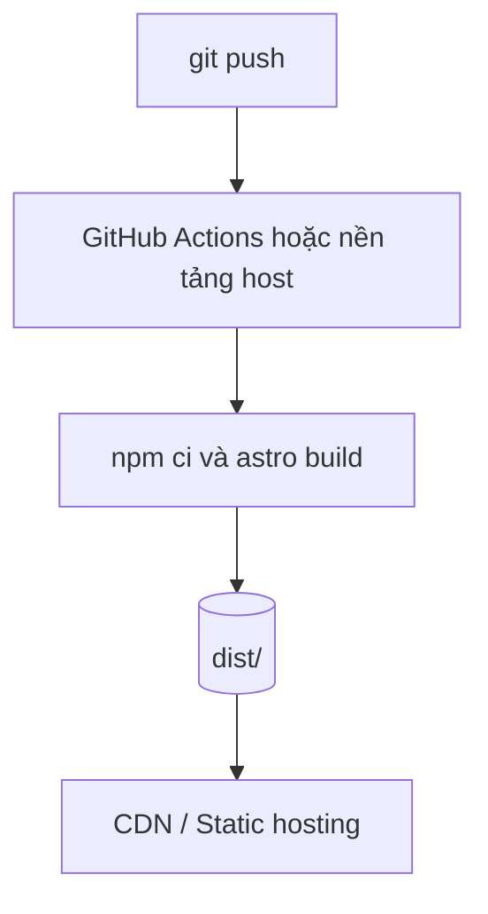
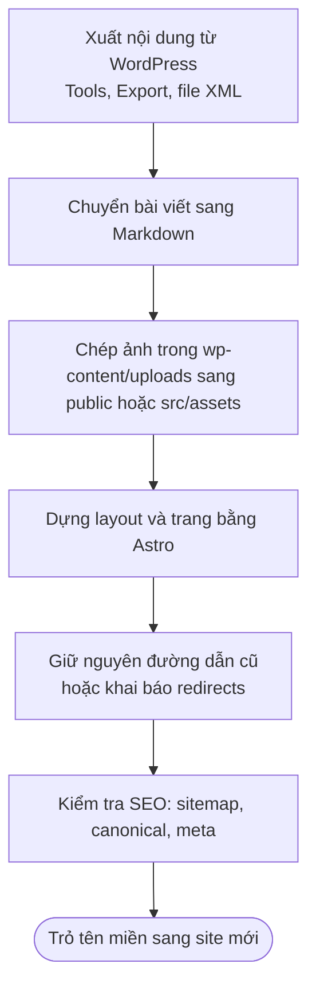

- [Tổng quan](#tổng-quan)
- [Các Web Framework Jamstack thay thế WordPress phổ biến hiện nay](#các-web-framework-jamstack-thay-thế-wordpress-phổ-biến-hiện-nay)
- [Thay thế WordPress Admin (Headless CMS)](#thay-thế-wordpress-admin-headless-cms)
- [Công thức thay thế WordPress phổ biến](#công-thức-thay-thế-wordpress-phổ-biến)
- [Astro là gì?](#astro-là-gì)
- [Tích hợp trực tiếp với các framework UI](#tích-hợp-trực-tiếp-với-các-framework-ui)
- [Các thông tin quan trọng khác cần có](#các-thông-tin-quan-trọng-khác-cần-có)
- [Các nguồn theme miễn phí](#các-nguồn-theme-miễn-phí)
- [Kết luận](#kết-luận)
- [Resources / Tài nguyên](#resources--tài-nguyên)

# Tổng quan

WordPress là hệ quản trị nội dung (CMS) phổ biến nhất thế giới, nhưng với một blog hay website giới thiệu thì nó mang theo khá nhiều gánh nặng: phải thuê hosting có PHP và MySQL, phải cập nhật core, theme và plugin liên tục để vá lỗi bảo mật, và mỗi lượt truy cập đều khiến server dựng lại trang từ database.

**Jamstack** đi theo hướng ngược lại: trang web được **dựng sẵn thành file tĩnh (HTML, CSS, JS) một lần lúc build**, rồi phát qua CDN. Nội dung nằm trong Markdown/Git hoặc một **Headless CMS** (CMS chỉ lo phần quản trị nội dung, trả dữ liệu qua API, không lo phần hiển thị).


| Tiêu chí | WordPress truyền thống | Jamstack (ví dụ Astro) |
| --- | --- | --- |
| Cách dựng trang | Mỗi request chạy PHP và truy vấn MySQL | Dựng sẵn HTML lúc build |
| Hosting | Cần PHP và MySQL | Static hosting hoặc CDN, có thể miễn phí |
| Bảo mật | Bề mặt tấn công lớn (core, plugin, theme, database) | Bề mặt tấn công nhỏ, không có database công khai |
| Tốc độ | Phụ thuộc cache và plugin | Nhanh sẵn vì chỉ phục vụ file tĩnh |
| Quản lý nội dung | Giao diện admin có sẵn | Markdown, Git hoặc Headless CMS |
| Chi phí vận hành | Hosting, backup, cập nhật | Thấp, chủ yếu là công sức lúc dựng |
| Tương tác động (đăng nhập, giỏ hàng) | Có sẵn qua plugin | Cần API hoặc dịch vụ ngoài |

Bài viết này giới thiệu các framework Jamstack có thể thay WordPress, cách thay phần quản trị bằng Headless CMS, vài "công thức" ghép sẵn theo từng loại website, rồi đi sâu vào **Astro**, framework đang được dùng nhiều nhất cho website thiên về nội dung.

# Các Web Framework Jamstack thay thế WordPress phổ biến hiện nay

| Framework | Nền tảng | Điểm mạnh | Hạn chế | Phù hợp với |
| --- | --- | --- | --- | --- |
| **Next.js** | React | Hệ sinh thái rất lớn, hỗ trợ SSG, SSR và render theo từng trang | Gửi nhiều JavaScript hơn cần thiết cho site chỉ có nội dung | Ứng dụng web lớn, website cần nhiều tương tác |
| **Astro** | Đa framework (React, Vue, Svelte...) | Ít JavaScript mặc định, kiến trúc Islands, Content Collections | Không phải lựa chọn tốt nhất cho ứng dụng cực kỳ tương tác | Blog, website doanh nghiệp, tài liệu, landing page |
| **Nuxt** | Vue.js | Trải nghiệm Vue liền mạch, hỗ trợ SSG và SSR | Gắn chặt với Vue | Đội đã dùng Vue |
| **SvelteKit** | Svelte | Code gọn, ít JavaScript phía client | Cộng đồng nhỏ hơn React và Vue | Đội thích Svelte, ứng dụng nhẹ |
| **Gatsby** | React và GraphQL | Từng là lựa chọn Jamstack hàng đầu, có nhiều plugin nguồn dữ liệu | Hoạt động ít sôi nổi hơn trước, build chậm với site lớn; nhiều dự án đã chuyển sang framework khác | Dự án cũ đang chạy ổn |
| **Remix** | React | Tập trung full-stack, xử lý form và dữ liệu tốt | Hướng SSR, không phải static-first; đã hợp nhất vào React Router v7 | Ứng dụng React full-stack |
| **Hugo** | Go | Build cực nhanh, chỉ một file chạy duy nhất | Template Go khá khó làm quen | Site rất nhiều trang, blog thuần |
| **Eleventy (11ty)** | JavaScript | Đơn giản, linh hoạt, mặc định không gửi JS | Phải tự ghép nhiều thứ | Người thích kiểm soát hoàn toàn |
| **Jekyll** | Ruby | GitHub Pages hỗ trợ sẵn, chính là nền tảng của blog này | Build chậm khi site lớn, hệ sinh thái Ruby | Blog cá nhân đơn giản trên GitHub Pages |

Cách chọn nhanh:



# Thay thế WordPress Admin (Headless CMS)

Điều người dùng WordPress tiếc nhất khi chuyển sang Jamstack thường là **trang quản trị**: soạn bài bằng trình soạn thảo, upload ảnh, bấm Publish. Giải pháp là dùng một **Headless CMS**: CMS lưu nội dung và cung cấp giao diện soạn bài, còn website Astro lấy nội dung qua API hoặc từ Git lúc build.



Trang tài liệu của Astro hướng dẫn kết nối với hàng chục CMS. Có hai kiểu lưu nội dung chính:

| Nhóm | Nội dung lưu ở đâu | Ví dụ | Điểm mạnh | Lưu ý |
| --- | --- | --- | --- | --- |
| **Git-based** | File Markdown/JSON ngay trong repo | Decap CMS, Keystatic, TinaCMS, Pages CMS | Miễn phí, có lịch sử Git, không cần database | Hợp với blog và site nhỏ đến vừa |
| **API-based (SaaS)** | Dịch vụ đám mây, truy cập qua API | Sanity, Contentful, Storyblok, Prismic, DatoCMS, Hygraph | Soạn thảo mạnh, phân quyền, nhiều người cùng làm | Có thể tốn phí khi quy mô tăng |
| **Self-hosted** | Server riêng, tự quản lý | Strapi, Directus, Payload CMS, Ghost | Toàn quyền dữ liệu, tùy biến sâu | Phải tự vận hành và bảo mật |
| **WordPress làm headless** | Giữ WordPress chỉ để soạn bài, lấy dữ liệu qua REST API hoặc GraphQL | WordPress REST API, WPGraphQL | Giữ nguyên admin quen thuộc và dữ liệu cũ | Vẫn phải vận hành WordPress |

Luồng cập nhật nội dung khi dùng CMS dạng API:



# Công thức thay thế WordPress phổ biến

Dưới đây là bốn "combo" ghép sẵn theo từng loại website. Đây là gợi ý để bắt đầu nhanh, không phải quy tắc bắt buộc.

### 🥇 Combo 1: Blog / Website nội dung

| Thành phần | Lựa chọn |
| --- | --- |
| Framework | Astro |
| Nội dung | Markdown hoặc MDX qua Content Collections |
| Giao diện soạn bài | Decap CMS, Keystatic, TinaCMS hoặc Pages CMS (tùy chọn) |
| Style | Tailwind CSS hoặc CSS thuần |
| Bình luận | Giscus hoặc Disqus |
| Hosting | GitHub Pages, Cloudflare Pages hoặc Netlify |

Đây là combo gần với blog Jekyll hiện tại nhất: bài viết là file Markdown trong Git, push lên là site tự cập nhật. Chi phí gần như bằng 0.

### 🥈 Combo 2: Website doanh nghiệp

| Thành phần | Lựa chọn |
| --- | --- |
| Framework | Astro |
| Nội dung | Storyblok, Sanity, Payload CMS hoặc Strapi |
| Form liên hệ | Dịch vụ form (Formspree, Netlify Forms...) hoặc API riêng |
| Đa ngôn ngữ | i18n routing có sẵn của Astro |
| Hosting | Cloudflare, Netlify hoặc Vercel |

Phần trang giới thiệu, dịch vụ, tin tức là tĩnh. Bộ phận marketing sửa nội dung trong CMS, mỗi lần Publish thì webhook kích hoạt build lại.

### 🥉 Combo 3: Thương mại điện tử

| Thành phần | Lựa chọn |
| --- | --- |
| Framework | Astro với adapter SSR (Node, Cloudflare, Netlify, Vercel) |
| Sản phẩm và giỏ hàng | Shopify Storefront API, Medusa hoặc Snipcart |
| Thanh toán | Stripe Checkout hoặc cổng thanh toán của nền tảng |
| Trang động (tài khoản, giỏ hàng) | Island (React, Svelte...) hoặc trang render theo yêu cầu |

Trang danh mục và chi tiết sản phẩm có thể dựng sẵn để nhanh. Giỏ hàng, tài khoản, thanh toán thì cần tính năng động. Với shop lớn hoặc nhiều nghiệp vụ, hãy cân nhắc cả Next.js hoặc dùng luôn nền tảng bán hàng có sẵn.

### 🏅 Combo 4: Tài liệu kỹ thuật

| Thành phần | Lựa chọn |
| --- | --- |
| Framework | Astro Starlight (theme tài liệu chính thức của Astro) |
| Nội dung | Markdown, MDX |
| Có sẵn | Thanh điều hướng, tìm kiếm, đa ngôn ngữ, dark mode, tô màu code |
| Hosting | GitHub Pages, Cloudflare Pages |

Starlight là dự án tài liệu dựng trên Astro: viết file Markdown, được ngay một trang tài liệu hoàn chỉnh, hỗ trợ Markdown, Markdoc và MDX, có kiểm tra frontmatter bằng TypeScript.

# Astro là gì?

**Astro** là web framework mã nguồn mở (giấy phép MIT) dành cho **website thiên về nội dung** như blog, trang giới thiệu, thương mại điện tử, tài liệu. Hai ý tưởng cốt lõi:

- **Server-first**: component được render trên server (hoặc lúc build), chỉ gửi HTML nhẹ xuống trình duyệt, gần như không có JavaScript thừa.
- **Islands**: chỉ những phần thực sự cần tương tác mới được gửi kèm JavaScript, phần còn lại là HTML tĩnh.


Ảnh dưới đây lấy từ trang chủ Astro, thể hiện tỷ lệ website thật đạt chuẩn **Core Web Vitals** (số liệu từ HTTP Archive và Chrome UX Report do Astro công bố, nên hãy coi đây là số liệu từ phía nhà phát triển):


| Framework | Website đạt Core Web Vitals tốt |
| --- | --- |
| Astro | 71% |
| WordPress | 48% |
| Gatsby | 45% |
| Next.js | 35% |
| Nuxt | 28% |

## Lịch sử và hiện trạng



- Tháng 1/2026, công ty đứng sau Astro gia nhập **Cloudflare**. Astro vẫn miễn phí, giữ giấy phép MIT, quản trị mở và vẫn hỗ trợ nhiều nền tảng triển khai khác ngoài Cloudflare.
- **Astro 6.0** (10/03/2026): dev server mới chạy cùng runtime với production, Fonts API tích hợp sẵn, Live Content Collections và Content Security Policy API ổn định. Yêu cầu Node 22 trở lên.
- **Astro 7.0** (22/06/2026): dùng Vite 8 (Rolldown), compiler viết bằng Rust, cơ chế render xếp hàng, Advanced Routing, route caching và nhật ký dạng JSON.
- **Astro 7.4** (15/10/2026) là bản mới nhất tại thời điểm viết bài.

## Bắt đầu nhanh

```bash
npm create astro@latest
cd ten-du-an
npm run dev
```

Trình hướng dẫn sẽ cho chọn template (blog, tối giản, tài liệu...). Cần **Node.js v22.23.4 trở lên** (không hỗ trợ các bản Node số lẻ như v23). Cấu trúc dự án cơ bản:

```text
my-site/
├── public/               # file tĩnh (robots.txt, favicon...)
├── src/
│   ├── components/       # component .astro, .jsx, .vue, .svelte...
│   ├── content/          # bài viết Markdown, MDX
│   ├── layouts/          # layout dùng chung
│   ├── pages/            # mỗi file tạo ra một trang (index.astro...)
│   └── content.config.ts # định nghĩa Content Collections
├── astro.config.mjs
├── package.json
└── tsconfig.json
```

## Component .astro

Một file `.astro` gồm phần mã chạy trên server (nằm giữa hai dòng `---`) và phần template HTML:

```astro
---
// src/pages/index.astro
import Layout from '../layouts/Layout.astro';
import { getCollection } from 'astro:content';

const posts = (await getCollection('blog')).sort(
  (a, b) => b.data.date.valueOf() - a.data.date.valueOf()
);
---
<Layout title="Trang chủ">
  <h1>Bài viết mới</h1>
  <ul>
    {posts.map((post) => (
      <li><a href={`/blog/${post.id}/`}>{post.data.title}</a></li>
    ))}
  </ul>
</Layout>
```

Phần mã giữa `---` chỉ chạy lúc build (hoặc trên server), không bao giờ gửi xuống trình duyệt.

## Content Collections

Content Collections quản lý bài viết Markdown/MDX có kiểm tra kiểu dữ liệu, thay thế phần "bài viết" của WordPress:

```ts
// src/content.config.ts
import { defineCollection } from 'astro:content';
import { glob } from 'astro/loaders';
import { z } from 'astro/zod';

const blog = defineCollection({
  loader: glob({ pattern: '**/*.md', base: './src/content/blog' }),
  schema: z.object({
    title: z.string(),
    date: z.coerce.date(),
    tags: z.array(z.string()).default([]),
  }),
});

export const collections = { blog };
```

Nếu thiếu `title` hoặc sai kiểu `date`, Astro báo lỗi ngay lúc build thay vì để lỗi lọt lên site. Ngoài file Markdown, **loader** còn lấy được dữ liệu từ API hoặc CMS, và **Live Content Collections** (ổn định từ Astro 6) cho phép lấy nội dung tại thời điểm có request, không cần build lại.

## Các chế độ render

| Chế độ | Khi nào dựng HTML | Cần adapter | Dùng cho |
| --- | --- | --- | --- |
| **Tĩnh (mặc định)** | Lúc build | Không | Blog, trang giới thiệu, tài liệu |
| **Theo yêu cầu (SSR)** | Mỗi request, trên server | Có (Node, Cloudflare, Netlify, Vercel...) | Trang cá nhân hóa, giỏ hàng, dữ liệu thay đổi liên tục |
| **Kết hợp** | Từng trang chọn chế độ riêng | Có | Phần lớn trang tĩnh, vài trang động |

# Tích hợp trực tiếp với các framework UI

Điểm đặc biệt của Astro là bạn có thể **dùng component của nhiều framework ngay trong cùng một trang** mà không bị khóa vào một framework. Thêm tích hợp chỉ bằng một lệnh:

```bash
npx astro add react
npx astro add svelte
npx astro add vue
```


| Nhóm | Gói chính thức |
| --- | --- |
| Front-end frameworks | `@astrojs/alpinejs`, `@astrojs/preact`, `@astrojs/react`, `@astrojs/solid-js`, `@astrojs/svelte`, `@astrojs/vue` |
| Adapters (SSR) | `@astrojs/cloudflare`, `@astrojs/netlify`, `@astrojs/node`, `@astrojs/vercel` |
| Khác | `@astrojs/markdoc`, `@astrojs/mdx`, `@astrojs/partytown`, `@astrojs/sitemap` |

Trộn nhiều framework trong một trang, mỗi island tải JavaScript theo cách riêng:

```astro
---
import Counter from '../components/Counter.jsx';   // React
import Chart from '../components/Chart.svelte';    // Svelte
import Menu from '../components/Menu.vue';         // Vue
---
<Menu client:load />
<Counter client:idle />
<Chart client:visible />
```

Không có `client:*` thì component chỉ được render thành HTML tĩnh, không gửi JavaScript. Các directive quyết định thời điểm island được "hydrate":


| Directive | Hydrate khi | Ví dụ dùng |
| --- | --- | --- |
| `client:load` | Ngay khi tải trang | Menu, nút chính cần phản hồi ngay |
| `client:idle` | Trình duyệt rảnh | Form bình luận, widget phụ |
| `client:visible` | Cuộn tới vùng nhìn thấy | Slider, bản đồ ở cuối trang |
| `client:media` | Khớp media query | Menu chỉ có trên điện thoại |
| `client:only` | Chỉ ở phía client | Component phụ thuộc API của trình duyệt |

# Các thông tin quan trọng khác cần có

## Triển khai và chi phí

Astro dựng ra file tĩnh nên đưa lên được hầu hết nền tảng: **GitHub Pages**, **GitLab Pages**, **Cloudflare**, **Netlify**, **Vercel**, Firebase, AWS, Azure, Google Cloud, Render, Fly.io... Trang tài liệu liệt kê hướng dẫn cho hơn ba mươi nơi. Nếu dùng chế độ SSR thì thêm adapter tương ứng.



Với GitHub Pages, chỉ cần khai báo địa chỉ site trong `astro.config.mjs`:

```js
// astro.config.mjs
import { defineConfig } from 'astro/config';

export default defineConfig({
  site: 'https://ten-ban.github.io',
});
```

## Tính năng đáng chú ý

| Tính năng | Ý nghĩa |
| --- | --- |
| Tối ưu ảnh (`astro:assets`) | Tự đổi kích thước, đổi định dạng, giảm dung lượng ảnh |
| Fonts API (Astro 6) | Tải, tự host và preload font, tạo font dự phòng |
| View Transitions | Chuyển trang mượt như ứng dụng |
| i18n routing | Website đa ngôn ngữ với đường dẫn theo ngôn ngữ |
| Sitemap, RSS | Có integration chính thức, hỗ trợ SEO và theo dõi bài mới |
| CSP API (Astro 6) | Tự tạo hash script và style cho Content Security Policy |
| TypeScript | Hỗ trợ sẵn, không cần cấu hình |

## Chuyển từ WordPress sang Astro



Mấy điểm dễ sót khi chuyển:

- **Giữ nguyên URL** của bài cũ, hoặc khai báo `redirects` (301) trong `astro.config.mjs` để không mất thứ hạng tìm kiếm.
- **Bình luận** trong WordPress không tự chuyển sang, cần dịch vụ khác như Giscus, Disqus hoặc xuất dữ liệu cũ.
- **Form, tìm kiếm, thành viên** cần thay bằng dịch vụ hoặc API bên ngoài. Ví dụ tìm kiếm có thể dùng Pagefind.
- **Plugin** WordPress không dùng được, cần tìm giải pháp tương ứng cho từng chức năng.

## Khi nào chưa nên dùng Astro

- Ứng dụng web có tương tác dày đặc (dashboard, trình soạn thảo, mạng xã hội): nên dùng Next.js, Nuxt hoặc SvelteKit thay vì Astro.
- Nhiều người không biết code cần tự soạn bài hằng ngày mà không muốn dùng Headless CMS: WordPress vẫn tiện hơn.
- Website có rất nhiều chức năng động đã được plugin WordPress giải quyết sẵn.

# Các nguồn theme miễn phí

| Nguồn | Mô tả |
| --- | --- |
| [Astro Themes](https://astro.build/themes/) | Kho theme chính thức, có cả miễn phí và trả phí (hãy lọc theo loại); chia theo blog, thương mại điện tử, landing page, portfolio, tài liệu |
| Template chính thức | Dùng khi tạo dự án: `npm create astro@latest -- --template blog` (cũng có `minimal`, `portfolio`, `starlight`...) |
| [Starlight](https://starlight.astro.build) | Theme và framework tài liệu chính thức |
| [Jamstack Themes](https://jamstackthemes.dev/ssg/astro/) | Danh mục theme Astro, lọc theo CSS, CMS và giấy phép |
| [CloudCannon: Top free Astro themes](https://cloudcannon.com/blog/top-10-free-astro-themes-to-use-in-2024/) | Bài tổng hợp theme miễn phí, có thể đã cũ nên hãy kiểm tra lại |
| [GitHub topic: astro-theme](https://github.com/topics/astro-theme) | Hàng trăm theme mã nguồn mở của cộng đồng |
| Theme cộng đồng nổi tiếng | AstroWind (landing page, Tailwind), Astroplate, AstroPaper (blog tối giản) |

Trước khi dùng theme, hãy kiểm tra **giấy phép** (MIT, GPL...), **ngày cập nhật gần nhất** và **phiên bản Astro** mà theme hỗ trợ, vì theme cũ thường cần sửa khi nâng cấp lên Astro 6 hoặc 7.

# Kết luận

- **Jamstack** thay đổi cách vận hành website: dựng sẵn một lần, phát qua CDN, nhanh hơn, ít bị tấn công hơn và chi phí thấp.
- **Astro** là lựa chọn rất hợp cho blog, website doanh nghiệp, tài liệu và landing page nhờ kiến trúc Islands, Content Collections và khả năng dùng chung nhiều framework UI.
- Phần quản trị của WordPress có thể thay bằng **Headless CMS** (Git-based, SaaS hoặc self-hosted) tùy quy mô và ngân sách.
- Số liệu Core Web Vitals trong bài lấy từ trang của Astro, chỉ nên xem như tham khảo. Tốc độ thực tế còn phụ thuộc cách bạn viết code, ảnh, font và script bên thứ ba.
- Với người đang dùng Jekyll trên GitHub Pages như blog này, việc chuyển sang Astro là khả thi: bài viết vẫn là Markdown, chỉ thay phần dựng giao diện.

# Resources / Tài nguyên

- Astro
  - [Trang chủ Astro](https://astro.build)
  - [Tài liệu Astro](https://docs.astro.build)
  - [Astro Blog (ghi chú phát hành)](https://astro.build/blog/)
  - [Astro 6.0](https://astro.build/blog/astro-6)
  - [The Astro Technology Company joins Cloudflare](https://astro.build/blog/joining-cloudflare/)
  - [Hướng dẫn cài đặt](https://docs.astro.build/en/install-and-setup/)
  - [Content collections](https://docs.astro.build/en/guides/content-collections/)
  - [Kết nối CMS](https://docs.astro.build/en/guides/cms/)
  - [Hướng dẫn triển khai](https://docs.astro.build/en/guides/deploy/)
  - [Astro Themes](https://astro.build/themes/)
  - [Starlight](https://starlight.astro.build)
  - [Astro trên GitHub](https://github.com/withastro/astro)
- Cộng đồng và học tập
  - [Astro Discord](https://astro.build/chat)
- Công cụ liên quan
  - [Decap CMS](https://decapcms.org), [Keystatic](https://keystatic.com), [TinaCMS](https://tina.io)
  - [Sanity](https://www.sanity.io), [Storyblok](https://www.storyblok.com), [Strapi](https://strapi.io), [Payload CMS](https://payloadcms.com)
  - [Jamstack Themes](https://jamstackthemes.dev)
  - [HTTP Archive](https://httparchive.org), [Chrome UX Report](https://developer.chrome.com/docs/crux)
