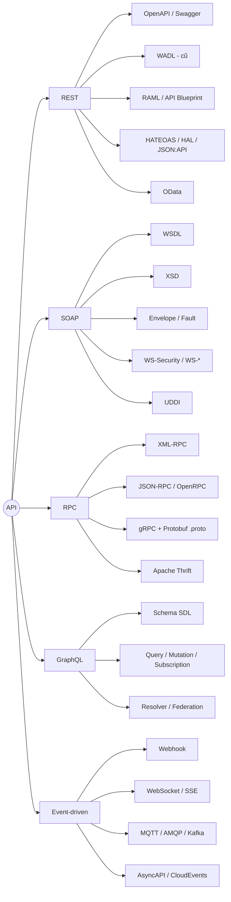

- [Mở đầu](#mở-đầu)
- [Bản đồ thuật ngữ theo kiến trúc](#bản-đồ-thuật-ngữ-theo-kiến-trúc)
- [1. Thuật ngữ chung (mọi kiến trúc)](#1-thuật-ngữ-chung-mọi-kiến-trúc)
- [2. Nhóm REST](#2-nhóm-rest)
- [3. Nhóm SOAP / Web Services (WS-\*)](#3-nhóm-soap--web-services-ws-)
- [4. Nhóm RPC (XML-RPC, JSON-RPC, gRPC)](#4-nhóm-rpc-xml-rpc-json-rpc-grpc)
- [5. Nhóm GraphQL](#5-nhóm-graphql)
- [6. Nhóm Event-driven / Bất đồng bộ](#6-nhóm-event-driven--bất-đồng-bộ)
- [7. Bảo mật và xác thực](#7-bảo-mật-và-xác-thực)
- [8. Hạ tầng tích hợp](#8-hạ-tầng-tích-hợp)
- [Bảng tra nhanh: Ngôn ngữ mô tả API ↔ Kiến trúc](#bảng-tra-nhanh-ngôn-ngữ-mô-tả-api--kiến-trúc)
- [Tổng kết](#tổng-kết)

# Mở đầu

Khi đọc tài liệu tích hợp với đối tác, ta hay gặp một loạt từ viết tắt: REST, SOAP, WSDL, WADL, XSD, OpenAPI, RAML, gRPC, Protobuf, AsyncAPI, HATEOAS... Nhiều thuật ngữ trông na ná nhau nhưng thuộc về những kiến trúc API hoàn toàn khác nhau. Nhầm lẫn ở đây dễ dẫn đến những câu hỏi kiểu *"API REST này có file WSDL không?"* (câu trả lời thường là không).

Bài viết này gom các thuật ngữ hay gặp nhất và ghi rõ **mỗi thuật ngữ thuộc kiến trúc API nào**. Nếu bạn chưa nắm các kiến trúc API, hãy đọc trước bài [API và những kiến trúc API phổ biến]().

Quy ước cột **Kiến trúc** trong các bảng:

| Ký hiệu | Ý nghĩa |
|---|---|
| **Chung** | Dùng cho mọi kiểu API |
| **REST** | REST / RESTful HTTP API |
| **SOAP** | SOAP Web Services và họ WS-\* |
| **RPC** | XML-RPC, JSON-RPC, gRPC, Thrift |
| **GraphQL** | GraphQL |
| **Event** | Webhook, WebSocket, SSE, MQTT, AMQP, Kafka... |

# Bản đồ thuật ngữ theo kiến trúc



# 1. Thuật ngữ chung (mọi kiến trúc)

| Thuật ngữ | Giải thích | Kiến trúc |
|---|---|---|
| **API** (Application Programming Interface) | Giao diện để hai phần mềm giao tiếp với nhau | Chung |
| **Web API / Web Service** | API được gọi qua mạng, thường qua HTTP. "Web Service" theo nghĩa hẹp thường chỉ SOAP | Chung (SOAP theo nghĩa hẹp) |
| **Endpoint** | Địa chỉ cụ thể để gọi API, ví dụ `https://api.example.com/v1/orders` | Chung |
| **Request / Response** | Yêu cầu gửi đi và phản hồi trả về | Chung |
| **Payload / Body** | Phần dữ liệu chính trong request/response | Chung |
| **Header** | Metadata đi kèm (Content-Type, Authorization...) | Chung |
| **Serialization** | Chuyển object thành chuỗi/byte để truyền (JSON, XML, Protobuf) | Chung |
| **Contract (API Contract)** | Tài liệu mô tả chính xác API nhận gì, trả gì. Là "hợp đồng" giữa provider và consumer | Chung |
| **Contract-first / Code-first** | Viết đặc tả (WSDL, OpenAPI, .proto) trước rồi sinh code, hoặc viết code trước rồi sinh đặc tả | Chung |
| **IDL** (Interface Definition Language) | Ngôn ngữ mô tả giao diện, độc lập với ngôn ngữ lập trình. WSDL, .proto, Thrift IDL đều là IDL | Chung (nổi bật ở SOAP, RPC) |
| **SDK / Client stub** | Thư viện phía client sinh ra từ đặc tả để gọi API như gọi hàm | Chung |
| **Provider / Consumer** | Bên cung cấp API và bên sử dụng API | Chung |
| **Synchronous / Asynchronous** | Đồng bộ (chờ kết quả ngay) và bất đồng bộ (kết quả trả về sau) | Chung |
| **Stateless / Stateful** | Server không lưu / có lưu trạng thái phiên giữa các request | Chung (Stateless là ràng buộc của REST) |
| **Idempotent** | Gọi nhiều lần cho cùng kết quả như gọi một lần (GET, PUT, DELETE) | Chung (quan trọng ở REST) |
| **Idempotency Key** | Khóa duy nhất gửi kèm request để server bỏ qua request trùng lặp khi retry | Chung (phổ biến ở API thanh toán) |
| **Versioning** | Đánh phiên bản API: qua URL (`/v2`), header, hoặc query string | Chung |
| **Backward compatibility / Breaking change** | Thay đổi không làm hỏng / làm hỏng client cũ | Chung |
| **Pagination** | Phân trang: offset/limit, page/size, cursor-based | Chung (REST, GraphQL) |
| **Rate limiting / Throttling / Quota** | Giới hạn số request trong một khoảng thời gian | Chung |
| **Timeout / Retry / Backoff** | Thời gian chờ tối đa, gửi lại, và tăng dần thời gian chờ giữa các lần gửi lại | Chung |
| **Latency / Throughput** | Độ trễ và lưu lượng xử lý | Chung |
| **SLA** | Cam kết chất lượng dịch vụ (uptime, thời gian phản hồi) | Chung |
| **Mock / Sandbox** | Server giả lập hoặc môi trường thử nghiệm để tích hợp trước khi lên production | Chung |

# 2. Nhóm REST

**REST** (Representational State Transfer) là một *kiểu kiến trúc* do Roy Fielding đưa ra năm 2000, không phải là giao thức hay chuẩn. REST dùng HTTP, xoay quanh khái niệm **tài nguyên** (resource).

| Thuật ngữ | Giải thích | Kiến trúc |
|---|---|---|
| **REST / RESTful** | API tuân theo các ràng buộc của REST: client-server, stateless, cacheable, uniform interface, layered system | REST |
| **Resource** | Đối tượng mà API thao tác, định danh bởi URI, ví dụ `/users/42` | REST |
| **URI / URL** | Định danh tài nguyên / địa chỉ tài nguyên | REST (cũng dùng chung) |
| **Representation** | Cách biểu diễn tài nguyên khi truyền: JSON, XML, HTML... | REST |
| **HTTP Methods / Verbs** | `GET` (đọc), `POST` (tạo), `PUT` (thay toàn bộ), `PATCH` (sửa một phần), `DELETE` (xóa) | REST |
| **HTTP Status Code** | `2xx` thành công, `3xx` chuyển hướng, `4xx` lỗi client, `5xx` lỗi server | REST |
| **Content Negotiation** | Client chọn định dạng qua header `Accept`, server trả về qua `Content-Type` | REST |
| **Query Parameter / Path Parameter** | `?status=paid` / `/orders/{id}` | REST |
| **ETag / Cache-Control** | Cơ chế cache và kiểm tra thay đổi của tài nguyên | REST |
| **HATEOAS** | Hypermedia as the Engine of Application State: response chứa link tới các hành động tiếp theo | REST |
| **Richardson Maturity Model** | Thang đo mức độ "RESTful" từ Level 0 (một endpoint, kiểu RPC qua HTTP) đến Level 3 (có HATEOAS) | REST |
| **HAL / JSON:API / Siren** | Các quy ước định dạng JSON có hỗ trợ hypermedia | REST |
| **Problem Details** (RFC 9457, trước đây RFC 7807) | Định dạng JSON chuẩn cho thông báo lỗi (`application/problem+json`) | REST |
| **OpenAPI Specification (OAS)** | Chuẩn mô tả REST API bằng YAML/JSON. Hiện là chuẩn phổ biến nhất | REST |
| **Swagger** | Tên cũ của OpenAPI (trước 2016), nay là tên bộ công cụ: Swagger UI, Swagger Editor, Swagger Codegen | REST |
| **WADL** (Web Application Description Language) | Ngôn ngữ mô tả REST API bằng XML, do Sun đề xuất lên W3C năm 2009. Được coi là "WSDL dành cho REST", nay hầu như không còn dùng, thay bằng OpenAPI. Vẫn gặp trong hệ thống Java cũ dùng Jersey (JAX-RS) | REST |
| **RAML** | RESTful API Modeling Language, mô tả REST API bằng YAML (gắn với MuleSoft) | REST |
| **API Blueprint** | Mô tả REST API bằng Markdown | REST |
| **JSON Schema** | Chuẩn mô tả cấu trúc và ràng buộc của dữ liệu JSON, được OpenAPI sử dụng | REST (cũng dùng cho AsyncAPI) |
| **OData** (Open Data Protocol) | Chuẩn OASIS xây dựng trên REST, hỗ trợ truy vấn qua URL như `$filter`, `$select`, `$orderby`, `$expand`. Metadata mô tả bằng **CSDL** tại `/$metadata` | REST (biến thể chuẩn hóa) |

Ví dụ một đoạn OpenAPI:

```yaml
openapi: 3.1.0
info:
  title: Order API
  version: 1.0.0
paths:
  /orders/{id}:
    get:
      summary: Lấy thông tin đơn hàng
      parameters:
        - name: id
          in: path
          required: true
          schema: { type: integer }
      responses:
        '200':
          description: OK
        '404':
          description: Không tìm thấy
```

Ví dụ tương đương bằng WADL (để thấy vì sao WADL bị thay thế):

```xml
<application xmlns="http://wadl.dev.java.net/2009/02">
  <resources base="https://api.example.com/">
    <resource path="orders/{id}">
      <param name="id" style="template" type="xsd:int"/>
      <method name="GET">
        <response status="200">
          <representation mediaType="application/json"/>
        </response>
      </method>
    </resource>
  </resources>
</application>
```

# 3. Nhóm SOAP / Web Services (WS-\*)

**SOAP** (ban đầu là Simple Object Access Protocol) là một *giao thức* nhắn tin dựa trên XML, chuẩn W3C. Khác với REST, SOAP có đặc tả chặt chẽ và một hệ sinh thái chuẩn mở rộng gọi chung là **WS-\***.

| Thuật ngữ | Giải thích | Kiến trúc |
|---|---|---|
| **SOAP** | Giao thức trao đổi thông điệp XML, có thể chạy trên HTTP, SMTP, JMS, TCP... Có hai phiên bản 1.1 và 1.2 | SOAP |
| **SOAP Envelope** | Phần bọc ngoài cùng của thông điệp SOAP | SOAP |
| **SOAP Header** | Chứa thông tin phụ: bảo mật, định tuyến, transaction | SOAP |
| **SOAP Body** | Chứa nội dung chính của request/response | SOAP |
| **SOAP Fault** | Cấu trúc chuẩn để trả về lỗi | SOAP |
| **SOAPAction** | HTTP header (SOAP 1.1) cho biết operation được gọi | SOAP |
| **WSDL** (Web Services Description Language) | File XML mô tả đầy đủ dịch vụ SOAP: có những operation nào, dữ liệu vào/ra, gọi ở đâu. Từ WSDL có thể sinh code client tự động. Phiên bản phổ biến là WSDL 1.1, ngoài ra có WSDL 2.0 | SOAP |
| **XSD** (XML Schema Definition) | Mô tả kiểu dữ liệu XML, thường được nhúng hoặc import trong WSDL | SOAP (cũng dùng cho XML nói chung) |
| **portType / Interface, Operation, Message, Binding, Service, Port / Endpoint** | Các thành phần cấu tạo nên WSDL | SOAP |
| **Binding style: RPC vs Document** | Kiểu tổ chức Body: gọi hàm (RPC) hay gửi tài liệu (Document) | SOAP |
| **Use: Literal vs Encoded** | Cách mã hóa dữ liệu. **Document/literal (wrapped)** là kiểu được khuyến nghị theo WS-I Basic Profile | SOAP |
| **WS-I Basic Profile** | Bộ hướng dẫn để các SOAP service tương thích giữa các nền tảng (.NET, Java...) | SOAP |
| **WS-Security** | Chuẩn bảo mật cho SOAP: ký số, mã hóa, UsernameToken, X.509 trong SOAP Header | SOAP |
| **WS-Addressing** | Thông tin định tuyến (To, ReplyTo, MessageID) trong Header | SOAP |
| **WS-ReliableMessaging** | Đảm bảo thông điệp đến đúng và đủ | SOAP |
| **WS-Policy / WS-AtomicTransaction** | Mô tả chính sách dịch vụ / giao dịch phân tán | SOAP |
| **MTOM** | Cơ chế gửi file nhị phân hiệu quả trong SOAP | SOAP |
| **UDDI** | Danh bạ để đăng ký và tìm kiếm Web Service. Hầu như không còn dùng | SOAP |
| **JAX-WS / WCF / Apache CXF** | Framework xây dựng SOAP service trên Java / .NET | SOAP |

Cấu trúc một thông điệp SOAP:

```xml
<soap:Envelope xmlns:soap="http://www.w3.org/2003/05/soap-envelope">
  <soap:Header>
    <!-- WS-Security, WS-Addressing... -->
  </soap:Header>
  <soap:Body>
    <GetOrder xmlns="http://example.com/orders">
      <OrderId>42</OrderId>
    </GetOrder>
  </soap:Body>
</soap:Envelope>
```

> **Hay nhầm:** WSDL thuộc SOAP, WADL thuộc REST. Một REST API hiện đại sẽ cung cấp file OpenAPI (`openapi.yaml` / `swagger.json`), không phải WSDL.

# 4. Nhóm RPC (XML-RPC, JSON-RPC, gRPC)

**RPC** (Remote Procedure Call) là mô hình gọi hàm trên máy khác như gọi hàm cục bộ. Tư duy là *hành động* (`getOrder`, `createUser`), khác với REST tư duy theo *tài nguyên*.

| Thuật ngữ | Giải thích | Kiến trúc |
|---|---|---|
| **RPC** | Gọi thủ tục từ xa | RPC |
| **XML-RPC** | RPC dùng XML qua HTTP, tiền thân của SOAP | RPC |
| **JSON-RPC** | RPC dùng JSON, rất gọn: `{"jsonrpc":"2.0","method":"getOrder","params":[42],"id":1}`. Được dùng nhiều trong blockchain (Ethereum) và Language Server Protocol | RPC |
| **OpenRPC** | Chuẩn mô tả JSON-RPC API, tương tự OpenAPI cho REST | RPC |
| **gRPC** | Framework RPC của Google, chạy trên HTTP/2, dữ liệu mã hóa bằng Protobuf | RPC |
| **Protocol Buffers (Protobuf)** | Định dạng tuần tự hóa nhị phân, nhỏ và nhanh hơn JSON/XML | RPC (gRPC) |
| **.proto file** | File IDL định nghĩa `service`, `rpc` và `message` của gRPC, dùng để sinh code client/server | RPC (gRPC) |
| **Unary / Server streaming / Client streaming / Bidirectional streaming** | Bốn kiểu gọi trong gRPC | RPC (gRPC) |
| **gRPC-Web** | Cho phép trình duyệt gọi gRPC thông qua proxy | RPC (gRPC) |
| **Server Reflection** | Cho phép client hỏi server danh sách service mà không cần file .proto | RPC (gRPC) |
| **Apache Thrift** | Framework RPC đa ngôn ngữ do Facebook phát triển | RPC |
| **HTTP/2** | Phiên bản HTTP hỗ trợ multiplexing, nén header, stream; nền tảng của gRPC | RPC (cũng dùng chung) |

```proto
syntax = "proto3";

service OrderService {
  rpc GetOrder (GetOrderRequest) returns (Order);
}

message GetOrderRequest { int32 id = 1; }
message Order { int32 id = 1; string status = 2; }
```

# 5. Nhóm GraphQL

| Thuật ngữ | Giải thích | Kiến trúc |
|---|---|---|
| **GraphQL** | Ngôn ngữ truy vấn cho API, client chỉ định chính xác các trường cần lấy, thường qua một endpoint duy nhất `/graphql` | GraphQL |
| **Schema / SDL** | Định nghĩa kiểu dữ liệu và thao tác bằng Schema Definition Language. Đây chính là "contract" của GraphQL | GraphQL |
| **Type / Field / Scalar / Enum / Input** | Các thành phần trong schema | GraphQL |
| **Query** | Thao tác đọc dữ liệu | GraphQL |
| **Mutation** | Thao tác ghi/sửa dữ liệu | GraphQL |
| **Subscription** | Nhận dữ liệu realtime, thường qua WebSocket | GraphQL |
| **Resolver** | Hàm phía server lấy dữ liệu cho từng field | GraphQL |
| **Introspection** | Truy vấn schema của chính API; nên tắt ở production nếu API không công khai | GraphQL |
| **Fragment / Variables / Alias** | Tái sử dụng phần truy vấn / truyền tham số / đặt tên khác cho field | GraphQL |
| **Over-fetching / Under-fetching** | Lấy thừa / lấy thiếu dữ liệu, vấn đề hay gặp ở REST mà GraphQL giải quyết | GraphQL (so sánh với REST) |
| **N+1 problem / DataLoader** | Vấn đề gọi DB lặp lại nhiều lần và kỹ thuật gom batch để khắc phục | GraphQL |
| **Federation / Supergraph** | Ghép nhiều GraphQL service con thành một graph thống nhất | GraphQL |
| **Persisted Query** | Lưu sẵn truy vấn trên server, client chỉ gửi ID để tăng bảo mật và hiệu năng | GraphQL |
| **Query depth / complexity limit** | Giới hạn độ sâu và độ phức tạp truy vấn để chống quá tải | GraphQL |

# 6. Nhóm Event-driven / Bất đồng bộ

| Thuật ngữ | Giải thích | Kiến trúc |
|---|---|---|
| **Polling / Long polling** | Client hỏi server định kỳ / giữ kết nối chờ đến khi có dữ liệu | Event (giải pháp thay thế) |
| **Webhook** | Server gọi HTTP POST tới URL của client khi có sự kiện ("reverse API") | Event |
| **Callback URL** | URL mà client đăng ký để nhận webhook | Event |
| **Webhook signature** | Chữ ký HMAC trong header để xác minh webhook đến từ nguồn tin cậy | Event |
| **WebSocket** | Kết nối hai chiều liên tục giữa client và server | Event |
| **SSE** (Server-Sent Events) | Server đẩy dữ liệu một chiều xuống client qua HTTP | Event |
| **Message Broker** | Trung gian nhận và phân phối thông điệp: RabbitMQ, Kafka, Mosquitto... | Event |
| **Publish/Subscribe (Pub/Sub)** | Bên gửi publish lên topic, nhiều bên subscribe để nhận | Event |
| **Queue / Topic** | Hàng đợi (mỗi message cho một consumer) / chủ đề (phát cho nhiều subscriber) | Event |
| **MQTT** | Giao thức pub/sub nhẹ cho IoT, có QoS 0/1/2 | Event |
| **AMQP** | Giao thức nhắn tin chuẩn cho hệ thống doanh nghiệp (RabbitMQ) | Event |
| **Apache Kafka** | Nền tảng event streaming, lưu sự kiện dạng log có thể đọc lại | Event |
| **Delivery semantics** | At-most-once / At-least-once / Exactly-once | Event |
| **Dead Letter Queue (DLQ)** | Hàng đợi chứa các message xử lý thất bại | Event |
| **AsyncAPI** | Chuẩn mô tả API bất đồng bộ (Kafka, MQTT, AMQP, WebSocket), tương tự OpenAPI cho REST | Event |
| **CloudEvents** | Chuẩn CNCF quy định định dạng chung cho dữ liệu sự kiện | Event |
| **EDA** (Event-Driven Architecture) | Kiến trúc hệ thống lấy sự kiện làm trung tâm | Event |

# 7. Bảo mật và xác thực

Phần lớn các thuật ngữ dưới đây dùng chung, trừ những gì riêng của SOAP.

| Thuật ngữ | Giải thích | Kiến trúc |
|---|---|---|
| **Authentication / Authorization** | Xác thực (bạn là ai) / Phân quyền (bạn được làm gì) | Chung |
| **API Key** | Chuỗi khóa định danh ứng dụng gọi API | Chung |
| **Basic Auth** | Gửi `username:password` mã hóa Base64 trong header; bắt buộc đi kèm HTTPS | Chung |
| **Bearer Token** | Token gửi trong header `Authorization: Bearer <token>` | Chung (chủ yếu REST, GraphQL) |
| **OAuth 2.0** | Framework ủy quyền: Authorization Code (+PKCE), Client Credentials... | Chung (chủ yếu REST, GraphQL) |
| **OpenID Connect (OIDC)** | Lớp xác thực danh tính xây dựng trên OAuth 2.0 | Chung |
| **JWT** (JSON Web Token) | Token dạng JSON có chữ ký, gồm header.payload.signature | Chung |
| **Scope** | Phạm vi quyền được cấp cho token | Chung |
| **mTLS** (Mutual TLS) | Cả client và server cùng xác thực bằng chứng chỉ | Chung (phổ biến ở gRPC, B2B) |
| **HMAC Signature** | Ký request/webhook bằng khóa bí mật chung | Chung (Webhook) |
| **CORS** | Cơ chế trình duyệt cho phép gọi API khác domain | Chung (API gọi từ trình duyệt) |
| **WS-Security, SAML Token** | Bảo mật ở mức thông điệp (message-level) | SOAP |
| **IP Whitelist** | Chỉ cho phép một số IP gọi API | Chung |

# 8. Hạ tầng tích hợp

| Thuật ngữ | Giải thích | Kiến trúc |
|---|---|---|
| **SOA** (Service-Oriented Architecture) | Kiến trúc hướng dịch vụ, thời kỳ hoàng kim gắn với SOAP và ESB | SOAP (về lịch sử) |
| **ESB** (Enterprise Service Bus) | "Trục" tích hợp trung tâm: định tuyến, chuyển đổi định dạng, điều phối (MuleSoft, WSO2, IBM) | SOAP + Chung |
| **Microservices** | Hệ thống chia thành nhiều service nhỏ độc lập | Chung (REST, gRPC, Event) |
| **API Gateway** | Cổng vào duy nhất: định tuyến, xác thực, rate limit, logging (Kong, Azure APIM, AWS API Gateway) | Chung |
| **BFF** (Backend for Frontend) | Một lớp API riêng cho từng loại client (web, mobile) | Chung |
| **Service Mesh** | Hạ tầng quản lý giao tiếp giữa các service (Istio, Linkerd) | Chung (hay đi với gRPC) |
| **Reverse Proxy / Load Balancer** | Nginx, HAProxy... đứng trước API server | Chung |
| **iPaaS** | Nền tảng tích hợp dạng dịch vụ đám mây (Zapier, Make, Azure Logic Apps) | Chung |
| **EDI** | Trao đổi dữ liệu điện tử giữa doanh nghiệp theo chuẩn (X12, EDIFACT) | B2B, tiền thân của API |
| **Circuit Breaker** | Ngắt tạm thời lời gọi tới service đang lỗi để tránh lỗi dây chuyền | Chung |
| **Observability: Logging / Tracing / Metrics** | Ghi log, theo vết request qua nhiều service (OpenTelemetry), đo đạc | Chung |
| **Correlation ID / Trace ID** | Mã định danh xuyên suốt một request qua nhiều hệ thống | Chung |

# Bảng tra nhanh: Ngôn ngữ mô tả API ↔ Kiến trúc

Đây là phần dễ nhầm lẫn nhất khi đối tác gửi tài liệu tích hợp:

| File / Chuẩn mô tả | Định dạng | Kiến trúc | Ghi chú |
|---|---|---|---|
| **WSDL** (`.wsdl`, `?wsdl`) | XML | **SOAP** | Chuẩn chính thức của SOAP |
| **XSD** (`.xsd`) | XML | **SOAP** / XML | Mô tả kiểu dữ liệu, đi kèm WSDL |
| **WADL** (`.wadl`, `application.wadl`) | XML | **REST** | Lỗi thời, thay bằng OpenAPI |
| **OpenAPI / Swagger** (`openapi.yaml`, `swagger.json`) | YAML / JSON | **REST** | Chuẩn phổ biến nhất hiện nay |
| **RAML** (`.raml`) | YAML | **REST** | Hệ sinh thái MuleSoft |
| **API Blueprint** (`.apib`) | Markdown | **REST** | Ít gặp |
| **OData CSDL** (`/$metadata`) | XML / JSON | **REST (OData)** | SAP, Microsoft Dynamics hay dùng |
| **.proto** | Protobuf IDL | **RPC (gRPC)** | Sinh code cho nhiều ngôn ngữ |
| **Thrift IDL** (`.thrift`) | Thrift IDL | **RPC (Thrift)** | |
| **OpenRPC** (`openrpc.json`) | JSON | **RPC (JSON-RPC)** | |
| **GraphQL SDL** (`schema.graphql`) | SDL | **GraphQL** | Có thể lấy qua introspection |
| **AsyncAPI** (`asyncapi.yaml`) | YAML / JSON | **Event-driven** | Kafka, MQTT, AMQP, WebSocket |
| **JSON Schema** | JSON | Chung | Dùng bên trong OpenAPI, AsyncAPI |
| **Postman Collection** | JSON | Chung (chủ yếu REST) | Bộ request mẫu, không phải đặc tả chính thức |

So sánh nhanh ba kiến trúc hay được đặt cạnh nhau nhất:

| Tiêu chí | SOAP | REST | gRPC |
|---|---|---|---|
| Bản chất | Giao thức | Kiểu kiến trúc | Framework RPC |
| Định dạng dữ liệu | XML | JSON (phổ biến), XML... | Protobuf (nhị phân) |
| Transport | HTTP, SMTP, JMS, TCP... | HTTP | HTTP/2 |
| Contract | WSDL + XSD (bắt buộc trên thực tế) | OpenAPI (tùy chọn, khuyến khích) | .proto (bắt buộc) |
| Xử lý lỗi | SOAP Fault | HTTP Status Code + body | gRPC Status Code |
| Bảo mật | WS-Security + TLS | TLS + OAuth2/JWT | TLS/mTLS + token |
| Hay gặp ở | Ngân hàng, bảo hiểm, chính phủ, hệ thống cũ | Web, mobile, public API | Microservices nội bộ |

# Tổng kết

Một cách nhớ đơn giản: **mỗi kiến trúc API đều có "ngôn ngữ hợp đồng" riêng**.

- SOAP → **WSDL** (+ XSD)
- REST → **OpenAPI** (ngày xưa là **WADL**)
- gRPC → **.proto**
- GraphQL → **SDL**
- Event-driven → **AsyncAPI**

Khi nhận một yêu cầu tích hợp, việc đầu tiên nên làm là hỏi đối tác *"API của bên anh là kiểu gì và có file đặc tả nào?"*. Có được file đặc tả, ta có thể sinh code client, dựng mock server và viết test tự động thay vì đọc tài liệu PDF rồi gõ tay từng trường.

-----
Tham khảo:
- [Architectural Styles and the Design of Network-based Software Architectures (Roy Fielding)](https://ics.uci.edu/~fielding/pubs/dissertation/top.htm)
- [SOAP Version 1.2 - W3C](https://www.w3.org/TR/soap12/)
- [Web Services Description Language (WSDL) 1.1 - W3C](https://www.w3.org/TR/wsdl)
- [Web Application Description Language (WADL) - W3C Member Submission](https://www.w3.org/submissions/wadl/)
- [OpenAPI Specification](https://spec.openapis.org/oas/latest.html)
- [AsyncAPI Specification](https://www.asyncapi.com/docs/reference/specification/latest)
- [gRPC Documentation](https://grpc.io/docs/)
- [GraphQL Specification](https://spec.graphql.org/)
- [JSON-RPC 2.0 Specification](https://www.jsonrpc.org/specification)
- [OData - OASIS](https://www.odata.org/)
- [RFC 9457 - Problem Details for HTTP APIs](https://www.rfc-editor.org/rfc/rfc9457)
- [CloudEvents](https://cloudevents.io/)
