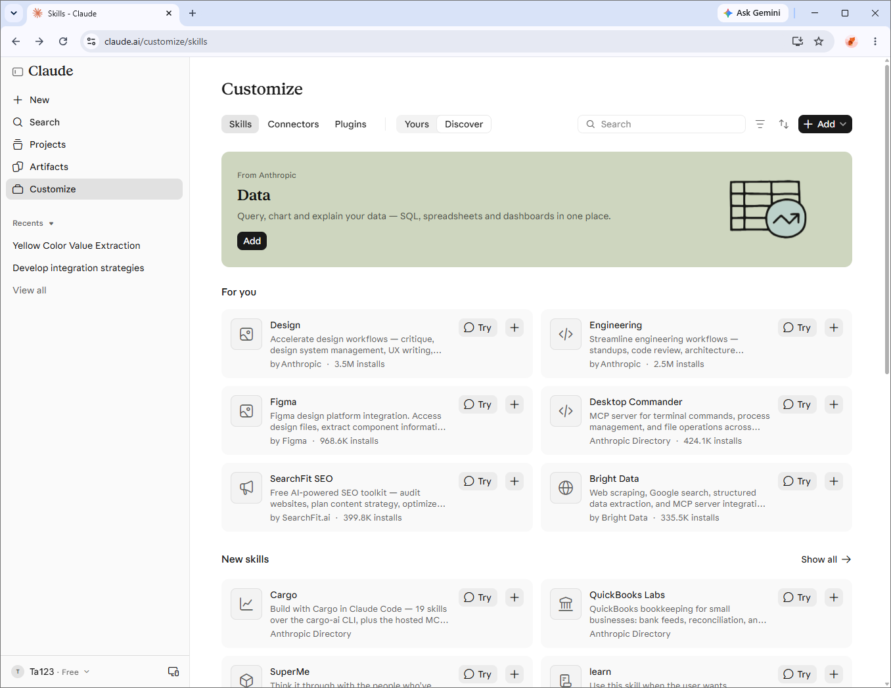

> Bài viết này là bản tóm lược và diễn giải bằng tiếng Việt dựa trên bài gốc [Best Claude Skills: 15 Worth Adding, and How to Install Them (2026)](https://fastero.com/blog/best-claude-skills) của Fastero Dev Team (04/11/2026). Số liệu về lượt cài đặt và số sao GitHub thay đổi liên tục, hãy kiểm tra lại trên thư mục skills của Claude và GitHub trước khi dựa vào.

- [Claude Skills là gì?](#claude-skills-là-gì)
- [Nên bắt đầu với skill nào?](#nên-bắt-đầu-với-skill-nào)
- [Skill dữ liệu theo từng stack](#skill-dữ-liệu-theo-từng-stack)
- [Cách cài đặt](#cách-cài-đặt)
- [Một skill được xây dựng như thế nào?](#một-skill-được-xây-dựng-như-thế-nào)
- [Lưu ý an toàn](#lưu-ý-an-toàn)
- [Skills so với Plugins, Connectors và Projects](#skills-so-với-plugins-connectors-và-projects)
- [Kết luận](#kết-luận)
- [Resources / Tài nguyên](#resources--tài-nguyên)

# Claude Skills là gì?

**Skill** là một thư mục chứa hướng dẫn (và đôi khi cả script) mà Claude chỉ nạp vào khi tác vụ hiện tại phù hợp. Nói đơn giản, skill dạy Claude làm một việc **theo đúng cách của bạn hoặc của team bạn**, thay vì phải nhắc lại cùng một quy trình trong mỗi cuộc trò chuyện.

Skills hoạt động trên nhiều nền tảng: claude.ai, ứng dụng desktop và mobile, Cowork, Claude Code và API.



# Nên bắt đầu với skill nào?

Bài gốc gợi ý đi từ những skill có sẵn và phổ biến nhất:

- **Document skills của Anthropic**: tạo và chỉnh sửa Excel, Word, PowerPoint và PDF. Đây là nhóm dùng nhiều nhất vì ai cũng gặp các định dạng này hằng ngày.
- **skill-creator**: skill giúp bạn tự xây dựng skill của riêng mình, rất hữu ích khi muốn đóng gói quy trình nội bộ.
- **Data skill**: hỗ trợ viết SQL và dựng dashboard.
- **Superpowers** (trong Claude Code): một bộ skill cộng đồng được cài đặt nhiều, tập trung vào quy trình làm việc phát triển phần mềm.

Ngoài ra bài gốc còn liệt kê danh sách 15 skill được đề xuất và các skill cộng đồng được yêu thích kèm số sao GitHub tại thời điểm đăng bài. Bạn nên xem danh sách đầy đủ ở bài gốc.

# Skill dữ liệu theo từng stack

Nếu làm việc với dữ liệu, có các skill gắn với công cụ cụ thể như **dbt**, **Streamlit**, **Supabase Postgres**, **ClickHouse**, **Databricks**, **DuckDB**... Mỗi skill có lệnh cài đặt riêng, xem chi tiết ở bài gốc.

# Cách cài đặt

| Nơi dùng | Cách cài |
|---|---|
| **claude.ai** | Vào **Customize → Skills**, bật skill trong mục **Discover**, hoặc tải lên file **ZIP** (thư mục skill phải nằm ở cấp cao nhất của ZIP). |
| **Claude Code** | Đặt thư mục skill vào `~/.claude/skills/` (dùng cho mọi dự án) hoặc `.claude/skills/` trong dự án (chỉ dùng cho dự án đó), hoặc cài qua plugin. |
| **API** | Tải skill lên bằng `POST /v1/skills`. |
| **Team / Enterprise** | Owner quản lý skill ở phần cài đặt tổ chức. |

Ví dụ trong Claude Code:

```bash
# Skill dùng cho mọi dự án
mkdir -p ~/.claude/skills/my-skill

# Skill chỉ dùng trong dự án hiện tại
mkdir -p .claude/skills/my-skill
```

# Một skill được xây dựng như thế nào?

Một skill là một thư mục có file `SKILL.md`, đầu file có phần frontmatter gồm `name` và `description`:

```markdown
---
name: ten-skill
description: Mô tả ngắn gọn skill làm gì và khi nào nên dùng.
---

# Hướng dẫn chi tiết

Các bước Claude cần làm theo...
```

Phần **`description` là quan trọng nhất**: đó là thứ Claude nhìn thấy để quyết định có nạp skill hay không. Mô tả mơ hồ thì skill sẽ ít khi được kích hoạt, hoặc bị kích hoạt sai lúc.

# Lưu ý an toàn

Skill có thể chứa script chạy được, nên hãy coi nó như một đoạn code bạn đưa vào máy mình:

- Đọc `SKILL.md` và **toàn bộ script** trước khi bật skill.
- Cảnh giác với skill **tải nội dung từ địa chỉ bên ngoài**.
- Với Claude Code, kiểm tra trường `allowed-tools` để biết skill được phép dùng công cụ nào.
- **Không lưu mật khẩu hoặc khóa API** trong skill.
- Giữ danh sách skill đang bật **ngắn gọn**, chỉ bật những gì thực sự dùng.

# Skills so với Plugins, Connectors và Projects

- **Skills**: dạy Claude một **quy trình** làm việc.
- **Plugins**: gói skills cùng các thành phần khác lại với nhau.
- **Connectors**: cho Claude truy cập **dữ liệu hoặc dịch vụ bên ngoài**.
- **Projects**: lưu **ngữ cảnh nền** cho các cuộc trò chuyện.

# Kết luận

- Bắt đầu với các document skill và skill-creator, sau đó mới thêm skill theo nhu cầu thực tế.
- Viết `description` thật rõ ràng, vì đó là yếu tố quyết định skill có được dùng đúng lúc hay không.
- Luôn đọc kỹ nội dung skill của người khác trước khi bật, và giữ số lượng skill ở mức vừa đủ.
- Lưu ý: bài gốc do Fastero xuất bản, đơn vị bán một connector cho Claude, nên có quảng bá sản phẩm của họ. Hãy đối chiếu số liệu với nguồn gốc.

# Resources / Tài nguyên

- [Best Claude Skills: 15 Worth Adding, and How to Install Them (2026) – Fastero](https://fastero.com/blog/best-claude-skills)
