- [Tổng quan](#tổng-quan)
- [Kiến trúc](#kiến-trúc)
- [Vì sao trình duyệt báo lỗi chứng chỉ – và cách tránh](#vì-sao-trình-duyệt-báo-lỗi-chứng-chỉ--và-cách-tránh)
- [Các file chứng chỉ và vai trò](#các-file-chứng-chỉ-và-vai-trò)
- [Cài đặt OpenSSL 3.5 LTS trên Windows](#cài-đặt-openssl-35-lts-trên-windows)
- [Tạo chứng chỉ bằng Script](#tạo-chứng-chỉ-bằng-script)
  - [PowerShell: gen-certs.ps1](#powershell-gen-certsps1)
  - [Batch: gen-certs.bat](#batch-gen-certsbat)
- [Tạo chứng chỉ thủ công (không dùng Script)](#tạo-chứng-chỉ-thủ-công-không-dùng-script)
- [Kiểm tra tính chính xác của các file chứng chỉ](#kiểm-tra-tính-chính-xác-của-các-file-chứng-chỉ)
- [Dựng web Node.js chạy song song HTTP và HTTPS](#dựng-web-nodejs-chạy-song-song-http-và-https)
- [Vị trí lưu trữ: code, server, client](#vị-trí-lưu-trữ-code-server-client)
- [Cài Root CA lên máy Client](#cài-root-ca-lên-máy-client)
- [Trình duyệt kiểm tra chứng chỉ như thế nào](#trình-duyệt-kiểm-tra-chứng-chỉ-như-thế-nào)
- [Kiểm thử và nghiệm thu](#kiểm-thử-và-nghiệm-thu)
- [Rủi ro và lưu ý](#rủi-ro-và-lưu-ý)
- [Gia hạn và thay chứng chỉ](#gia-hạn-và-thay-chứng-chỉ)
- [Phụ lục A: HTTP và HTTPS dùng chung một cổng](#phụ-lục-a-http-và-https-dùng-chung-một-cổng)
- [Phụ lục B: Giới hạn phạm vi Root CA bằng nameConstraints](#phụ-lục-b-giới-hạn-phạm-vi-root-ca-bằng-nameconstraints)
- [Tham khảo](#tham-khảo)


# Tổng quan

Trong bài [Cấu hình SSL HTTPS cho Localhost trong Node.js](/2026/10/01/set-up-ssl-https-localhost-for-node-js/) mình dùng gói `mkcert` cho nhanh. Bài này làm lại từ đầu **chỉ với OpenSSL**, để hiểu rõ từng file, từng extension và kiểm soát được thời hạn, phạm vi của chứng chỉ.

Mục tiêu: một web Node.js tối giản, chạy song song HTTP và HTTPS trên server Windows có IP `192.168.1.2`. Các máy trong mạng LAN mở `https://192.168.1.2:3443` thấy ổ khóa, **không** gặp `NET::ERR_CERT_COMMON_NAME_INVALID` hay `NET::ERR_CERT_AUTHORITY_INVALID`.

| Hạng mục | Giá trị |
|---|---|
| Công cụ | OpenSSL **3.5 LTS** (phát hành 08/04/2025, hỗ trợ tới 08/04/2030) |
| Môi trường | Windows 10/11, Windows Server 2019+ |
| Root CA | Tự tạo, RSA 4096, SHA-256, **10 năm** (3650 ngày) |
| Cert server | RSA 2048, SHA-256, **10 năm** (Windows/Android) hoặc **825 ngày** (có macOS/iOS) |
| subjectAltName | `IP:192.168.1.2`, `IP:127.0.0.1`, `IP:::1`, `DNS:localhost` |
| Web | Node.js LTS + Express, HTTP `:3000`, HTTPS `:3443` |
| Phụ lục | Gộp HTTP + HTTPS vào một cổng `:3000` |

> **Vì sao không dùng Let's Encrypt?** Let's Encrypt chỉ cấp cho tên miền hoặc IP **công khai** và cần xác thực qua Internet. IP nội bộ `192.168.x.x` thì chỉ có cách tự làm CA nội bộ.


# Kiến trúc

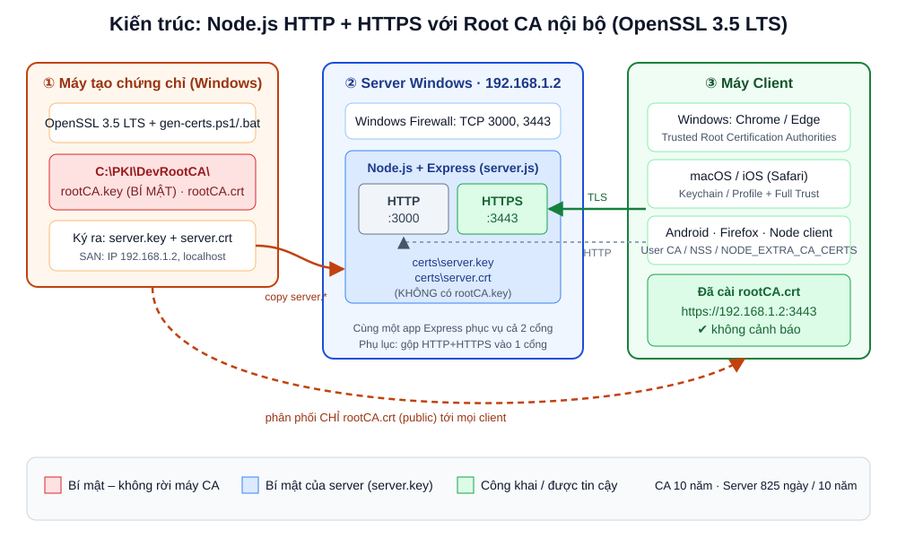

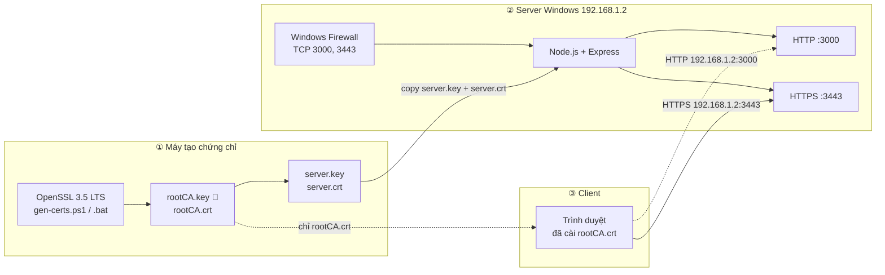

Ý tưởng cốt lõi: **trình duyệt không tin server, trình duyệt tin Root CA**. Ta tự làm một Root CA, cài nó vào kho tin cậy của client, rồi dùng nó ký chứng chỉ cho server. Muốn thêm server khác chỉ việc ký thêm, client không phải cài lại gì.


# Vì sao trình duyệt báo lỗi chứng chỉ – và cách tránh

| Lỗi trên Chrome/Edge | Nguyên nhân hay gặp | Cách tránh |
|---|---|---|
| `NET::ERR_CERT_AUTHORITY_INVALID` | Cert tự ký (self-signed) đơn lẻ, hoặc chưa cài `rootCA.crt` vào **Trusted Root Certification Authorities**, hoặc cài nhầm vào kho *Personal* / *Intermediate* | Dùng Root CA riêng ký cert server, cài `rootCA.crt` đúng kho Root, khởi động lại trình duyệt |
| `NET::ERR_CERT_COMMON_NAME_INVALID` | Cert **không có subjectAltName** (từ Chrome 58, CN bị bỏ qua) hoặc ghi IP thành `DNS.1 = 192.168.1.2` | Khai báo `IP.1 = 192.168.1.2` trong `[alt_names]`, thêm `DNS.1 = localhost` nếu cần |
| `NET::ERR_CERT_DATE_INVALID` | Cert hết hạn, hoặc đồng hồ máy client/server sai | Theo dõi ngày hết hạn, đồng bộ NTP |
| `NET::ERR_CERT_VALIDITY_TOO_LONG` | Cert server > **825 ngày** khi mở trên macOS/iOS | Cấp cert server ≤ 825 ngày nếu có thiết bị Apple |
| `NET::ERR_CERT_INVALID` | Thiếu `extendedKeyUsage = serverAuth`, cert server lại có `CA:TRUE`, file hỏng | Dùng đúng file `server.ext` trong bài |
| `ERR_SSL_PROTOCOL_ERROR` | Gõ `https://` vào cổng HTTP `3000` | HTTPS dùng cổng `3443` (hoặc xem Phụ lục A) |
| `ERR_SSL_VERSION_OR_CIPHER_MISMATCH` | Client quá cũ, server ép TLS cao | Giữ `minVersion: 'TLSv1.2'` |

Hai điểm hay bị hiểu nhầm nhất:

- **CN không còn giá trị.** Ghi `CN = 192.168.1.2` mà không có SAN thì Chrome vẫn báo `COMMON_NAME_INVALID`.
- **IP phải nằm trong `IP.x`, không phải `DNS.x`.** `DNS:192.168.1.2` là một tên miền tên "192.168.1.2", không khớp với địa chỉ IP.


# Các file chứng chỉ và vai trò

| File | Loại | Vai trò | Bí mật? | Ở đâu |
|---|---|---|---|---|
| `rootCA.key` | Khóa riêng RSA 4096 | Ký mọi cert server. Ai có file này có thể giả mạo **mọi** website trên máy đã tin CA | 🔴 **Rất bí mật** | Kho CA, offline |
| `rootCA.crt` | Chứng chỉ X.509 tự ký | "Mỏ neo tin cậy" cài vào client | 🟢 Công khai | Kho CA + mọi client |
| `rootCA.cnf` | Cấu hình OpenSSL | Subject, `CA:TRUE`, `keyCertSign` | Không | Kho CA |
| `rootCA.srl` | Text | Số serial kế tiếp, tránh trùng serial | Không | Kho CA |
| `server.key` | Khóa riêng RSA 2048 | Server dùng để bắt tay TLS | 🔵 Bí mật | Server |
| `server.csr` | Yêu cầu ký (CSR) | Chứa public key + subject gửi cho CA. Ký xong có thể xóa | Không | Tạm thời |
| `server.cnf` | Cấu hình OpenSSL | Subject của CSR | Không | Repo / máy CA |
| `server.ext` | Cấu hình extension | **SAN**, `serverAuth`, `CA:FALSE` | Không | Repo / máy CA |
| `server.crt` | Chứng chỉ X.509 | Server gửi cho trình duyệt khi bắt tay TLS | 🟢 Công khai | Server |

Tất cả ở định dạng **PEM** (text Base64, bắt đầu bằng `-----BEGIN ...-----`). Windows mở được `.crt` PEM trực tiếp, không cần đổi sang `.cer`/`.der`.

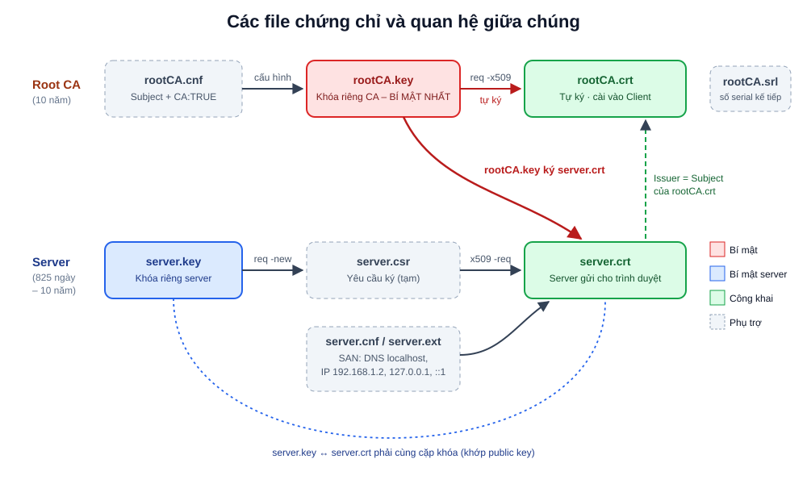

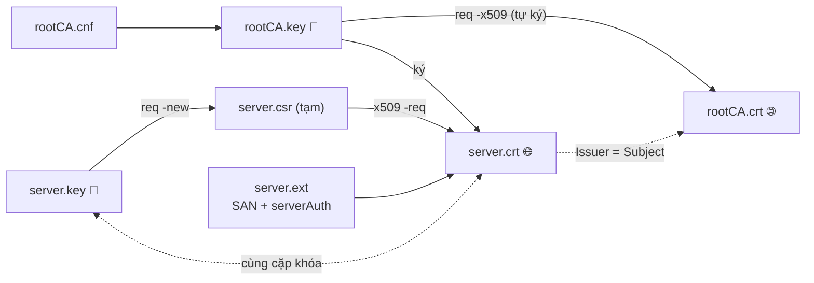


# Cài đặt OpenSSL 3.5 LTS trên Windows

OpenSSL không ship sẵn bản Windows, ta dùng bản build của bên thứ ba. Chọn **một** trong các cách sau:

| Cách | Lệnh / thao tác | Ghi chú |
|---|---|---|
| **winget** | `winget search openssl` rồi `winget install --id ShiningLight.OpenSSL.Light -e --version 3.5.x` | Thay `3.5.x` bằng bản 3.5 mới nhất; xem danh sách bằng `winget show ShiningLight.OpenSSL.Light --versions` |
| **Installer** | Tải *Win64 OpenSSL v3.5.x Light* tại [slproweb.com](https://slproweb.com/products/Win32OpenSSL.html) | Chọn copy DLL vào thư mục `bin` của OpenSSL |
| **Zip (không cài)** | Tải *OpenSSL 3.5 LTS* tại [FireDaemon](https://kb.firedaemon.com/support/solutions/articles/4000121705) rồi giải nén | Hợp với server không muốn cài thêm phần mềm |
| **Chocolatey** | `choco install openssl --version=3.5.x` | Nếu đã dùng Chocolatey |

Thêm vào PATH (PowerShell **Run as Administrator**), nếu installer chưa làm:

```powershell
$bin = 'C:\Program Files\OpenSSL-Win64\bin'
$old = [Environment]::GetEnvironmentVariable('Path', 'Machine')
if ($old -notlike "*$bin*") { [Environment]::SetEnvironmentVariable('Path', "$old;$bin", 'Machine') }
```

Mở **cửa sổ mới** rồi kiểm tra:

```bat
where openssl
openssl version -a
```

Kết quả đúng (số bản vá có thể khác):

```text
C:\Program Files\OpenSSL-Win64\bin\openssl.exe
OpenSSL 3.5.x  ... (Library: OpenSSL 3.5.x ...)
```

> ⚠️ **Git for Windows** cũng có `openssl.exe` riêng (`C:\Program Files\Git\usr\bin\openssl.exe`). Nếu `where openssl` trả về nhiều dòng, dòng đầu tiên là bản sẽ chạy. Hãy chắc chắn đó là bản 3.5.


# Tạo chứng chỉ bằng Script

Cả hai script làm cùng một việc:

1. Tạo Root CA trong `C:\PKI\DevRootCA\` (nếu đã có thì **dùng lại**, không tạo đè).
2. Tạo `server.key` + `server.crt` trong `certs\` của dự án, SAN gồm IP truyền vào + `127.0.0.1`, `::1`, `localhost`.
3. Copy `rootCA.crt` (bản public) vào `certs\` để phát cho client.
4. Tự kiểm tra: chain, IP, khớp khóa.
5. (Tùy chọn) Cài Root CA vào kho *Trusted Root* của máy đang chạy.

## PowerShell: gen-certs.ps1

Lưu tại `scripts\gen-certs.ps1`:

```powershell
<#
.SYNOPSIS
  Tao Root CA noi bo + chung chi server (SAN: IP + localhost) bang OpenSSL 3.5 LTS.
.EXAMPLE
  .\gen-certs.ps1                                  # IP 192.168.1.2, server 10 nam
  .\gen-certs.ps1 -ServerDays 825                  # tuong thich macOS/iOS
  .\gen-certs.ps1 -IP 192.168.1.2 -InstallRoot     # chay PowerShell "Run as Administrator"
#>
[CmdletBinding()]
param(
  [string]   $IP          = '192.168.1.2',
  [string[]] $DnsNames    = @('localhost'),
  [int]      $CaDays      = 3650,                  # Root CA: 10 nam
  [int]      $ServerDays  = 3650,                  # Server: 10 nam (dung 825 cho Apple)
  [string]   $CaDir       = 'C:\PKI\DevRootCA',    # NGOAI repo
  [string]   $OutDir      = (Join-Path $PSScriptRoot '..\certs'),
  [string]   $Org         = 'FSTV Dev',            # chi dung ky tu ASCII
  [switch]   $InstallRoot,                         # cai rootCA.crt vao LocalMachine\Root
  [switch]   $Force                                # tao lai cert server du da ton tai
)
$ErrorActionPreference = 'Stop'

function Invoke-OpenSSL {
  & openssl @args
  if ($LASTEXITCODE -ne 0) { throw "openssl $($args -join ' ') -> exit $LASTEXITCODE" }
}

# 0) Kiem tra OpenSSL
if (-not (Get-Command openssl -ErrorAction SilentlyContinue)) { throw 'Khong tim thay openssl trong PATH.' }
$ver = (& openssl version)
Write-Host "[i] $ver  ($((Get-Command openssl).Source))"
if ($ver -notmatch '^OpenSSL 3\.') { throw 'Can OpenSSL 3.x (khuyen nghi 3.5 LTS).' }
if ($ServerDays -gt 825) { Write-Warning "ServerDays=$ServerDays > 825: Safari/Chrome tren macOS, iOS se bao NET::ERR_CERT_VALIDITY_TOO_LONG." }

New-Item -ItemType Directory -Force -Path $CaDir, $OutDir | Out-Null
$OutDir = (Resolve-Path $OutDir).Path
$caKey = Join-Path $CaDir 'rootCA.key'; $caCrt = Join-Path $CaDir 'rootCA.crt'
$caCnf = Join-Path $CaDir 'rootCA.cnf'; $caSrl = Join-Path $CaDir 'rootCA.srl'
$srvKey = Join-Path $OutDir 'server.key'; $srvCsr = Join-Path $OutDir 'server.csr'
$srvCrt = Join-Path $OutDir 'server.crt'; $srvCnf = Join-Path $OutDir 'server.cnf'
$srvExt = Join-Path $OutDir 'server.ext'

# 1) Root CA (tao 1 lan, dung lai cho cac lan sau)
if (Test-Path $caKey) {
  Write-Host "[i] Dung lai Root CA co san: $caCrt"
} else {
@"
[ req ]
distinguished_name = dn
prompt             = no
x509_extensions    = v3_ca

[ dn ]
C  = VN
O  = $Org
CN = $Org Root CA

[ v3_ca ]
basicConstraints       = critical, CA:TRUE, pathlen:0
keyUsage               = critical, keyCertSign, cRLSign
subjectKeyIdentifier   = hash
authorityKeyIdentifier = keyid:always
"@ | Set-Content -Path $caCnf -Encoding ascii

  Invoke-OpenSSL genpkey -algorithm RSA -pkeyopt rsa_keygen_bits:4096 -out $caKey
  Invoke-OpenSSL req -x509 -new -key $caKey -sha256 -days $CaDays -config $caCnf -out $caCrt
  if ($env:OS -eq 'Windows_NT') {   # chi tai khoan hien tai doc duoc rootCA.key
    icacls $caKey /inheritance:r /grant:r "$($env:USERNAME):(F)" | Out-Null
  }
  Write-Host "[+] Da tao Root CA ($CaDays ngay): $caCrt"
}

# 2) Chung chi server
if ((Test-Path $srvCrt) -and -not $Force) { throw "Da co $srvCrt. Them -Force de tao lai." }

$alt = @(); $i = 1
foreach ($d in $DnsNames) { $alt += "DNS.$i = $d"; $i++ }
$i = 1
foreach ($addr in @($IP, '127.0.0.1', '::1') | Select-Object -Unique) { $alt += "IP.$i  = $addr"; $i++ }

@"
[ req ]
distinguished_name = dn
prompt             = no

[ dn ]
C  = VN
O  = $Org
CN = $IP
"@ | Set-Content -Path $srvCnf -Encoding ascii

@"
basicConstraints       = critical, CA:FALSE
keyUsage               = critical, digitalSignature, keyEncipherment
extendedKeyUsage       = serverAuth
subjectKeyIdentifier   = hash
authorityKeyIdentifier = keyid, issuer
subjectAltName         = @alt_names

[ alt_names ]
$($alt -join "`n")
"@ | Set-Content -Path $srvExt -Encoding ascii

Invoke-OpenSSL genpkey -algorithm RSA -pkeyopt rsa_keygen_bits:2048 -out $srvKey
Invoke-OpenSSL req -new -key $srvKey -config $srvCnf -out $srvCsr
Invoke-OpenSSL x509 -req -in $srvCsr -CA $caCrt -CAkey $caKey -CAserial $caSrl -CAcreateserial `
  -days $ServerDays -sha256 -extfile $srvExt -out $srvCrt
Remove-Item $srvCsr
Copy-Item $caCrt (Join-Path $OutDir 'rootCA.crt') -Force   # ban public de phat cho client

# 3) Tu kiem tra
Write-Host "`n[?] Kiem tra:"
Invoke-OpenSSL verify -CAfile $caCrt -verify_ip $IP $srvCrt
Invoke-OpenSSL x509 -in $srvCrt -noout -subject -enddate -ext subjectAltName
$h1 = (& openssl x509 -noout -pubkey -in $srvCrt | & openssl sha256)
$h2 = (& openssl pkey -in $srvKey -pubout | & openssl sha256)
if ($h1 -ne $h2) { throw 'server.key KHONG khop server.crt' } else { Write-Host '[+] server.key khop server.crt' }

# 4) (Tuy chon) cai Root CA vao Windows
if ($InstallRoot) {
  certutil -addstore -f Root $caCrt
  if ($LASTEXITCODE -ne 0) { throw 'certutil that bai - hay chay PowerShell voi quyen Administrator.' }
}

Write-Host "`n[OK] Server: $srvKey, $srvCrt"
Write-Host "     Client: cai $caCrt vao Trusted Root. KHONG chia se $caKey."
```

Chạy:

```powershell
cd C:\Projects\web-https-demo
# Có máy Apple trong mạng -> 825 ngày
powershell -ExecutionPolicy Bypass -File .\scripts\gen-certs.ps1 -IP 192.168.1.2 -ServerDays 825
# Chỉ Windows/Android -> 10 năm (mặc định), đồng thời cài Root CA vào máy này (cần Admin)
powershell -ExecutionPolicy Bypass -File .\scripts\gen-certs.ps1 -IP 192.168.1.2 -InstallRoot
# Cấp lại cert server (giữ nguyên Root CA)
powershell -ExecutionPolicy Bypass -File .\scripts\gen-certs.ps1 -Force
```

Kết quả mong đợi:

```text
[i] OpenSSL 3.5.x ...  (C:\Program Files\OpenSSL-Win64\bin\openssl.exe)
[+] Da tao Root CA (3650 ngay): C:\PKI\DevRootCA\rootCA.crt
Certificate request self-signature ok
subject=C = VN, O = FSTV Dev, CN = 192.168.1.2

[?] Kiem tra:
C:\Projects\web-https-demo\certs\server.crt: OK
subject=C = VN, O = FSTV Dev, CN = 192.168.1.2
notAfter=Feb 11 05:18:28 2029 GMT
X509v3 Subject Alternative Name:
    DNS:localhost, IP Address:192.168.1.2, IP Address:127.0.0.1, IP Address:0:0:0:0:0:0:0:1
[+] server.key khop server.crt
```

> 💡 PowerShell **không phân biệt hoa thường** tên biến: `$ip` và `$IP` là một. Vì vậy vòng lặp trong script dùng `$addr` – một lỗi rất dễ dính khi tự viết script tương tự.

## Batch: gen-certs.bat

Dành cho máy bị chặn PowerShell script. Lưu tại `scripts\gen-certs.bat` (thông báo không dấu để tránh lỗi code page):

```bat
@echo off
rem ==========================================================================
rem  gen-certs.bat  [IP] [SERVER_DAYS] [install]
rem  Vi du: gen-certs.bat 192.168.1.2 825 install   (cmd "Run as administrator")
rem ==========================================================================
setlocal EnableExtensions
set "IP=%~1"
if "%IP%"=="" set "IP=192.168.1.2"
set "SERVER_DAYS=%~2"
if "%SERVER_DAYS%"=="" set "SERVER_DAYS=3650"
set "CA_DAYS=3650"
set "ORG=FSTV Dev"
set "CA_DIR=C:\PKI\DevRootCA"
set "OUT_DIR=%~dp0..\certs"

where openssl >nul 2>&1 || (echo [LOI] Khong tim thay openssl trong PATH & exit /b 1)
openssl version
if %SERVER_DAYS% GTR 825 echo [CANH BAO] Server ^> 825 ngay: macOS/iOS se bao ERR_CERT_VALIDITY_TOO_LONG
if not exist "%CA_DIR%" mkdir "%CA_DIR%"
if not exist "%OUT_DIR%" mkdir "%OUT_DIR%"

rem ---- 1) Root CA: tao 1 lan -------------------------------------------------
if exist "%CA_DIR%\rootCA.key" (
  echo [i] Dung lai Root CA co san: %CA_DIR%\rootCA.crt
  goto :server
)
> "%CA_DIR%\rootCA.cnf" (
  echo [ req ]
  echo distinguished_name = dn
  echo prompt             = no
  echo x509_extensions    = v3_ca
  echo [ dn ]
  echo C  = VN
  echo O  = %ORG%
  echo CN = %ORG% Root CA
  echo [ v3_ca ]
  echo basicConstraints       = critical, CA:TRUE, pathlen:0
  echo keyUsage               = critical, keyCertSign, cRLSign
  echo subjectKeyIdentifier   = hash
  echo authorityKeyIdentifier = keyid:always
)
openssl genpkey -algorithm RSA -pkeyopt rsa_keygen_bits:4096 -out "%CA_DIR%\rootCA.key" || goto :fail
openssl req -x509 -new -key "%CA_DIR%\rootCA.key" -sha256 -days %CA_DAYS% -config "%CA_DIR%\rootCA.cnf" -out "%CA_DIR%\rootCA.crt" || goto :fail
icacls "%CA_DIR%\rootCA.key" /inheritance:r /grant:r "%USERNAME%:(F)" >nul
echo [+] Da tao Root CA (%CA_DAYS% ngay)

:server
rem ---- 2) Chung chi server -----------------------------------------------------
> "%OUT_DIR%\server.cnf" (
  echo [ req ]
  echo distinguished_name = dn
  echo prompt             = no
  echo [ dn ]
  echo C  = VN
  echo O  = %ORG%
  echo CN = %IP%
)
> "%OUT_DIR%\server.ext" (
  echo basicConstraints       = critical, CA:FALSE
  echo keyUsage               = critical, digitalSignature, keyEncipherment
  echo extendedKeyUsage       = serverAuth
  echo subjectKeyIdentifier   = hash
  echo authorityKeyIdentifier = keyid, issuer
  echo subjectAltName         = @alt_names
  echo [ alt_names ]
  echo DNS.1 = localhost
  echo IP.1  = %IP%
  echo IP.2  = 127.0.0.1
  echo IP.3  = ::1
)
openssl genpkey -algorithm RSA -pkeyopt rsa_keygen_bits:2048 -out "%OUT_DIR%\server.key" || goto :fail
openssl req -new -key "%OUT_DIR%\server.key" -config "%OUT_DIR%\server.cnf" -out "%OUT_DIR%\server.csr" || goto :fail
openssl x509 -req -in "%OUT_DIR%\server.csr" -CA "%CA_DIR%\rootCA.crt" -CAkey "%CA_DIR%\rootCA.key" -CAserial "%CA_DIR%\rootCA.srl" -CAcreateserial -days %SERVER_DAYS% -sha256 -extfile "%OUT_DIR%\server.ext" -out "%OUT_DIR%\server.crt" || goto :fail
del "%OUT_DIR%\server.csr"
copy /y "%CA_DIR%\rootCA.crt" "%OUT_DIR%\rootCA.crt" >nul

rem ---- 3) Tu kiem tra ------------------------------------------------------------
openssl verify -CAfile "%CA_DIR%\rootCA.crt" -verify_ip %IP% "%OUT_DIR%\server.crt" || goto :fail
openssl x509 -in "%OUT_DIR%\server.crt" -noout -subject -enddate -ext subjectAltName

rem ---- 4) Tuy chon: cai Root CA vao Windows -----------------------------------
if /i "%~3"=="install" certutil -addstore -f Root "%CA_DIR%\rootCA.crt" || goto :fail

echo [OK] Xong. Server dung: %OUT_DIR%\server.key + server.crt
exit /b 0

:fail
echo [LOI] Lenh openssl/certutil that bai (errorlevel %errorlevel%)
exit /b 1
```

Chạy:

```bat
scripts\gen-certs.bat 192.168.1.2 825
scripts\gen-certs.bat 192.168.1.2 3650 install
```

> Lưu ý khi sửa file `.bat`: trong khối `( ... )` không được có dấu `)` chưa escape, nếu không cmd sẽ hiểu là kết thúc khối. Đó là lý do script dùng `goto :server` thay vì `if ... else` lồng nhau.


# Tạo chứng chỉ thủ công (không dùng Script)

Mở **cmd** trong thư mục làm việc (ví dụ `C:\PKI\DevRootCA`). Mỗi bước có một lệnh, bạn có thể copy chạy từng dòng.

**Bước 1 – Tạo file `rootCA.cnf`:**

```ini
[ req ]
distinguished_name = dn
prompt             = no
x509_extensions    = v3_ca

[ dn ]
C  = VN
O  = FSTV Dev
CN = FSTV Dev Root CA

[ v3_ca ]
basicConstraints       = critical, CA:TRUE, pathlen:0
keyUsage               = critical, keyCertSign, cRLSign
subjectKeyIdentifier   = hash
authorityKeyIdentifier = keyid:always
```

> Dùng file cấu hình riêng với `-config` để **không** phụ thuộc vào `openssl.cnf` mặc định – vị trí file này khác nhau giữa các bản build Windows. `pathlen:0` nghĩa là CA này chỉ được ký cert cuối (leaf), không ký thêm CA con.

**Bước 2 – Khóa riêng và chứng chỉ Root CA (10 năm):**

```bat
openssl genpkey -algorithm RSA -pkeyopt rsa_keygen_bits:4096 -out rootCA.key
openssl req -x509 -new -key rootCA.key -sha256 -days 3650 -config rootCA.cnf -out rootCA.crt
```

**Bước 3 – Tạo `server.cnf` và `server.ext`:**

`server.cnf`:

```ini
[ req ]
distinguished_name = dn
prompt             = no

[ dn ]
C  = VN
O  = FSTV Dev
CN = 192.168.1.2
```

`server.ext`:

```ini
basicConstraints       = critical, CA:FALSE
keyUsage               = critical, digitalSignature, keyEncipherment
extendedKeyUsage       = serverAuth
subjectKeyIdentifier   = hash
authorityKeyIdentifier = keyid, issuer
subjectAltName         = @alt_names

[ alt_names ]
DNS.1 = localhost
IP.1  = 192.168.1.2
IP.2  = 127.0.0.1
IP.3  = ::1
```

**Bước 4 – Khóa riêng và CSR của server:**

```bat
openssl genpkey -algorithm RSA -pkeyopt rsa_keygen_bits:2048 -out server.key
openssl req -new -key server.key -config server.cnf -out server.csr
```

**Bước 5 – CA ký cert server.** Chọn **một** trong hai:

```bat
:: (A) 825 ngày – KHUYẾN NGHỊ khi có macOS/iOS (1–2 năm cũng được: 365 hoặc 730)
openssl x509 -req -in server.csr -CA rootCA.crt -CAkey rootCA.key -CAserial rootCA.srl -CAcreateserial -days 825 -sha256 -extfile server.ext -out server.crt

:: (B) 10 năm – chỉ dùng khi client toàn Windows / Android
openssl x509 -req -in server.csr -CA rootCA.crt -CAkey rootCA.key -CAserial rootCA.srl -CAcreateserial -days 3650 -sha256 -extfile server.ext -out server.crt
```

**Bước 6 – Dọn dẹp và phân phối:**

```bat
del server.csr
copy server.key  C:\Projects\web-https-demo\certs\
copy server.crt  C:\Projects\web-https-demo\certs\
copy rootCA.crt  C:\Projects\web-https-demo\certs\
```

Không có `copy rootCA.key` – file này **không bao giờ** rời kho CA.

> ❗ Đừng dùng lệnh "một dòng" kiểu `openssl req -x509 -newkey ... -addext subjectAltName=...` cho mọi trường hợp. Lệnh đó tạo cert **tự ký đơn lẻ** – mỗi lần đổi cert là mỗi lần client phải cài lại, và dễ dính `ERR_CERT_AUTHORITY_INVALID` vì cert vừa là CA vừa là server.

## Thời hạn: vì sao 825 ngày?

| Nền tảng | Giới hạn cert server do **CA nội bộ** cấp | 10 năm được không? |
|---|---|---|
| Chrome / Edge trên Windows | Không áp giới hạn 398 ngày (chỉ áp cho CA công khai) | ✅ |
| Firefox | Không áp cho CA do người dùng thêm | ✅ |
| Android (Chrome) | Không áp cho CA người dùng | ✅ |
| macOS / iOS / iPadOS | Cert cấp sau 01/07/2019 phải **≤ 825 ngày**, RSA ≥ 2048, SHA-2, có SAN và `serverAuth` | ❌ → dùng 825 ngày |
| CA công khai (để so sánh) | Hiện ≤ 398 ngày và đang giảm dần theo lộ trình CA/B Forum | – |

Root CA 10 năm thì không vướng giới hạn nào ở trên.


# Kiểm tra tính chính xác của các file chứng chỉ

Chạy trong thư mục chứa file (cmd hoặc PowerShell đều được).

| # | Kiểm tra | Lệnh |
|---|---|---|
| 1 | Phiên bản OpenSSL | `openssl version` |
| 2 | Root CA đúng là CA | `openssl x509 -in rootCA.crt -noout -subject -issuer -dates -ext basicConstraints,keyUsage` |
| 3 | SAN của cert server | `openssl x509 -in server.crt -noout -ext subjectAltName` |
| 4 | Cert server do Root CA ký | `openssl verify -CAfile rootCA.crt server.crt` |
| 5 | Cert khớp IP truy cập | `openssl verify -CAfile rootCA.crt -verify_ip 192.168.1.2 server.crt` |
| 6 | Cert dùng được cho server TLS | `openssl verify -CAfile rootCA.crt -purpose sslserver server.crt` |
| 7 | Khóa khớp cert | `openssl x509 -noout -pubkey -in server.crt \| openssl sha256` và `openssl pkey -in server.key -pubout \| openssl sha256` |
| 8 | Còn hạn ít nhất 30 ngày | `openssl x509 -in server.crt -noout -checkend 2592000` |
| 9 | Thời hạn, thuật toán | `openssl x509 -in server.crt -noout -dates -text \| findstr /C:"Signature Algorithm" /C:"Public-Key"` |
| 10 | Server thật trả đúng cert | `openssl s_client -connect 192.168.1.2:3443 -CAfile rootCA.crt -verify_ip 192.168.1.2 -brief` |

### Kết quả đúng

```text
> openssl x509 -in rootCA.crt -noout -subject -issuer -dates -ext basicConstraints,keyUsage
subject=C = VN, O = FSTV Dev, CN = FSTV Dev Root CA
issuer=C = VN, O = FSTV Dev, CN = FSTV Dev Root CA        <- tự ký: issuer = subject
notBefore=Nov  9 05:13:34 2026 GMT
notAfter=Nov  6 05:13:34 2036 GMT                          <- 10 năm
X509v3 Basic Constraints: critical
    CA:TRUE, pathlen:0
X509v3 Key Usage: critical
    Certificate Sign, CRL Sign

> openssl x509 -in server.crt -noout -ext subjectAltName
X509v3 Subject Alternative Name:
    DNS:localhost, IP Address:192.168.1.2, IP Address:127.0.0.1, IP Address:0:0:0:0:0:0:0:1

> openssl verify -CAfile rootCA.crt -verify_ip 192.168.1.2 server.crt
server.crt: OK

> openssl verify -CAfile rootCA.crt -purpose sslserver server.crt
server.crt: OK

> openssl x509 -noout -pubkey -in server.crt | openssl sha256
SHA2-256(stdin)= d6747c61dac8714300f2efd87260d302f3131c6f513254ecbc5587368b9cc32a
> openssl pkey -in server.key -pubout | openssl sha256
SHA2-256(stdin)= d6747c61dac8714300f2efd87260d302f3131c6f513254ecbc5587368b9cc32a   <- giống nhau

> openssl x509 -in server.crt -noout -checkend 2592000
Certificate will not expire

> openssl s_client -connect 192.168.1.2:3443 -CAfile rootCA.crt -verify_ip 192.168.1.2 -brief
CONNECTION ESTABLISHED
Protocol version: TLSv1.3
Ciphersuite: TLS_AES_256_GCM_SHA384
Peer certificate: C = VN, O = FSTV Dev, CN = 192.168.1.2
Verification: OK
```

### Kết quả sai (minh họa)

| Tình huống | Output | Ý nghĩa → Cách sửa |
|---|---|---|
| Ký bằng CA khác / dùng nhầm `rootCA.crt` | `error 20 at 0 depth lookup: unable to get local issuer certificate` | Cert không do CA này ký → ký lại bằng đúng `rootCA.key` |
| Cert thiếu SAN | `No extensions in certificate` (hoặc không in ra dòng SAN nào) | Quên `-extfile server.ext` → ký lại |
| IP không khớp / IP ghi thành `DNS:192.168.1.2` | `error 64 at 0 depth lookup: IP address mismatch` | Sửa `[alt_names]` thành `IP.1 = ...` → ký lại |
| Thiếu `extendedKeyUsage = serverAuth` | `error 26 at 0 depth lookup: unsuitable certificate purpose` | Bổ sung trong `server.ext` |
| Khóa không khớp cert | Hai dòng `SHA2-256(stdin)=` **khác nhau** | Copy nhầm `server.key` cũ → dùng đúng cặp |
| Cert sắp/đã hết hạn | `Certificate will expire` | Cấp lại cert server |
| Server dùng cert khác / thiếu Root CA | `verify error:num=20:unable to get local issuer certificate` và `num=21:unable to verify the first certificate` | Kiểm tra `CERT_DIR` server và tham số `-CAfile` |
| Gõ HTTPS vào cổng HTTP | `curl: (52) Empty reply from server` hoặc `ERR_SSL_PROTOCOL_ERROR` | Dùng cổng 3443 |

Một phép thử thú vị chứng minh "CN không có giá trị": cert có `CN = 192.168.1.2` nhưng không có SAN vẫn trả `error 64 ... IP address mismatch`.


# Dựng web Node.js chạy song song HTTP và HTTPS

Cấu trúc dự án:

```text
web-https-demo\
├─ certs\               <- sinh bởi script, KHÔNG commit key
│  ├─ server.key
│  ├─ server.crt
│  └─ rootCA.crt        <- chỉ để phát cho client
├─ scripts\
│  ├─ gen-certs.ps1
│  └─ gen-certs.bat
├─ server.js
├─ server-one-port.js   <- Phụ lục A
├─ package.json
└─ .gitignore
```

`package.json`:

```json
{
  "name": "web-https-demo",
  "version": "1.0.0",
  "private": true,
  "scripts": {
    "certs": "powershell -ExecutionPolicy Bypass -File scripts/gen-certs.ps1 -ServerDays 825",
    "start": "node server.js",
    "start:one-port": "node server-one-port.js"
  },
  "dependencies": {
    "express": "^5.1.0"
  }
}
```

`.gitignore`:

```gitignore
node_modules/
certs/*.key
certs/*.csr
# Khuyến nghị: bỏ qua cả thư mục certs, mỗi môi trường tự sinh
# certs/
```

`server.js`:

```js
const fs = require('node:fs');
const path = require('node:path');
const http = require('node:http');
const https = require('node:https');
const express = require('express');

const HOST       = process.env.HOST       || '0.0.0.0';
const HTTP_PORT  = Number(process.env.HTTP_PORT  || 3000);
const HTTPS_PORT = Number(process.env.HTTPS_PORT || 3443);
const CERT_DIR   = process.env.CERT_DIR   || path.join(__dirname, 'certs');

const app = express();
app.get('/', (req, res) => {
  res.type('html').send(`<h1>Xin chào qua ${req.protocol.toUpperCase()}</h1>
    <p>Host: ${req.headers.host} – TLS: ${req.secure ? req.socket.getProtocol() : 'không'}</p>`);
});
app.get('/health', (req, res) => res.json({ ok: true, protocol: req.protocol }));

const tlsOptions = {
  key:  fs.readFileSync(path.join(CERT_DIR, 'server.key')),
  cert: fs.readFileSync(path.join(CERT_DIR, 'server.crt')),
  minVersion: 'TLSv1.2',
};

http.createServer(app).listen(HTTP_PORT, HOST, () =>
  console.log(`HTTP  : http://192.168.1.2:${HTTP_PORT}`));
https.createServer(tlsOptions, app).listen(HTTPS_PORT, HOST, () =>
  console.log(`HTTPS : https://192.168.1.2:${HTTPS_PORT}`));
```

Một vài điểm đáng chú ý:

- **Cùng một `app`** được gắn vào cả hai server, nên route chỉ viết một lần.
- `HOST = '0.0.0.0'` để máy khác trong LAN truy cập được. Nếu để `localhost` thì chỉ máy server vào được.
- Cert ký trực tiếp bởi Root CA nên **không cần** tham số `ca` (chain chỉ có một cert). Nếu sau này dùng CA trung gian, ghép `server.crt` + `intermediate.crt` vào một file `fullchain.crt` và trỏ `cert` tới đó.
- Muốn ép mọi người sang HTTPS, thay handler HTTP bằng redirect:

```js
http.createServer((req, res) => {
  const host = (req.headers.host || '192.168.1.2').split(':')[0];
  res.writeHead(301, { Location: `https://${host}:${HTTPS_PORT}${req.url}` }).end();
}).listen(HTTP_PORT, HOST);
```

Mở firewall trên server (PowerShell Admin) và chạy:

```powershell
New-NetFirewallRule -DisplayName "Node web-https-demo" -Direction Inbound -Protocol TCP -LocalPort 3000,3443 -Action Allow -Profile Private,Domain
npm install
npm start
```

```text
HTTP  : http://192.168.1.2:3000
HTTPS : https://192.168.1.2:3443
```

Kiểm tra nhanh từ một máy client:

```powershell
Test-NetConnection 192.168.1.2 -Port 3443         # TcpTestSucceeded : True
curl.exe http://192.168.1.2:3000/health            # {"ok":true,"protocol":"http"}
curl.exe https://192.168.1.2:3443/health           # {"ok":true,"protocol":"https"} (sau khi cài Root CA)
```

Trên PowerShell hãy gõ `curl.exe`, vì `curl` là alias của `Invoke-WebRequest`. `curl.exe` của Windows dùng Schannel, tức là đọc luôn kho chứng chỉ Windows. Nếu chưa cài Root CA sẽ thấy:

```text
curl: (60) schannel: SEC_E_UNTRUSTED_ROOT (0x80090325) - The certificate chain was issued by an authority that is not trusted.
```


# Vị trí lưu trữ: code, server, client

| Nơi | Đường dẫn gợi ý | File | Quyền truy cập |
|---|---|---|---|
| **Kho CA** (máy quản trị, ngoài repo) | `C:\PKI\DevRootCA\` | `rootCA.key`, `rootCA.crt`, `rootCA.cnf`, `rootCA.srl` | Chỉ quản trị viên (`icacls /inheritance:r`), backup mã hóa / USB offline |
| **Mã nguồn** | `web-https-demo\certs\` | `server.crt`, `rootCA.crt` (public); `server.key` bị `.gitignore` | Dev |
| **Mã nguồn** | `web-https-demo\scripts\` | `gen-certs.ps1`, `gen-certs.bat` | Commit bình thường |
| **Server** 192.168.1.2 | `C:\apps\web-https-demo\certs\` hoặc `C:\ProgramData\web-https-demo\certs\` + biến `CERT_DIR` | `server.key`, `server.crt` | `server.key` chỉ cho tài khoản chạy Node (service account) đọc |
| **Client Windows** | `Cert:\LocalMachine\Root` (*Trusted Root Certification Authorities*) | `rootCA.crt` | Admin cài cho mọi user; `CurrentUser\Root` cho riêng một user |
| **Client macOS** | `/Library/Keychains/System.keychain` | `rootCA.crt` | `sudo` |
| **Client iOS/iPadOS** | Cấu hình (Profile) + *Certificate Trust Settings* | `rootCA.crt` | Người dùng bật Full Trust |
| **Client Android** | *Encryption & credentials → User credentials* | `rootCA.crt` | Người dùng |
| **Firefox** | Kho NSS riêng, hoặc đọc kho hệ điều hành | `rootCA.crt` | Người dùng |
| **Linux** | `/usr/local/share/ca-certificates/` (Debian/Ubuntu) | `rootCA.crt` | `root` |
| **Node.js client / script** | Biến `NODE_EXTRA_CA_CERTS` | `rootCA.crt` | Theo tiến trình |

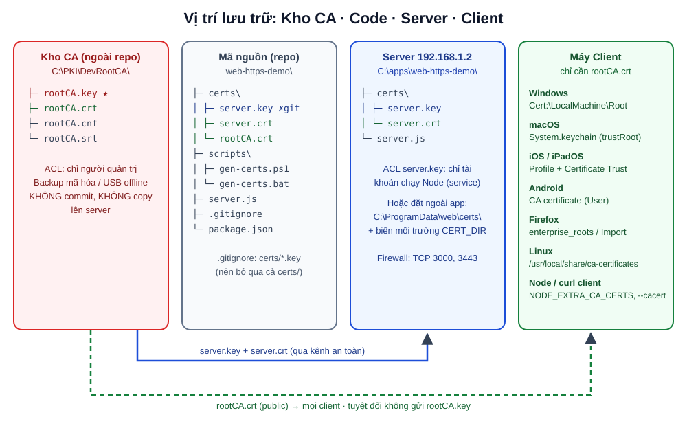

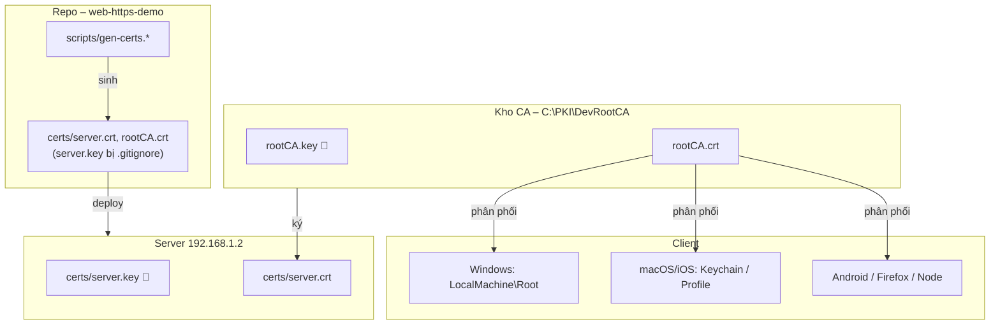


# Cài Root CA lên máy Client

Chỉ gửi **`rootCA.crt`**. Kiểm tra fingerprint trước khi cài để chắc không bị tráo file:

```bat
openssl x509 -in rootCA.crt -noout -fingerprint -sha256
certutil -hashfile rootCA.crt SHA256
```

| Nền tảng | Cách cài |
|---|---|
| **Windows (mọi user)** | `certutil -addstore -f Root rootCA.crt` (cmd Admin) hoặc `Import-Certificate -FilePath rootCA.crt -CertStoreLocation Cert:\LocalMachine\Root` |
| **Windows (một user)** | `certutil -user -addstore Root rootCA.crt` – Windows hiện hộp thoại xác nhận |
| **Windows (nhiều máy trong domain)** | GPO: *Computer Configuration → Policies → Windows Settings → Security Settings → Public Key Policies → Trusted Root Certification Authorities* |
| **macOS** | `sudo security add-trusted-cert -d -r trustRoot -k /Library/Keychains/System.keychain rootCA.crt` |
| **iOS / iPadOS** | Gửi file qua AirDrop/mail → *Settings → General → VPN & Device Management* cài profile → *Settings → General → About → Certificate Trust Settings* bật Full Trust |
| **Android** | *Settings → Security → Encryption & credentials → Install a certificate → CA certificate* (Chrome tin CA người dùng; app native từ Android 7 thì mặc định **không**) |
| **Firefox** | `about:config` → `security.enterprise_roots.enabled = true` để đọc kho Windows/macOS, hoặc *Settings → Privacy & Security → Certificates → View Certificates → Authorities → Import* |
| **Ubuntu/Debian** | `sudo cp rootCA.crt /usr/local/share/ca-certificates/fstv-dev-root-ca.crt && sudo update-ca-certificates` (Chrome trên Linux dùng NSS: `certutil -d sql:$HOME/.pki/nssdb -A -t "C,," -n "FSTV Dev Root CA" -i rootCA.crt`) |
| **Node.js client** | `set NODE_EXTRA_CA_CERTS=C:\path\rootCA.crt` trước khi chạy `node` (Node bản mới có thêm cờ `--use-system-ca` để đọc kho hệ điều hành) |

Kiểm tra đã cài trên Windows:

```powershell
Get-ChildItem Cert:\LocalMachine\Root | Where-Object Subject -like '*FSTV Dev Root CA*' | Format-List Subject, NotAfter, Thumbprint
```

Sau khi cài, **đóng hẳn trình duyệt** (mọi cửa sổ, kể cả chạy nền) rồi mở lại.


# Trình duyệt kiểm tra chứng chỉ như thế nào

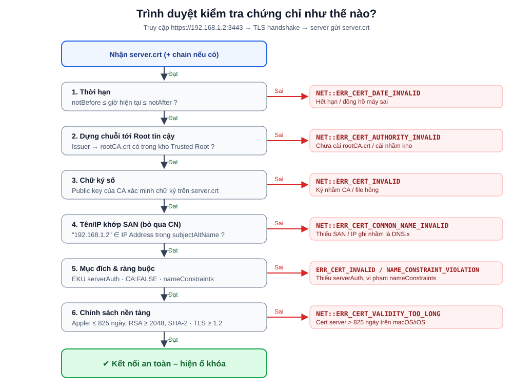

Quá trình bắt tay TLS 1.3 rút gọn:

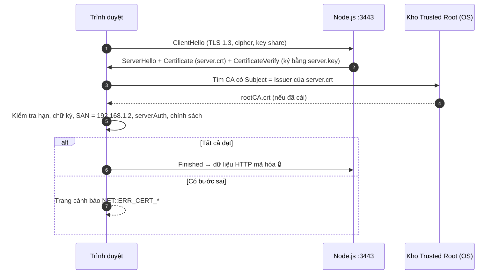

Thứ tự kiểm tra và lỗi tương ứng:

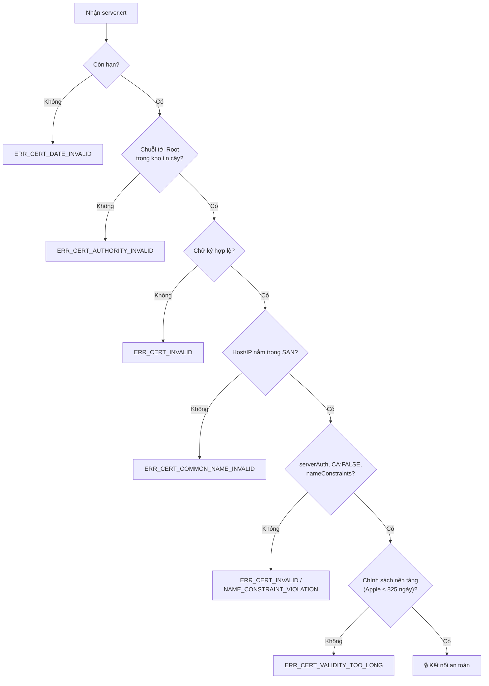

Về **thu hồi (revocation)**: CA nội bộ trong bài không công bố CRL/OCSP. Với cert do CA người dùng tự thêm, Chrome/Edge không bắt buộc kiểm tra thu hồi nên vẫn hiện ổ khóa. Hệ quả là nếu `server.key` bị lộ thì không có cách "thu hồi" nhanh – phải cấp lại cert, và nếu `rootCA.key` lộ thì phải gỡ Root CA khỏi mọi client.


# Kiểm thử và nghiệm thu

| # | Hạng mục | Cách kiểm tra | Kết quả mong đợi | Đạt |
|---|---|---|---|---|
| 1 | OpenSSL đúng bản | `openssl version` | `OpenSSL 3.5.x` | ☐ |
| 2 | Root CA hợp lệ | `openssl x509 -in rootCA.crt -noout -ext basicConstraints -enddate` | `CA:TRUE, pathlen:0`, hết hạn sau ~10 năm | ☐ |
| 3 | SAN đầy đủ | `openssl x509 -in server.crt -noout -ext subjectAltName` | Có `IP Address:192.168.1.2` và `DNS:localhost` | ☐ |
| 4 | Chain + IP | `openssl verify -CAfile rootCA.crt -verify_ip 192.168.1.2 server.crt` | `server.crt: OK` | ☐ |
| 5 | Khóa khớp cert | So 2 hash SHA-256 | Giống nhau | ☐ |
| 6 | Thời hạn cert server | `openssl x509 -in server.crt -noout -enddate` | ≤ 825 ngày nếu có Apple, ≤ 10 năm nếu không | ☐ |
| 7 | Bí mật CA | Kiểm tra repo và server | Không có `rootCA.key` ngoài kho CA | ☐ |
| 8 | Git | `git check-ignore certs/server.key` | In ra đường dẫn (đã bị ignore) | ☐ |
| 9 | Firewall | `Test-NetConnection 192.168.1.2 -Port 3443` | `TcpTestSucceeded : True` | ☐ |
| 10 | HTTP | Mở `http://192.168.1.2:3000` | Trang "Xin chào qua HTTP" | ☐ |
| 11 | HTTPS Chrome/Edge (Windows) | Mở `https://192.168.1.2:3443` | Ổ khóa, không cảnh báo | ☐ |
| 12 | HTTPS localhost (trên server) | Mở `https://localhost:3443` | Ổ khóa, không cảnh báo | ☐ |
| 13 | HTTPS Safari (macOS/iOS) | Mở `https://192.168.1.2:3443` | Ổ khóa (cert ≤ 825 ngày) | ☐ |
| 14 | HTTPS Android Chrome | Mở `https://192.168.1.2:3443` | Ổ khóa | ☐ |
| 15 | Firefox | Mở `https://192.168.1.2:3443` | Ổ khóa | ☐ |
| 16 | TLS tối thiểu | `openssl s_client -connect 192.168.1.2:3443 -tls1_1` | Bắt tay **thất bại** | ☐ |
| 17 | curl | `curl.exe https://192.168.1.2:3443/health` | `{"ok":true,"protocol":"https"}` | ☐ |
| 18 | Truy cập sai IP (âm tính) | Mở `https://<IP khác của server>:3443` | **Có** cảnh báo `COMMON_NAME_INVALID` – đúng thiết kế | ☐ |
| 19 | Khởi động lại server | Reboot, chạy lại service | HTTP/HTTPS lên lại, cert không đổi | ☐ |

Mẹo xem chi tiết cert trên Chrome/Edge: bấm biểu tượng bên trái thanh địa chỉ → *Connection is secure* → *Certificate is valid* → tab *Details* để xem *Subject Alternative Name* và *Certification Path*.


# Rủi ro và lưu ý

| Rủi ro | Mức độ | Hậu quả | Giảm thiểu |
|---|---|---|---|
| **Lộ `rootCA.key`** | 🔴 Rất cao | Kẻ có file có thể giả mạo HTTPS của **bất kỳ** website (ngân hàng, email...) trên mọi máy đã tin CA | Lưu offline, ACL chặt, không commit, không copy lên server; dùng `nameConstraints` (Phụ lục B); khi lộ thì gỡ Root CA khỏi mọi client và làm CA mới |
| Lộ `server.key` | 🟠 Cao | Giả mạo đúng server `192.168.1.2` | ACL cho service account, không commit, cấp lại cert khi nghi ngờ |
| IP server thay đổi (DHCP) | 🟠 Cao | Toàn bộ client báo `COMMON_NAME_INVALID` | Đặt IP tĩnh hoặc DHCP reservation; tốt hơn là thêm tên DNS nội bộ (`DNS.2 = app.fstv.local`) vào SAN |
| Cert server 10 năm trên Apple | 🟠 Trung bình | Safari/iOS không vào được | Dùng 825 ngày khi có thiết bị Apple |
| Cert dài hạn ít được thay | 🟡 Trung bình | Lộ khóa thì bị khai thác lâu dài; quên quy trình gia hạn | Ưu tiên 1–2 năm; ghi lịch nhắc trước 30 ngày; script `-checkend` |
| Root CA hết hạn (sau 10 năm) | 🟡 Thấp | Toàn bộ cert con mất hiệu lực cùng lúc | Ghi lịch, tạo CA mới trước 6–12 tháng, cài song song |
| Cài nhầm kho (Personal/Intermediate) | 🟡 Thấp | Vẫn `AUTHORITY_INVALID` | Cài đúng *Trusted Root Certification Authorities* |
| Trùng serial khi ký lại | 🟡 Thấp | Firefox có thể báo `SEC_ERROR_REUSED_ISSUER_AND_SERIAL` | Luôn dùng `-CAserial rootCA.srl -CAcreateserial`; không xóa `rootCA.srl` |
| HSTS trên IP/localhost | 🟡 Thấp | Bật `helmet()` gửi HSTS → trình duyệt nhớ, sau này không quay lại HTTP được | Tắt HSTS cho môi trường nội bộ: `helmet({ hsts: false })` |
| Nhiều bản OpenSSL trong PATH | 🟢 Thấp | Lệnh chạy bằng bản cũ (1.1.x) khác cú pháp | `where openssl`, script kiểm tra `OpenSSL 3.` |
| App Android native | 🟢 Thấp | App không tin CA người dùng | Khai báo `network_security_config` trong app |
| BOM UTF-8 trong file `.cnf` | 🟢 Thấp | OpenSSL báo lỗi parse cấu hình | Lưu ASCII/UTF-8 **không BOM** (script dùng `-Encoding ascii`) |

Một số lưu ý thêm:

- **Đây là giải pháp cho mạng nội bộ / dev / demo.** Website công khai hãy dùng CA công khai (Let's Encrypt...).
- Thêm `rootCA.crt` vào kho tin cậy là **quyết định tin tưởng**. Chỉ cài vào máy mình quản lý, và nói rõ cho người dùng biết.
- Nếu sau này cần nhiều server, nên tách thành **Root CA (offline) → Intermediate CA (ký hằng ngày)**. Khi đó đổi `pathlen:0` thành `pathlen:1` và server phải gửi kèm cert intermediate.


# Gia hạn và thay chứng chỉ

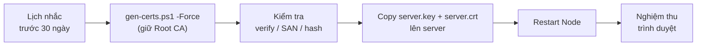

Client **không cần làm gì** khi cấp lại cert server, vì Root CA không đổi. Để giám sát, có thể đặt lệnh sau vào Task Scheduler, mã thoát `1` nghĩa là cert sẽ hết hạn trong 30 ngày:

```bat
openssl x509 -in C:\apps\web-https-demo\certs\server.crt -noout -checkend 2592000
```


# Phụ lục A: HTTP và HTTPS dùng chung một cổng

Hai `server.listen()` không thể cùng chiếm một cổng (`EADDRINUSE`). Nhưng ta có thể mở **một** server TCP, đọc byte đầu tiên mà client gửi rồi chuyển socket cho đúng bên xử lý: gói TLS luôn mở đầu bằng record type `0x16` (Handshake), còn HTTP mở đầu bằng chữ cái của method (`G` trong `GET`, `P` trong `POST`...).

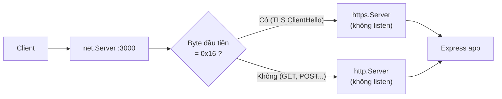

`server-one-port.js`:

```js
const fs = require('node:fs');
const path = require('node:path');
const net = require('node:net');
const http = require('node:http');
const https = require('node:https');
const express = require('express');

const PORT = Number(process.env.PORT || 3000);
const app = express();
app.get('/', (req, res) => res.send(`Xin chào qua ${req.protocol.toUpperCase()} trên cổng ${PORT}`));

const tlsOptions = {
  key:  fs.readFileSync(path.join(__dirname, 'certs', 'server.key')),
  cert: fs.readFileSync(path.join(__dirname, 'certs', 'server.crt')),
  minVersion: 'TLSv1.2',
};

// Hai server "ảo": không gọi listen(), chỉ nhận socket được chuyển tới
const httpServer  = http.createServer(app);
const httpsServer = https.createServer(tlsOptions, app);

// Server TCP duy nhất: đọc byte đầu tiên để biết client nói giao thức gì
net.createServer((socket) => {
  socket.once('data', (chunk) => {
    socket.pause();
    socket.unshift(chunk);                       // trả byte đã đọc lại cho luồng
    const isTls = chunk[0] === 0x16;             // 0x16 = TLS Handshake record
    (isTls ? httpsServer : httpServer).emit('connection', socket);
    process.nextTick(() => socket.resume());
  });
  socket.on('error', () => socket.destroy());
}).listen(PORT, '0.0.0.0', () => console.log(`HTTP + HTTPS cùng cổng ${PORT}`));
```

Kết quả:

```text
> curl.exe http://192.168.1.2:3000/
Xin chào qua HTTP trên cổng 3000
> curl.exe https://192.168.1.2:3000/
Xin chào qua HTTPS trên cổng 3000
```

| | Hai cổng (3000 / 3443) | Một cổng (3000) |
|---|---|---|
| Độ phức tạp | Thấp | Trung bình (tự xử lý socket) |
| Firewall | Mở 2 cổng | Mở 1 cổng |
| Debug, log, proxy | Dễ, công cụ hỗ trợ sẵn | Khó hơn; reverse proxy / load balancer thường không hiểu kiểu này |
| HTTP/2, keep-alive | Bình thường | Cần thử kỹ |
| Khi nào dùng | **Mặc định** | Môi trường chỉ cho mở đúng 1 cổng, thiết bị nhúng, demo |

Lưu ý: kỹ thuật này chỉ phân biệt TLS và HTTP thô. Với client "im lặng chờ server nói trước" (một số giao thức khác) socket sẽ treo, nên nên thêm `socket.setTimeout()` nếu đưa vào môi trường thật.


# Phụ lục B: Giới hạn phạm vi Root CA bằng nameConstraints

Để giảm hậu quả khi lộ `rootCA.key`, thêm vào mục `[ v3_ca ]` của `rootCA.cnf` **trước khi tạo CA**:

```ini
nameConstraints = critical, permitted;IP:192.168.1.0/255.255.255.0, permitted;IP:127.0.0.1/255.255.255.255, permitted;IP:0:0:0:0:0:0:0:1/FFFF:FFFF:FFFF:FFFF:FFFF:FFFF:FFFF:FFFF, permitted;DNS:localhost
```

Khi đó CA này chỉ ký hợp lệ được cho dải `192.168.1.0/24`, `127.0.0.1`, `::1` và `localhost`. Cert cho `google.com` do CA này ký sẽ bị từ chối (`NET::ERR_CERT_NAME_CONSTRAINT_VIOLATION`). Kiểm tra:

```text
> openssl x509 -in rootCA.crt -noout -ext nameConstraints
X509v3 Name Constraints: critical
    Permitted:
      IP:192.168.1.0/255.255.255.0
      IP:127.0.0.1/255.255.255.255
      IP:0:0:0:0:0:0:0:1/FFFF:FFFF:FFFF:FFFF:FFFF:FFFF:FFFF:FFFF
      DNS:localhost
```

Đánh đổi: muốn thêm tên miền nội bộ (ví dụ `*.fstv.local`) thì phải khai báo trước (`permitted;DNS:.fstv.local`), nếu không phải làm lại CA. Hãy thử nghiệm trên đủ các trình duyệt mục tiêu trước khi áp dụng.


# Tham khảo

- [OpenSSL 3.5 Final Release – OpenSSL Library](https://openssl-library.org/post/2025-04-08-openssl-35-final-release)
- [OpenSSL 3.5 will be the next LTS release](https://openssl-library.org/post/2025-02-20-openssl-3.5-lts)
- [OpenSSL 3.5 Series Release Notes](https://mirror.openssl-library.org/news/openssl-3.5-notes/)
- [openssl-x509(1)](https://docs.openssl.org/3.5/man1/openssl-x509/), [openssl-req(1)](https://docs.openssl.org/3.5/man1/openssl-req/), [x509v3_config(5)](https://docs.openssl.org/3.5/man5/x509v3_config/)
- [Win32/Win64 OpenSSL – Shining Light Productions](https://slproweb.com/products/Win32OpenSSL.html)
- [FireDaemon OpenSSL for Windows](https://kb.firedaemon.com/support/solutions/articles/4000121705)
- [Requirements for trusted certificates in iOS 13 and macOS 10.15 – Apple](https://support.apple.com/en-us/103769)
- [Node.js – HTTPS](https://nodejs.org/api/https.html), [TLS](https://nodejs.org/api/tls.html)
- [Bài trước: Cấu hình SSL HTTPS cho Localhost trong Node.js (mkcert)](/2026/10/01/set-up-ssl-https-localhost-for-node-js/)
