> Bài viết dựa trên README, CHANGELOG và ROADMAP của [tt-a1i/archify](https://github.com/tt-a1i/archify) (phiên bản ổn định **v3.2.0**, phát hành 18/10/2026). 20 sơ đồ minh họa trong bài được tạo bằng chính Archify: viết JSON IR, chạy `finalize` (qua đủ các bước kiểm tra), rồi xuất ra SVG nền sáng từ Viewer. Số liệu thời gian và các mốc trong sơ đồ chỉ là **ví dụ minh họa**.

- [Giới thiệu chung](#giới-thiệu-chung)
  - [Archify là gì?](#archify-là-gì)
  - [Điểm khác biệt](#điểm-khác-biệt)
  - [Archify hoạt động như thế nào?](#archify-hoạt-động-như-thế-nào)
- [Cách cài đặt](#cách-cài-đặt)
- [Cách update](#cách-update)
- [Bắt đầu sử dụng](#bắt-đầu-sử-dụng)
- [Chọn đúng loại sơ đồ](#chọn-đúng-loại-sơ-đồ)
- [20 sơ đồ minh họa cho 10 loại](#20-sơ-đồ-minh-họa-cho-10-loại)
  - [1. Architecture – Kiến trúc](#1-architecture--kiến-trúc)
  - [2. Workflow – Quy trình](#2-workflow--quy-trình)
  - [3. Sequence – Tuần tự](#3-sequence--tuần-tự)
  - [4. Data Flow – Luồng dữ liệu](#4-data-flow--luồng-dữ-liệu)
  - [5. Lifecycle – Vòng đời trạng thái](#5-lifecycle--vòng-đời-trạng-thái)
  - [6. ERD – Lược đồ cơ sở dữ liệu](#6-erd--lược-đồ-cơ-sở-dữ-liệu)
  - [7. Class – Lớp và giao diện](#7-class--lớp-và-giao-diện)
  - [8. Tree – Cây phân cấp](#8-tree--cây-phân-cấp)
  - [9. Timeline – Dòng thời gian](#9-timeline--dòng-thời-gian)
  - [10. Waterfall – Thác nước](#10-waterfall--thác-nước)
- [Xuất sơ đồ sang SVG để dùng cho blog](#xuất-sơ-đồ-sang-svg-để-dùng-cho-blog)
- [Các thư viện dùng cho vẽ sơ đồ](#các-thư-viện-dùng-cho-vẽ-sơ-đồ)
- [Roadmap](#roadmap)
- [Lưu ý khi sử dụng](#lưu-ý-khi-sử-dụng)
- [Kết luận](#kết-luận)
- [Resources / Tài nguyên](#resources--tài-nguyên)

# Giới thiệu chung

## Archify là gì?

**Archify** là một **Agent Skill** mã nguồn mở (giấy phép Apache-2.0) dành cho các AI coding agent như **Claude Code**, **Codex CLI**, **Cursor**, **OpenCode** và **GitHub Copilot**. Bạn mô tả hệ thống bằng lời (hoặc yêu cầu agent đọc một repository), Archify sẽ giúp agent tạo ra một **file HTML độc lập** chứa sơ đồ tương tác: có thể phóng to, tìm node, lần theo đường đi, đổi theme sáng/tối và xuất ảnh.

Một câu lệnh là đủ để bắt đầu:

```text
Use Archify to diagram a web request: Browser calls the API,
the API checks Redis, and a cache miss queries PostgreSQL and fills the cache.
```

Sau đó bạn tiếp tục chỉnh bằng hội thoại: *"thêm bước xác thực"*, *"làm nổi bật nhánh cache miss"*, *"chuyển sang theme sáng"*...

Một số con số đáng chú ý (tại thời điểm viết bài):

| Thông tin | Giá trị |
|---|---|
| Phiên bản ổn định | v3.2.0 (18/10/2026) |
| Số loại sơ đồ | 10 loại + trang giải thích một trang (explainer) |
| Lượt cài trên skills.sh | hơn 130K |
| Agent hỗ trợ | Claude Code, Codex CLI, Cursor, OpenCode, GitHub Copilot |
| Đầu ra | 1 file HTML độc lập, xuất được PNG/WebP/JPG/SVG/WebM |
| Yêu cầu | Node.js ≥ 18 |

## Điểm khác biệt

Archify **không phải** công cụ vẽ kéo thả, cũng không phải theme cho Mermaid. Tác giả gọi nó là công cụ biến *ý đồ kỹ thuật* thành *tài liệu truyền đạt*. Các điểm nổi bật:

- **Bố cục do agent quyết định, không dùng auto-layout chung chung**: agent chọn vị trí, khoảng cách, nhóm và nhấn mạnh. Tác giả đã thử nghiệm và kết luận rằng "auto-layout + CSS đẹp" không tốt hơn Mermaid gốc, nên giữ cách đặt tay làm giá trị cốt lõi.
- **JSON IR có schema**: mỗi loại sơ đồ có một JSON Schema, nguồn sơ đồ là file JSON có thể diff trong Git và render lại được.
- **Kiểm tra trước khi giao**: schema, bố cục, HTML/SVG, đường nối, khoảng cách nhãn... đều phải đạt thì file mới thay thế bản cũ. Lỗi được trả về dạng JSON có mã lỗi và gợi ý sửa.
- **Tương tác trung thực**: focus, upstream/downstream, route, lens chỉ dùng node và quan hệ đã khai báo, không tự "bịa" ra topology.
- **Dẫn nguồn khi đọc từ code**: node trong sơ đồ kiến trúc có thể gắn `SRC n`, mở đúng file và dòng code tại một commit cố định.
- **Dễ chia sẻ**: một file HTML gửi cho người khác là đủ, không cần cài Archify để xem.

Phím tắt trong Viewer:

| Hành động | Phím |
|---|---|
| Mở hướng dẫn sơ đồ | <kbd>?</kbd> |
| Tìm và focus một node | <kbd>/</kbd> |
| Lần đường đi giữa hai node | <kbd>R</kbd> |
| So sánh 1–2 vai trò (lens) | <kbd>L</kbd> |
| Bản đồ tổng quan | <kbd>M</kbd> |
| Chế độ trình chiếu | <kbd>F</kbd> |
| Đổi style / theme / mở menu Export | <kbd>S</kbd> / <kbd>T</kbd> / <kbd>E</kbd> |
| Phóng to / thu nhỏ / về mặc định | <kbd>+</kbd> / <kbd>-</kbd> / <kbd>0</kbd> |

## Archify hoạt động như thế nào?

| Bước | Diễn ra điều gì |
|---|---|
| **Generate** | Agent viết JSON IR (có kiểu) từ mô tả của bạn hoặc từ code. |
| **Validate** | Bộ kiểm tra đi kèm soát schema và quy tắc bố cục; lỗi chỉ ra đúng chỗ cần sửa. |
| **Preview** (tùy chọn) | Một phiên xem trên `127.0.0.1` theo dõi file JSON, chỉ tải lại khi bản mới đạt kiểm tra. |
| **Deliver** | Render ra file tạm, kiểm tra, rồi mới thay thế file đích một cách nguyên tử (atomic). |
| **Iterate** | Agent sửa JSON theo yêu cầu mới, phần không liên quan giữ nguyên vị trí. |

Lệnh quan trọng nhất là `finalize`, gom đủ các cổng kiểm tra `validate → deliver → check → browser-check`:

```bash
node archify/bin/archify.mjs finalize architecture candidate.json out.html --quality showcase --json
```

# Cách cài đặt

**Cách 1 – nhờ agent tự cài (khuyến nghị).** Gửi câu sau cho agent (Claude Code, Codex, Cursor...):

```text
Install Archify for me by reading https://raw.githubusercontent.com/tt-a1i/archify/main/llms.txt
```

File `llms.txt` hướng dẫn agent: hỏi bạn phạm vi cài (toàn cục hay chỉ project, cho agent nào), liệt kê gói, cài, rồi kiểm tra bằng `doctor`.

**Cách 2 – cài bằng lệnh.** Archify được phân phối qua CLI [`skills`](https://skills.sh). Cài toàn cục cho Claude Code:

```bash
# Xem gói trước (không cài)
npx -y skills@latest add https://archify.si --list --full-depth

# Cài cho Claude Code, toàn cục, copy file thay vì symlink
npx -y skills@latest add https://archify.si --skill archify --agent claude-code --global --copy --yes

# Cài cho nhiều agent cùng lúc: lặp lại --agent
npx -y skills@latest add https://archify.si --skill archify --agent claude-code --agent cursor --agent codex --global --copy --yes
```

Bỏ `--global` nếu chỉ muốn cài cho project hiện tại. Với Claude Code cài toàn cục, skill nằm ở `~/.claude/skills/archify` (trên Windows là `C:\Users\<user>\.claude\skills\archify`).

**Cách 3 – dùng thử không cần cài:**

```bash
npx skills use tt-a1i/archify@archify --agent codex
```

**Kiểm tra sau khi cài:**

```bash
node ~/.claude/skills/archify/bin/archify.mjs doctor
node ~/.claude/skills/archify/bin/archify.mjs demo /tmp/archify-demo
```

# Cách update

Archify **không bao giờ tự cài bản cập nhật**. Bạn quyết định khi nào nâng cấp.

- **Nhắc cập nhật trong lúc dùng**: khi chạy `finalize`/`deliver`, Archify có thể kiểm tra manifest phiên bản ổn định (khoảng 24 giờ một lần) và hiện một dòng nhắc kèm link release notes. Request này không gửi phiên bản, dự án, prompt hay ID thiết bị. Muốn tắt hẳn, đặt biến môi trường `ARCHIFY_UPDATE_CHECK_DISABLED=1`.
- **Nhận thông báo release**: trên GitHub chọn **Watch → Custom → Releases** (Star không đăng ký nhận thông báo), hoặc theo dõi [release feed](https://github.com/tt-a1i/archify/releases.atom).
- **Cập nhật thực tế**: nhờ agent cập nhật (*"Update Archify by reading https://raw.githubusercontent.com/tt-a1i/archify/main/llms.txt"*), hoặc chạy lại lệnh cài ở trên với cùng `--agent` và phạm vi để thay bản copy cũ. CLI `skills` cũng có lệnh `npx skills check` / `npx skills update` để kiểm tra và cập nhật các skill đã cài.
- **Sau khi cập nhật**: chạy lại `doctor` và đọc [CHANGELOG](https://github.com/tt-a1i/archify/blob/main/CHANGELOG.md), nhất là mục *Upgrading* khi lên phiên bản lớn (ví dụ 2.x → 3.0 đổi bố cục Viewer). Các file HTML đã tạo trước đó vẫn chạy được vì Viewer được nhúng sẵn bên trong.

# Bắt đầu sử dụng

**Từ một mô tả, không cần repository:**

```text
Use Archify to draw: Browser -> API -> Redis cache -> PostgreSQL fallback.
```

**Từ một repository, có dẫn nguồn:**

```text
Analyze this repository, then use archify to create a high-level runtime architecture diagram.
Show 8–12 core components, one primary path, external dependencies, and trust boundaries.
Put supporting detail in cards instead of adding more edges.
```

**Không chắc nên dùng loại nào?** Hỏi CLI (không cần mạng):

```bash
node archify/bin/archify.mjs guide "Show an API request with Redis cache miss"
node archify/bin/archify.mjs guide "Map Kafka topics, consumer groups, replay, and DLQ" --json
```

**Viết nhãn tiếng Việt:** đặt `meta.locale: "vi"`. Tiếng Việt chưa có bộ dịch Viewer đi kèm (hiện có `en`, `zh-CN`, `zh-TW`, `es`, `ko`, `ar`), nên muốn chú giải trong sơ đồ là tiếng Việt thì bổ sung `meta.translations` cho các khóa như `legend.title`, `legend.erd.pk`... Các khóa còn thiếu sẽ hiện tiếng Anh và Archify chỉ cảnh báo, không chặn.

# Chọn đúng loại sơ đồ

| Loại | Phù hợp nhất cho | Nên có trong prompt |
|---|---|---|
| **Architecture** | Thành phần, service, lưu trữ, ranh giới | Phạm vi, thành phần cốt lõi, luồng chính |
| **Workflow** | CI/CD, phê duyệt, tool call, runbook | Người tham gia, thứ tự, nhánh rẽ, ngoại lệ |
| **Sequence** | Gọi API, cache fallback, xác thực, trace bất đồng bộ | Bên gọi, bên được gọi, phản hồi, thời điểm |
| **Data Flow** | Pipeline, lineage, PII, bên tiêu thụ | Nguồn, biến đổi, nơi lưu, ranh giới |
| **Lifecycle** | Trạng thái, thử lại, chờ, kết thúc | Trạng thái, sự kiện, nhánh retry và hủy |
| **ERD** | Lược đồ CSDL: bảng, cột, khóa, bội số quan hệ | Bảng, mọi cột kèm kiểu, khóa chính/ngoại/duy nhất, cardinality |
| **Class** | Lớp, interface, thành viên chọn lọc, quan hệ kiểu | Kiểu, thành viên chính, kế thừa và hiện thực, composition, phụ thuộc |
| **Tree** | Phân cấp một cha: repository, module, phân rã năng lực | Gốc, các cấp, mỗi nhánh chứa gì |
| **Timeline** | Khi nào điều gì xảy ra: postmortem, lịch sử release | Mốc thời gian có múi giờ, sự kiện, làn nguồn, thời gian thật hay minh họa |
| **Waterfall** | Thời gian đi đâu trong một request hoặc một lần chạy agent | Span, thời điểm bắt đầu và thời lượng, lồng nhau, đo thật hay minh họa |

# 20 sơ đồ minh họa cho 10 loại

Mỗi loại sơ đồ có hai tab: **tab 1** là một ví dụ ở lĩnh vực khác, **tab 2** áp dụng cho **hệ thống WMS quản lý kho** (Warehouse Management System). File JSON nguồn của từng sơ đồ nằm trong thư mục [`/img/2026/archify/json/`](https://github.com/boxxv/boxxv.github.io/tree/master/img/2026/archify/json), bạn có thể render lại bằng `archify finalize`.

## 1. Architecture – Kiến trúc

Dùng để trả lời câu hỏi *"hệ thống gồm những gì và nối với nhau ra sao?"*. Mỗi thành phần có loại ngữ nghĩa (`frontend`, `backend`, `database`, `cloud`, `security`, `messagebus`, `external`), ranh giới `region`/`security-group`, và nhãn trên đường nối.

```text
Use Archify to draw the architecture of our WMS: warehouse staff use an Android PDA app,
calls go through an API Gateway to the WMS Core API (.NET 8) backed by PostgreSQL and Redis,
Keycloak verifies JWT, events go to RabbitMQ and an integration worker syncs with ERP/TMS.
```

<ul class="nav nav-tabs" role="tablist">
<li role="presentation" class="active"><a href="#arch-1" aria-controls="arch-1" role="tab" data-toggle="tab">AI chăm sóc khách hàng (RAG)</a></li>
<li role="presentation"><a href="#arch-2" aria-controls="arch-2" role="tab" data-toggle="tab">Hệ thống WMS</a></li>
</ul>
<div class="tab-content">
<div role="tabpanel" class="tab-pane fade in active" id="arch-1">
<p></p>
<p><em>Câu hỏi đi qua API Gateway tới RAG Orchestrator; Retriever lấy đoạn tài liệu từ Vector DB, LLM sinh câu trả lời; Guardrails lọc PII và chuyển câu khó cho nhân viên CSKH.</em></p>
</div>
<div role="tabpanel" class="tab-pane fade" id="arch-2">
<p></p>
<p><em>PDA và Web Admin cùng đi qua API Gateway; WMS Core ghi PostgreSQL, Keycloak xác thực, sự kiện kho qua RabbitMQ để đồng bộ ERP/TMS.</em></p>
</div>
</div>

## 2. Workflow – Quy trình

Quy trình chia theo **làn** (lane: ai làm), **cột** (thứ tự) và **phase**. Luồng chính khai báo trong `mainPath`; nhánh lỗi, nhánh rẽ, đường quay lại có `role` riêng. Làn ngoại lệ (`variant: "exception"`) được vẽ khung đứt.

```text
Use Archify to draw a workflow for WMS inbound receiving: supplier sends ASN, WMS schedules a dock,
staff receive and scan with PDA, WMS matches against ASN; mismatches go to QC quarantine;
matched goods are put away by suggestion and stock is posted to ERP.
```

<ul class="nav nav-tabs" role="tablist">
<li role="presentation" class="active"><a href="#wf-1" aria-controls="wf-1" role="tab" data-toggle="tab">Đơn hàng &amp; đổi trả E-commerce</a></li>
<li role="presentation"><a href="#wf-2" aria-controls="wf-2" role="tab" data-toggle="tab">Nhập kho WMS</a></li>
</ul>
<div class="tab-content">
<div role="tabpanel" class="tab-pane fade in active" id="wf-1">
<p></p>
<p><em>Đặt hàng → thanh toán → giữ tồn → đóng gói → giao hàng. Thanh toán lỗi thì hủy đơn; hàng trả phải qua kiểm tra rồi mới nhập lại kho và hoàn tiền.</em></p>
</div>
<div role="tabpanel" class="tab-pane fade" id="wf-2">
<p></p>
<p><em>ASN → xếp lịch dock → nhận và quét → đối chiếu → cất hàng → cập nhật tồn. Hàng lệch hoặc hư hỏng đi sang làn QC.</em></p>
</div>
</div>

## 3. Sequence – Tuần tự

Một tương tác theo thời gian: ai gọi ai, theo thứ tự nào. Phân biệt rõ yêu cầu chính, phản hồi (`return`), gọi liên quan bảo mật (`security`) và gọi bất đồng bộ (`dashed`); thanh kích hoạt cho thấy mỗi bên bận trong bao lâu.

```text
Use Archify to draw a sequence: picker scans bin + SKU on the PDA, PDA calls POST /picks/confirm,
WMS API locks the bin in Redis, deducts stock in PostgreSQL in one transaction, unlocks,
publishes PickConfirmed to RabbitMQ, returns the next task; ERP sync happens asynchronously.
```

<ul class="nav nav-tabs" role="tablist">
<li role="presentation" class="active"><a href="#seq-1" aria-controls="seq-1" role="tab" data-toggle="tab">Xác thực đa yếu tố (MFA)</a></li>
<li role="presentation"><a href="#seq-2" aria-controls="seq-2" role="tab" data-toggle="tab">Xác nhận picking WMS</a></li>
</ul>
<div class="tab-content">
<div role="tabpanel" class="tab-pane fade in active" id="seq-1">
<p></p>
<p><em>Yếu tố 1 là mật khẩu; Risk Engine đánh giá IP/thiết bị và yêu cầu yếu tố 2 (OTP) khi rủi ro cao; xác minh xong mới cấp access + refresh token.</em></p>
</div>
<div role="tabpanel" class="tab-pane fade" id="seq-2">
<p></p>
<p><em>Khóa ô kệ trên Redis để tránh hai người lấy cùng lúc, trừ tồn trong một transaction, đồng bộ ERP không chặn phản hồi cho picker.</em></p>
</div>
</div>

## 4. Data Flow – Luồng dữ liệu

Dữ liệu đi từ trái sang phải qua các **stage** (Nguồn → Thu nhận → Xử lý → Lưu trữ → Sử dụng). Mỗi luồng bắt buộc có nhãn; `security` dành cho chính sách/PII, `dashed` cho batch hoặc bất đồng bộ.

```text
Use Archify to draw a data flow for WMS inventory: PDA scans and RFID gates feed the WMS API,
ERP orders arrive via an integration hub, the inventory engine posts stock to PostgreSQL
and emits StockChanged events consumed by ERP sync and a nightly ETL into the data warehouse for forecasting.
```

<ul class="nav nav-tabs" role="tablist">
<li role="presentation" class="active"><a href="#df-1" aria-controls="df-1" role="tab" data-toggle="tab">IoT nhà thông minh</a></li>
<li role="presentation"><a href="#df-2" aria-controls="df-2" role="tab" data-toggle="tab">Dữ liệu tồn kho WMS</a></li>
</ul>
<div class="tab-content">
<div role="tabpanel" class="tab-pane fade in active" id="df-1">
<p></p>
<p><em>Telemetry qua MQTT tới Rule Engine rồi vào time-series DB; video camera được làm mờ khuôn mặt và mã hóa trước khi lưu (luồng PII màu đỏ).</em></p>
</div>
<div role="tabpanel" class="tab-pane fade" id="df-2">
<p></p>
<p><em>Mọi lượt quét đi qua Inventory Engine trước khi ghi tồn; ERP và Data Warehouse nhận thay đổi qua Event Bus.</em></p>
</div>
</div>

## 5. Lifecycle – Vòng đời trạng thái

Mô tả một đối tượng đang ở trạng thái nào và chuyển sang đâu. Khai báo `mainPath` cho đường hạnh phúc, mọi `transition` khác do renderer tự xếp chỗ. Trạng thái `start`, `waiting`, `decision`, `success`, `failure` có màu và ký hiệu riêng; trạng thái không có lối ra được viền đôi.

```text
Use Archify to draw the lifecycle of a WMS outbound order: received → allocated → picking → packing → shipped.
Insufficient stock goes to backorder until goods arrive or it expires and is cancelled;
an empty bin during picking triggers re-allocation; packing errors send it back to picking.
```

<ul class="nav nav-tabs" role="tablist">
<li role="presentation" class="active"><a href="#lc-1" aria-controls="lc-1" role="tab" data-toggle="tab">MLOps</a></li>
<li role="presentation"><a href="#lc-2" aria-controls="lc-2" role="tab" data-toggle="tab">Đơn xuất kho WMS</a></li>
</ul>
<div class="tab-content">
<div role="tabpanel" class="tab-pane fade in active" id="lc-1">
<p></p>
<p><em>Dữ liệu → huấn luyện → đánh giá → staging → production; khi phát hiện drift thì quay lại chuẩn bị dữ liệu để huấn luyện lại, hoặc cho mô hình ngừng sử dụng.</em></p>
</div>
<div role="tabpanel" class="tab-pane fade" id="lc-2">
<p></p>
<p><em>Thiếu tồn chuyển sang "Chờ hàng"; ô kệ trống khi lấy hàng thì phân bổ lại; quá hạn chờ thì hủy đơn.</em></p>
</div>
</div>

## 6. ERD – Lược đồ cơ sở dữ liệu

ERD theo kiểu **bảng trước**: liệt kê đủ mọi cột kèm kiểu SQL, đánh dấu `pk`/`fk`/`uk` (một cột có thể vừa `fk` vừa `uk`), cột `fk` phải có `references`. Bảng được nhóm theo **domain** (`tag`), mỗi domain nằm gọn trong một hình chữ nhật của lưới.

```text
Use Archify to draw an ERD for a WMS: warehouses, locations, products, inventory (by lot and expiry),
stock_movements (from/to location), outbound_orders, order_lines and pick_tasks.
Show every column with its type, PK/FK/UK and cardinality; group tables into domains.
```

<ul class="nav nav-tabs" role="tablist">
<li role="presentation" class="active"><a href="#erd-1" aria-controls="erd-1" role="tab" data-toggle="tab">E-Learning</a></li>
<li role="presentation"><a href="#erd-2" aria-controls="erd-2" role="tab" data-toggle="tab">CSDL WMS</a></li>
</ul>
<div class="tab-content">
<div role="tabpanel" class="tab-pane fade in active" id="erd-1">
<p></p>
<p><em>Ba domain: người dùng, nội dung (courses, lessons), học tập (enrollments, quiz_attempts, certificates). Mỗi lượt ghi danh có tối đa một chứng chỉ (enrollment_id vừa FK vừa UK).</em></p>
</div>
<div role="tabpanel" class="tab-pane fade" id="erd-2">
<p></p>
<p><em>Tồn kho quản lý theo ô kệ + sản phẩm + lô/hạn dùng; mọi biến động ghi vào stock_movements; đơn xuất sinh order_lines rồi pick_tasks tại từng vị trí.</em></p>
</div>
</div>

## 7. Class – Lớp và giao diện

Thể hiện các kiểu (`class`, `abstract`, `interface`, `enum`, `record`), một số thuộc tính/phương thức chọn lọc và sáu loại quan hệ: phụ thuộc, liên kết, kế thừa, hiện thực, hợp thành (composition), kết tập (aggregation).

```text
Use Archify to draw a class diagram of the WMS core domain: Warehouse composes Locations,
Location aggregates InventoryItems, OutboundOrder composes OrderLines and depends on an
AllocationStrategy interface implemented by FefoStrategy; OrderLine creates PickTasks that pick from InventoryItems.
```

<ul class="nav nav-tabs" role="tablist">
<li role="presentation" class="active"><a href="#cls-1" aria-controls="cls-1" role="tab" data-toggle="tab">Ứng dụng đặt xe</a></li>
<li role="presentation"><a href="#cls-2" aria-controls="cls-2" role="tab" data-toggle="tab">Domain model WMS</a></li>
</ul>
<div class="tab-content">
<div role="tabpanel" class="tab-pane fade in active" id="cls-1">
<p></p>
<p><em>Rider và Driver kế thừa User; Trip liên kết với cả hai và tính cước qua interface PricingStrategy (SurgePricing hiện thực theo cung cầu).</em></p>
</div>
<div role="tabpanel" class="tab-pane fade" id="cls-2">
<p></p>
<p><em>Chiến lược phân bổ tách thành interface để đổi giữa FEFO, FIFO... mà không sửa OutboundOrder.</em></p>
</div>
</div>

## 8. Tree – Cây phân cấp

Cây **một cha**: mỗi node chỉ thuộc đúng một node cha, đường nối biểu thị quan hệ chứa, không phải lời gọi. Cây sâu nên dùng `layout.direction: "right"`. Trong Viewer có thể thu gọn/mở rộng từng nhánh.

```text
Use Archify to draw a tree of the warehouse location hierarchy:
warehouse → zones (receiving, storage, picking, shipping) → aisles → racks → bins. Direction: right.
```

<ul class="nav nav-tabs" role="tablist">
<li role="presentation" class="active"><a href="#tree-1" aria-controls="tree-1" role="tab" data-toggle="tab">Định tuyến yêu cầu hỗ trợ</a></li>
<li role="presentation"><a href="#tree-2" aria-controls="tree-2" role="tab" data-toggle="tab">Phân cấp vị trí kho</a></li>
</ul>
<div class="tab-content">
<div role="tabpanel" class="tab-pane fade in active" id="tree-1">
<p></p>
<p><em>Mỗi nhánh là một điều kiện phân loại, mỗi lá là đội tiếp nhận tương ứng.</em></p>
</div>
<div role="tabpanel" class="tab-pane fade" id="tree-2">
<p></p>
<p><em>Kho → khu → dãy → kệ → ô: cấu trúc mà WMS dùng để sinh mã vị trí (ví dụ A-01-02) và gợi ý cất hàng.</em></p>
</div>
</div>

## 9. Timeline – Dòng thời gian

Đặt sự kiện lên **một trục thời gian tỷ lệ thật**, mỗi nguồn một làn. Mốc thời gian bắt buộc có múi giờ (`+07:00`), và phải khai báo `evidence` là `observed` (ghi nhận thật) hay `illustrative` (minh họa); nhãn này được vẽ ngay trên sơ đồ. Khoảng trống dài không có sự kiện được nén lại.

```text
Use Archify to draw a timeline (Asia/Ho_Chi_Minh, illustrative) of a WMS–ERP stock sync incident:
lanes Release, Monitoring, Warehouse ops, Response; deploy at 08:00, queue alert 08:20,
PDA negative stock 08:35, picking paused 08:45, rollback 09:20, stock reconciled 10:10.
```

<ul class="nav nav-tabs" role="tablist">
<li role="presentation" class="active"><a href="#tl-1" aria-controls="tl-1" role="tab" data-toggle="tab">Roadmap SaaS 2027</a></li>
<li role="presentation"><a href="#tl-2" aria-controls="tl-2" role="tab" data-toggle="tab">Sự cố đồng bộ WMS</a></li>
</ul>
<div class="tab-content">
<div role="tabpanel" class="tab-pane fade in active" id="tl-1">
<p></p>
<p><em>Ba làn Sản phẩm, Kỹ thuật, Go-to-market; từ chốt PRD (01/2027) đến GA v1.0 (09/2027). Kế hoạch minh họa.</em></p>
</div>
<div role="tabpanel" class="tab-pane fade" id="tl-2">
<p></p>
<p><em>Postmortem minh họa: từ lúc deploy đến lúc tồn kho khớp ERP và mở lại picking mất khoảng 2 giờ 15 phút.</em></p>
</div>
</div>

## 10. Waterfall – Thác nước

Trong Archify, **Waterfall** là biểu đồ *thời gian đi đâu* trong **một request hoặc một lần chạy agent**: các span lồng nhau và chạy chồng lên nhau trên cùng trục thời gian (đơn vị `us`, `ms` hoặc `s`), giống màn hình trace của Jaeger/Zipkin.

Vì vậy tab 1, **mô hình phát triển phần mềm Thác nước** (đo bằng tuần, là một *quy trình*), được vẽ bằng loại **Workflow** với bố cục bậc thang: mỗi giai đoạn một làn, phase ghi số tuần, có đường quay lại khi kiểm thử phát hiện lỗi. Tab 2 mới là Waterfall đúng nghĩa của Archify.

```text
Use Archify to draw a waterfall (illustrative, ms) of POST /outbound/{id}/allocate in our WMS:
auth 40ms, load order 80ms, FEFO stock query 280ms (cache miss + SQL) in parallel with rule evaluation 180ms,
row lock 60ms, create pick tasks + route optimisation 260ms, commit 80ms, publish event 40ms.
```

<ul class="nav nav-tabs" role="tablist">
<li role="presentation" class="active"><a href="#wfall-1" aria-controls="wfall-1" role="tab" data-toggle="tab">Mô hình Thác nước dự án WMS</a></li>
<li role="presentation"><a href="#wfall-2" aria-controls="wfall-2" role="tab" data-toggle="tab">Thời gian xử lý API WMS</a></li>
</ul>
<div class="tab-content">
<div role="tabpanel" class="tab-pane fade in active" id="wfall-1">
<p></p>
<p><em>Yêu cầu → thiết kế → lập trình → kiểm thử → triển khai → bảo trì, khoảng 28 tuần đến go-live; giai đoạn sau chỉ bắt đầu khi giai đoạn trước được ký duyệt.</em></p>
</div>
<div role="tabpanel" class="tab-pane fade" id="wfall-2">
<p></p>
<p><em>Tổng 860 ms (minh họa): tạo pick task và truy vấn tồn theo FEFO chiếm nhiều thời gian nhất, nên tối ưu ở đó trước.</em></p>
</div>
</div>

# Xuất sơ đồ sang SVG để dùng cho blog

File HTML của Archify rất tiện để chia sẻ, nhưng blog tĩnh (Jekyll, Hugo...) thường cần ảnh. Menu **Export** (phím <kbd>E</kbd>) trong Viewer có:

| Định dạng | Ghi chú |
|---|---|
| SVG (auto) | Tự đổi sáng/tối theo `prefers-color-scheme` của người xem |
| SVG light / SVG dark | Khóa một theme, phù hợp nền blog cố định |
| PNG / JPEG / WebP | Ảnh raster, PNG copy được vào clipboard |
| WebM | Video chuyển động của luồng |

SVG xuất ra nhúng sẵn font **JetBrains Mono** (có bộ ký tự tiếng Việt), nên hiển thị đúng dấu khi chèn bằng thẻ ``. Quy trình mình dùng cho bài này:

```bash
A=~/.claude/skills/archify/bin/archify.mjs
node $A finalize architecture 02-architecture-wms.json html/02-architecture-wms.html --quality showcase --json
# Mở HTML → nhấn E → chọn "SVG light" → lưu vào img/2026/archify/
```

Muốn tự động hóa cho nhiều sơ đồ, có thể dùng Playwright mở từng file HTML, nhấn `E` rồi bấm nút `button[data-format="svg-light"]` và lưu file tải về. Mỗi SVG khoảng 160–190 KB, phần lớn là font nhúng.

# Các thư viện dùng cho vẽ sơ đồ

**Bên trong Archify** dùng rất ít phụ thuộc:

| Thành phần | Vai trò |
|---|---|
| Renderer thuần JavaScript (Node.js ≥ 18) | Chuyển JSON IR → SVG trong một template HTML, không dùng dagre/elk |
| JSON Schema + [Ajv](https://ajv.js.org) | Schema cho 10 loại sơ đồ; validator được biên dịch sẵn nên lúc chạy không cần cài thêm |
| Template Viewer (HTML/CSS/JS nhúng) | Zoom, tìm kiếm, route, lens, theme, export, chuyển động |
| [JetBrains Mono](https://www.jetbrains.com/lp/mono/) | Font nhúng (WOFF2, chia theo unicode-range) |
| [Simple Icons](https://simpleicons.org) | Logo thương hiệu (tùy chọn) cho node như PostgreSQL, Redis... |
| Trình duyệt thật (Chromium) | Cho bước `browser-check`/`visual-check` khi kiểm tra đầu ra |

**So sánh với các công cụ phổ biến khác** (xem thêm bài [Vẽ diagram bằng code với Mermaid](/2026/10/28/mermaid-diagrams-as-code/)):

| Công cụ | Cách vẽ | Bố cục | Đầu ra | Phù hợp khi |
|---|---|---|---|---|
| **Archify** | AI agent viết JSON IR | Agent đặt tay, có kiểm tra | HTML tương tác, SVG/PNG/WebM | Cần sơ đồ đẹp, tương tác, có dẫn nguồn từ code |
| **Mermaid** | Text DSL | Tự động | SVG trong Markdown | Tài liệu, README, GitHub/GitLab |
| **PlantUML** | Text DSL | Tự động (Graphviz) | PNG/SVG | UML đầy đủ, doanh nghiệp |
| **D2** | Text DSL | Tự động (dagre/ELK/TALA) | SVG/PNG | Sơ đồ kiến trúc hiện đại bằng code |
| **Structurizr DSL** | Text DSL theo C4 | Tự động / chỉnh tay | Nhiều view từ một model | Kiến trúc theo mô hình C4 |
| **Graphviz** | DOT | Tự động | SVG/PNG/PDF | Đồ thị lớn, sinh tự động |
| **draw.io / Excalidraw** | Kéo thả | Thủ công | XML/PNG/SVG | Phác thảo nhanh, whiteboard |

Archify cũng nhận **Mermaid làm đầu vào**: agent đọc topology và ý nghĩa từ `flowchart`, `sequenceDiagram`, `stateDiagram`, `erDiagram`, `classDiagram` rồi viết lại thành JSON Archify (không render máy móc theo style Mermaid).

# Roadmap

**Lịch sử phiên bản chính:**

| Phiên bản | Ngày | Điểm chính |
|---|---|---|
| 2.x | 04–08/2026 | JSON IR + schema, renderer cho architecture, workflow, sequence, data-flow, lifecycle; Mermaid làm đầu vào (06/2026) |
| 3.0.0 | 28/09/2026 | Viewer thiết kế lại, lifecycle schema mới, hiển thị trọn sơ đồ ngay màn hình đầu |
| 3.0.1 | 28/09/2026 | Nhắc cập nhật khi giao sơ đồ |
| 3.1.0 | 14/10/2026 | Thêm 5 loại: **ERD, Class, Tree, Timeline, Waterfall**; chuyển động mặc định; bộ dịch Viewer theo `meta.locale` |
| 3.2.0 | 18/10/2026 | **Explainer**: trả lời bằng một trang (kết luận trước, các panel bảng/bước/biểu đồ/sơ đồ), 4 style, xuất ảnh dài hoặc PDF |

**Định hướng** (theo ROADMAP.md): giữ JSON IR làm nguồn ổn định về tọa độ, Claude/agent là người quyết định bố cục, renderer chỉ vẽ và kiểm tra.

**Những ý tưởng đã bị từ chối có chủ đích** (để tránh đề xuất lại):

| Ý tưởng | Lý do không làm |
|---|---|
| Auto-layout (dagre / elk-js) | Bố cục đặt tay chính là sản phẩm; tự động hóa sẽ làm mất điểm khác biệt |
| YAML làm định dạng IR | YAML do LLM sinh ra hay "nhìn đúng nhưng parse sai" vì phụ thuộc khoảng trắng |
| Parser Mermaid + auto-layout | Thử nghiệm (04/2026) cho thấy không đẹp hơn Mermaid gốc đáng kể |
| Chế độ editor chú thích | Archify là *generator + viewer*, không phải editor |
| Nút export PDF | `Ctrl+P → Save as PDF` đã cho kết quả sạch nhờ print stylesheet |
| Link chia sẻ nén gzip+base64 | Cần server giải mã lâu dài và mở ra rủi ro XSS |
| Giao diện riêng cho mobile | Tối ưu cho đọc, trình chiếu và export trên desktop |

# Lưu ý khi sử dụng

- **Kiểm tra tự động không thay cho mắt người**: `finalize` đạt nghĩa là schema, bố cục, đường nối và trình duyệt đều qua cổng, chứ chưa phải đã được người xem lại. Hãy mở file và đọc lại trước khi đưa vào tài liệu chính thức.
- **Sơ đồ từ code cần đối chiếu**: khi agent đọc repository, các node có `SRC n` chỉ chứng minh đúng điều thấy ở dòng code đó. Với quan hệ quan trọng (giao thức, nơi lưu dữ liệu), hãy mở nguồn để xác nhận.
- **Đánh dấu dữ liệu minh họa**: Timeline và Waterfall bắt buộc khai báo `evidence`; chỉ gọi là "đo thực tế" khi số liệu lấy từ log hoặc trace.
- **Không có gì gửi đi ngoài kiểm tra phiên bản**: Archify chạy cục bộ; ngoài request kiểm tra manifest (tắt được), sơ đồ và prompt không rời máy bạn (dĩ nhiên agent/LLM bạn đang dùng vẫn xử lý prompt theo chính sách của nó).
- **Chọn đúng loại sơ đồ**: đừng nhồi mọi thứ vào một sơ đồ kiến trúc. Mỗi sơ đồ nên trả lời một câu hỏi; chi tiết phụ đưa vào `cards`.

# Kết luận

- **Archify** biến mô tả hoặc mã nguồn thành sơ đồ HTML tương tác, chạy ngay trong các AI coding agent quen thuộc như Claude Code, Cursor, Codex.
- Điểm mạnh nằm ở **bố cục do agent quyết định**, **JSON IR có schema** và **nhiều lớp kiểm tra** trước khi giao file, nên sơ đồ vừa đẹp vừa đáng tin.
- **10 loại sơ đồ** phủ hầu hết nhu cầu tài liệu kỹ thuật: từ kiến trúc, quy trình, tuần tự, luồng dữ liệu, vòng đời, đến ERD, class, cây, dòng thời gian và waterfall.
- Với blog tĩnh, chỉ cần **xuất SVG light/dark** từ Viewer là có ảnh vector sắc nét, giữ đúng tiếng Việt.

# Resources / Tài nguyên

- Archify
  - [GitHub – tt-a1i/archify](https://github.com/tt-a1i/archify)
  - [Trang chủ archify.si](https://archify.si)
  - [Gallery – ví dụ tương tác](https://archify.si/gallery.html)
  - [Hướng dẫn chọn loại sơ đồ](https://archify.si/guide.html)
  - [llms.txt – hướng dẫn cài cho agent](https://raw.githubusercontent.com/tt-a1i/archify/main/llms.txt)
  - [CHANGELOG](https://github.com/tt-a1i/archify/blob/main/CHANGELOG.md) · [ROADMAP](https://github.com/tt-a1i/archify/blob/main/ROADMAP.md) · [Releases](https://github.com/tt-a1i/archify/releases)
  - [Archify trên skills.sh](https://skills.sh/tt-a1i/archify/archify)
- Bài viết liên quan
  - [Vẽ diagram bằng code với Mermaid](/2026/10/28/mermaid-diagrams-as-code/)
  - [Claude Skills đáng dùng và cách cài đặt (2026)](/2026/11/06/best-claude-skills/)
  - [Archify: An Agent Skill That Turns Plain English into Shareable Technical Diagrams – PyShine](https://pyshine.com/Archify-Agent-Skill-Technical-Diagram-Generator/)
  - [Archify Architecture Diagram Skill Tutorial – knightli](https://knightli.com/en/2026/07/15/archify-skill-install-architecture-diagram-troubleshooting/)
