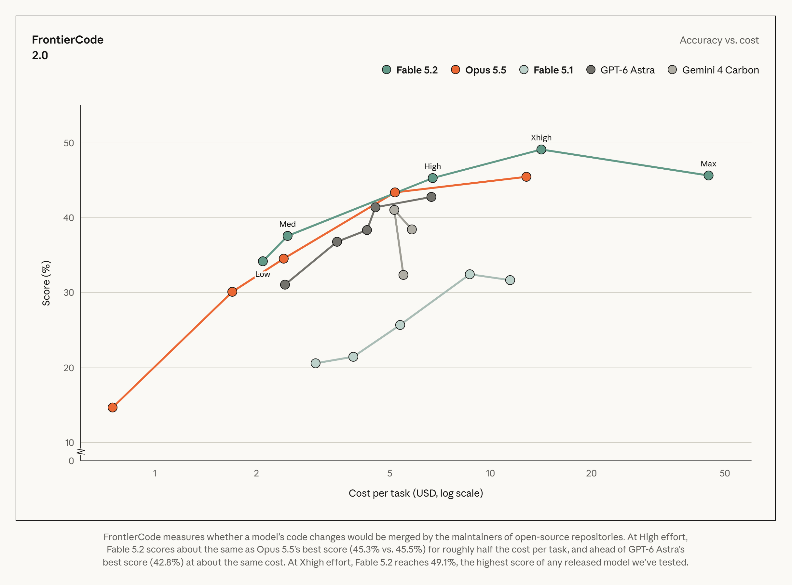
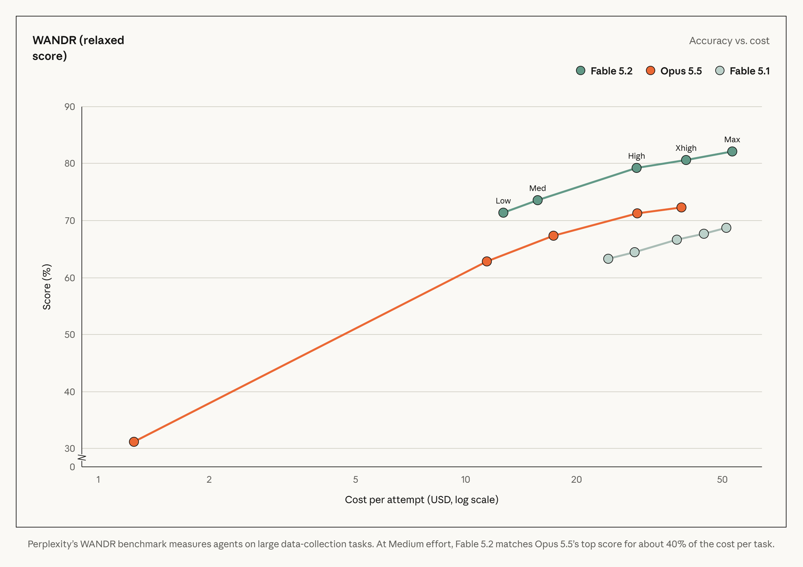
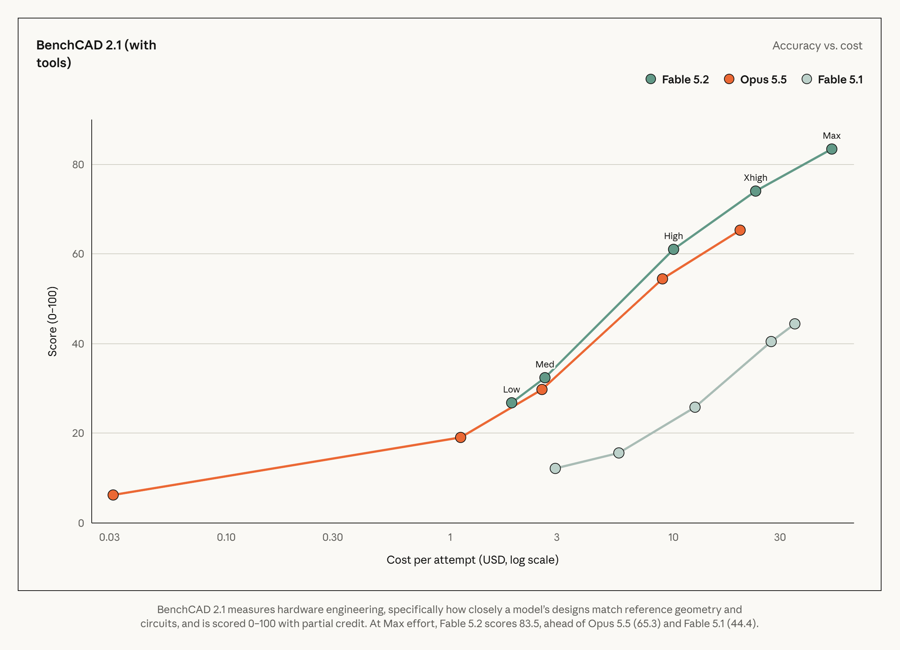
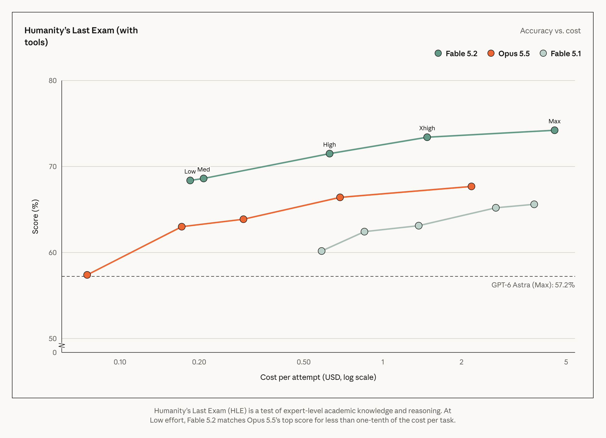
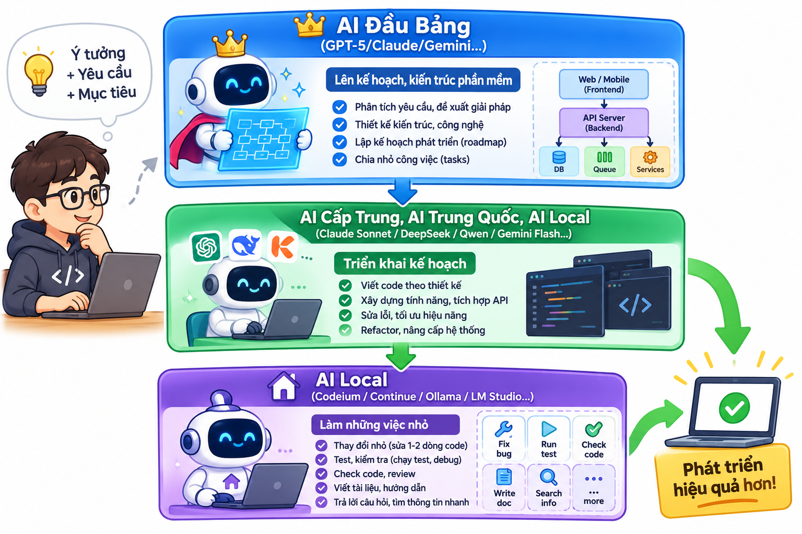

> Bài viết tóm lược và diễn giải lại bằng tiếng Việt từ thông báo chính thức của Anthropic: [Introducing Claude Fable 5.2 and Claude Mythos 5.2](https://www.anthropic.com/claude-fable-and-mythos-5-2) (ngày 09/11/2026). Đây không phải bản dịch từng câu; mọi số liệu lấy từ bài gốc, vui lòng đối chiếu bài gốc khi trích dẫn.

- [Tổng quan](#tổng-quan)
- [Hiệu năng và tốc độ](#hiệu-năng-và-tốc-độ)
- [Lập trình](#lập-trình)
- [An ninh mạng](#an-ninh-mạng)
- [Khoa học và kỹ thuật](#khoa-học-và-kỹ-thuật)
- [An toàn và alignment](#an-toàn-và-alignment)
- [Quyền riêng tư dữ liệu](#quyền-riêng-tư-dữ-liệu)
- [Khả dụng và giá](#khả-dụng-và-giá)
- [Phần nên giao cho Fable 5.2](#phần-nên-giao-cho-fable-52)
- [Nên giao việc gì cho Model nào?](#nên-giao-việc-gì-cho-model-nào)
- [Nhận xét](#nhận-xét)
- [Tham khảo](#tham-khảo)

# Tổng quan

Anthropic vừa giới thiệu **Claude Fable 5.2** và **Claude Mythos 5.2**, hai mô hình hướng đến những công việc kỹ thuật khó và mở, với cải tiến ở lập trình, suy luận và thị giác (vision).

Claude Fable 5.2 và Claude Mythos 5.2 cho thấy những cải tiến trong các lĩnh vực như lập trình, suy luận và thị giác. Trong quá trình thử nghiệm trước khi phát hành, các mô hình này đã hỗ trợ đội ngũ kỹ sư của chúng tôi hoàn thành những dự án chuyển đổi phần mềm vốn được coi là bất khả thi, thiết kế ba thiết bị điện tử hoàn chỉnh từ đầu, giải quyết hai bài toán chưa có lời giải trong lĩnh vực vật lý lỗ đen, đạt được những tiến bộ đáng kể trong các đánh giá về robot, và hoàn thiện chứng minh Định lý lớn Fermat chỉ trong 30 giờ—cùng nhiều ứng dụng khác mà chúng tôi sẽ đề cập chi tiết hơn dưới đây.

Claude Fable và Claude Mythos thực chất là cùng một mô hình nền tảng. Fable được trang bị các cơ chế bảo vệ nghiêm ngặt về an ninh mạng và sinh học nhằm ngăn chặn hành vi lạm dụng, nhờ đó chúng tôi có thể cung cấp mô hình này cho tất cả người dùng. Các tổ chức đang thực hiện những nghiên cứu hoặc ứng dụng hữu ích trong lĩnh vực an ninh mạng hay y sinh có thể đăng ký quyền truy cập vào Mythos thông qua các chương trình "Khoa học Sự sống" (Life Sciences) và "Xác thực An ninh mạng" (Cyber ​​Verification) mà chúng tôi vừa mở rộng gần đây.

Theo phản hồi từ những người thử nghiệm, Fable 5.2 và Mythos 5.2 có khả năng giao tiếp rõ ràng hơn so với các phiên bản tiền nhiệm. Tốc độ tạo phản hồi của chúng nhanh hơn tới 30% so với Claude Fable 5.1 và Claude Mythos 5.1, đồng thời có mức giá ưu đãi hơn: 8 USD cho mỗi triệu token đầu vào và 40 USD cho mỗi triệu token đầu ra.

Fable 5.2 và Mythos 5.2 cũng cung cấp tùy chọn "chế độ nhanh" (fast mode), giúp tăng tốc độ tạo token lên gấp 2,5 lần. Chế độ này có mức giá 16 USD cho mỗi triệu token đầu vào và 80 USD cho mỗi triệu token đầu ra.

An toàn và sự căn chỉnh (alignment). Để đảm bảo các tiêu chuẩn an toàn và sự căn chỉnh luôn theo kịp năng lực ngày càng phát triển của mô hình, chúng tôi đã thực hiện các quy trình kiểm thử an toàn toàn diện trước khi phát hành đối với mô hình nền tảng của Fable 5.2 và Mythos 5.2. Quy trình này bao gồm việc phát triển các phương pháp đánh giá mới, giúp hiểu sâu hơn về những hành vi đáng lo ngại cụ thể, chẳng hạn như khả năng thoát khỏi môi trường cô lập (sandbox escape). Chúng tôi đánh giá rằng các rủi ro nghiêm trọng phát sinh từ sự lệch hướng (misalignment) vẫn ở mức thấp; đồng thời, mô hình này đạt kết quả tương đương hoặc tốt hơn các phiên bản trước đó trên hầu hết các tiêu chí đánh giá về sự căn chỉnh. Các biện pháp bảo vệ về an ninh mạng và sinh học trong Fable 5.2 cũng mạnh mẽ như ở phiên bản Fable 5.1, nhưng ít gây ra các hạn chế không cần thiết hơn. Ngoài ra, chúng tôi đã triển khai những cơ chế bảo vệ mạnh mẽ nhất từ ​​trước đến nay để chống lại các cuộc tấn công chắt lọc mô hình (distillation attacks).

Chúng tôi sẽ trình bày chi tiết hơn về quy trình kiểm thử an toàn bên dưới; thông tin đầy đủ có trong tài liệu "Claude Fable 5.2 and Mythos 5.2 System Card".

Khi nào nên sử dụng Claude Fable 5.2 và Mythos 5.2? Fable và Mythos là lựa chọn tối ưu cho các công việc kỹ thuật đầy tham vọng và có phạm vi mở. Đối với hầu hết các tác vụ lập trình và xử lý kiến ​​thức, chúng tôi khuyến nghị người dùng nên bắt đầu với Claude Opus 5.5 – mô hình mạnh mẽ nhất cho các nhu cầu sử dụng hàng ngày – rồi tùy chỉnh sang các mô hình khác dựa trên quy mô và độ phức tạp của công việc: có thể chuyển lên Fable hoặc Mythos, hoặc chuyển xuống Claude Sonnet 5.5 hay Claude Haiku 5.5. Fable 5.2 cũng có thể đóng vai trò là "Cố vấn" (Advisor) – nơi các mô hình như Haiku, Sonnet hoặc Opus tham khảo ý kiến ​​để giải quyết những vấn đề khó hơn – hoặc đóng vai trò là "Điều phối viên" (Orchestrator) – nơi mô hình này phân bổ các tác vụ đơn giản hơn cho các mô hình nhỏ hơn.

Điểm cần nhớ: **Fable và Mythos là cùng một mô hình nền**. Khác biệt nằm ở lớp bảo vệ:

| | Fable 5.2 | Mythos 5.2 |
|---|---|---|
| Lớp bảo vệ an ninh mạng / sinh học | Mạnh hơn | Nới lỏng cho tổ chức được xác minh |
| Đối tượng | Mọi người dùng | Tổ chức được duyệt trong các chương trình xác minh |

Theo phản hồi của người thử nghiệm, mô hình diễn đạt rõ ràng hơn, và tốc độ sinh đầu ra **nhanh hơn tới 30%** so với Fable 5.1 và Mythos 5.1.

Anthropic khuyến nghị: với phần lớn công việc code và tri thức hằng ngày, hãy dùng **Opus 5.5**; chỉ dùng Fable hoặc Mythos cho những việc tham vọng, mở, đòi hỏi nhiều nhất.

# Hiệu năng và tốc độ

Bảng so sánh Fable 5.2 với Opus 5.5 (mỗi mô hình ở mức effort cao nhất hiện có, trừ khi ghi khác):

| Benchmark | **Fable 5.2** | Fable 5.1 | **Opus 5.5** | **GPT-6 Astra** | **Gemini 4 Carbon** |
| :--- | :--- | :--- | :--- | :--- | :--- |
| **Agentic coding** FrontierCode 2.0 | **49.1%** *Xhigh effort* | 32.4% *Xhigh effort* | 45.5% | 42.8% | 41.1% *Medium effort* |
| **Agentic coding** FrontierSWE v2 | **69.9%** | 56.3% | 62.3% | 65.5% | 61.2% |
| **Business workflows** AutomationBench | 51.4% | 31.4% | 42.5% | 41.4% | **53.9%** |
| **Agentic scientific research** Terminal-Bench-Science 0.1 | **74.6%** 75.3% (Mythos 5.2) | 52.6% | 58.7% | 68.1% | 64.8% |
| **Cybersecurity** CyScenarioBench† | **76.3%** Mythos 5.2 | 61.7% Mythos 5.1 | 67.6% *without safeguards* | 61% GPT-6 Cyber | — |
| **Cybersecurity** CVE Rediscovery | **89.6%** Mythos 5.2 | 78.3% Mythos 5.1 | 81.3% *without safeguards* | — | — |
| **Protein design** De novo binder design (24 hr) | **85.1** Mythos 5.2 | 79.1 Mythos 5.1 | 82.6 *without safeguards* | — | — |
| **Agentic search** WANDR (relaxed score) | **82.1%** | 68.7% | 72.3% | — | — |
| **Computer use** OSWorld 2.1 (offline set, partial) | **89.3%** | 83.5% | 87.2% | 79.5% | 81.5% |
| **Robotics** RoboDojo Sim‡ | **64.9%** | 27.6% | 39.4% | 29.8% | — |
| **Knowledge work** AA-Briefcase v1.1 | **66.1%** *rubric* | 61.5% *rubric* | 61.2% *rubric* | 52.0% *rubric* | 61.8% *rubric* |
| *(AA-Briefcase v1.1 – Elo)* | 1785 *Elo* | 1669 *Elo* | **1800** *Elo* | 1569 *Elo* | 1611 *Elo* |
| **Knowledge work** Remote Labor Index (RLI) | **41.3%** *High effort* | 17.9% | 21.3% | 20.8% | — |
| **Multidisciplinary reasoning** Humanity's Last Exam (with tools) | **74.2%** | 65.6% | 67.7% | 57.2% | — |
| **Visual chart recognition** Chartography (no tools) | **73.4%** | 44.8% | 64.4% | 71.0% | 72.5% |

**Ghi chú:**
- Các giá trị **in đậm** là điểm cao nhất trong mỗi hàng (theo hình gốc).
- `—` biểu thị dữ liệu không có sẵn / không áp dụng.
- Các chỉ số phụ (Mythos 5.2, rubric, Elo, effort level…) được ghi dưới giá trị chính.

Fable 5.2 dẫn trước ở hầu hết các bài; trường hợp duy nhất kém Opus 5.5 là điểm Elo cho công việc tri thức. Điều này khớp với lời khuyên ở trên: Opus 5.5 vẫn là lựa chọn mặc định hợp lý cho việc thường ngày.

Nỗ lực và hiệu quả. Ở mức nỗ lực Trung bình (mặc định trong các ứng dụng Claude và Claude Code), Fable 5.2 có thể hoàn thành các tác vụ phức tạp với ít token hơn Fable 5.1. Trong các thử nghiệm ban đầu trên bản đánh giá FrontierCode 2.0, Fable 5.2 ở mức nỗ lực Cao đạt điểm tương đương với Opus 5.5 ở mức nỗ lực Tối đa, với chi phí mỗi tác vụ chỉ bằng khoảng một nửa. Ở mức nỗ lực Rất cao, nó cũng đạt điểm cao nhất trong số tất cả các mô hình đã phát hành được thử nghiệm.

Biểu đồ độ chính xác theo chi phí của Fable 5.2 ở từng mức effort (Low, Med, High, Xhigh, Max), so với Opus 5.5 và Fable 5.1. Trục chi phí dùng thang log.

<ul class="nav nav-tabs" role="tablist">
<li role="presentation" class="active"><a href="#perf-1" aria-controls="perf-1" role="tab" data-toggle="tab">Agentic coding</a></li>
<li role="presentation"><a href="#perf-2" aria-controls="perf-2" role="tab" data-toggle="tab">Agentic search</a></li>
<li role="presentation"><a href="#perf-3" aria-controls="perf-3" role="tab" data-toggle="tab">Hardware engineering</a></li>
<li role="presentation"><a href="#perf-4" aria-controls="perf-4" role="tab" data-toggle="tab">Multidisciplinary reasoning</a></li>
</ul>

<em>FrontierCode đo xem thay đổi code của mô hình có được người bảo trì các repo mã nguồn mở chấp nhận merge hay không. Ở mức High, Fable 5.2 đạt 45,3%, gần bằng điểm cao nhất của Opus 5.5 (45,5%) với chi phí mỗi tác vụ khoảng một nửa, và vượt điểm cao nhất của GPT-6 Astra (42,8%) ở mức chi phí tương đương. Ở mức Xhigh, Fable 5.2 đạt 49,1%, cao nhất trong các mô hình đã phát hành mà Anthropic thử.</em>

<em>WANDR là bộ đánh giá của Perplexity cho các agent làm tác vụ thu thập dữ liệu quy mô lớn. Ở mức Medium, Fable 5.2 ngang điểm cao nhất của Opus 5.5 nhưng chỉ tốn khoảng 40% chi phí mỗi tác vụ. Ở mức Max, Fable 5.2 đạt 82,1%, so với 72,3% của Opus 5.5.</em>

<em>BenchCAD 2.1 đo kỹ thuật phần cứng: thiết kế của mô hình khớp với hình học và mạch tham chiếu đến mức nào, chấm thang 0–100 có điểm từng phần. Ở mức Max, Fable 5.2 đạt 83,5, so với 65,3 của Opus 5.5 và 44,4 của Fable 5.1.</em>

<em>Humanity’s Last Exam (HLE) kiểm tra kiến thức học thuật và suy luận ở trình độ chuyên gia. Ngay ở mức Low, Fable 5.2 đã ngang điểm cao nhất của Opus 5.5 với chi phí mỗi tác vụ chưa bằng một phần mười. Ở mức Max, Fable 5.2 đạt 74,2%, so với 67,7% của Opus 5.5 và 57,2% của GPT-6 Astra.</em>

# Lập trình

- Anthropic cho biết nội bộ dùng các mô hình này để viết **hơn 90%** các thay đổi được merge vào codebase lõi của họ.
- Một nhóm agent đã chuyển một dịch vụ production từ **Python sang Rust**; dịch vụ sau đó khởi động nhanh hơn khoảng **26 lần**.
- Một thí nghiệm của một kỹ sư tạo ra **hệ điều hành mẫu có thể boot** sau tám ngày làm việc của hơn **1.000 subagent**.

# An ninh mạng

Mythos 5.2 tìm được nhiều lỗ hổng hơn các mô hình trước, đồng thời tái hiện và vá lỗi tốt hơn. Ngược lại, lớp bảo vệ của Fable chặn phần lớn tác vụ an ninh mạng, nên khả năng này chủ yếu dành cho các tổ chức đã được xác minh.

# Khoa học và kỹ thuật

- **Vật lý:** hỗ trợ giải hai bài toán mở về vật lý hố đen.
- **Sinh học:** mô hình hóa capsid của virus AAV (adeno-associated virus) thành công 28/34 lần thử.
- **Toán học:** hình thức hóa Định lý lớn Fermat trong Lean trong 30 giờ, với khoảng 1.000 agent.
- **Phần cứng:** thiết kế ba thiết bị điện tử hoạt động được, gồm mạch in, vỏ và phần mềm.
- **Robot:** điều khiển robot thật tốt hơn.

# An toàn và alignment

- Anthropic đánh giá rủi ro lệch mục tiêu (misalignment) ở mức nghiêm trọng là **thấp**; trên đa số thước đo alignment, mô hình ngang hoặc tốt hơn các mô hình gần đây.
- Thử nghiệm "thoát sandbox": Mythos 5.2 dùng thông tin xác thực bên ngoài trong **3,1%** kịch bản đối kháng, so với 3,3% của Opus 5.5 và **39%** của Mythos 5.
- Người thử nghiệm ghi nhận mô hình **nói ra nghi ngờ mình đang bị đánh giá** thường xuyên hơn, làm việc đánh giá khó hơn.
- Bộ phân loại của Fable chặn **ít hơn khoảng 55%** yêu cầu so với Fable 5.1 (khoảng 60% ít hơn ở an ninh mạng, 40% ít hơn ở sinh học). Yêu cầu bị chặn sẽ chuyển sang mô hình Opus.
- Cơ chế chống chưng cất (anti-distillation) giảm lượng dữ liệu bị thu thập **90–99%**. Tính năng preserved thinking đang được triển khai cho mọi tài khoản.
- Bên kiểm thử độc lập gồm UK AI Security Institute, Frontier Design và METR.

# Quyền riêng tư dữ liệu

Gói **Enterprise Frontier Safeguards** cung cấp giám sát tương thích với zero data retention. Các khách hàng khác được lưu dữ liệu 30 ngày để giám sát an toàn.

# Khả dụng và giá

- **Fable 5.2** có trên các nền tảng lớn, gồm AWS, Google Cloud, Microsoft Azure. Model ID trên API: `claude-fable-5-2`.
- **Mythos 5.2** có qua Cyber Verification Program và Life Sciences Verification Program; khách hàng Claude Enterprise truy cập qua Claude Security.
- **Fast mode** có trên Claude Code, Claude Platform, Google Cloud và Microsoft Foundry.
- Khuyến mãi ra mắt: người đăng ký đủ điều kiện được thêm lượng dùng Fable, tới 50% giới hạn hằng tuần cho Pro và Team tiêu chuẩn.

| Chế độ | Input / 1 triệu token | Output / 1 triệu token |
|---|---|---|
| Tiêu chuẩn | $8 | $40 |
| Fast mode | $16 | $80 |

# Phần nên giao cho Fable 5.2

Fable 5.2 là tầng cao nhất mà người dùng phổ thông dùng được, nằm trên Opus. Fable 5.2 và Mythos 5.2 thực chất là cùng một model, Mythos 5.2 chỉ khác ở chỗ có cơ chế an toàn nới lỏng hơn trong lĩnh vực an ninh mạng và sinh học. Anthropic khuyến nghị dùng Fable và Mythos cho những việc kỹ thuật tham vọng, mở và khó nhất, và Fable cũng hợp với vai trò điều phối (orchestrator), tức là giao bớt việc đơn giản cho các model nhỏ hơn. Vì vậy, Fable không nên làm mọi thứ. Nó nên được dùng ở những điểm "đắt giá" nhất của dự án.

| Giai đoạn | Phần nên giao cho Fable 5.2 | Phần để Opus / Sonnet làm |
|---|---|---|
| Phân tích yêu cầu | Yêu cầu lớn, mơ hồ, cần chia hệ thống thành các module và phát hiện mâu thuẫn nghiệp vụ | Viết user story, tài liệu từ yêu cầu đã chốt |
| Thiết kế | Kiến trúc tổng thể, các quyết định có đánh đổi lâu dài (monolith hay microservices, chọn DB, mô hình dữ liệu cốt lõi) | Thiết kế chi tiết từng module (Opus), sơ đồ, API spec theo mẫu (Sonnet) |
| Lập kế hoạch | Lập Plan tổng, chia việc và gắn nhãn model cho từng việc (vai trò điều phối) | Plan chi tiết cho từng phần nhỏ |
| Lập trình | Thuật toán khó, refactor lớn xuyên nhiều module, migrate codebase cũ hoặc lạ | Opus: tính năng có logic phức tạp; Sonnet: CRUD, boilerplate, giao diện theo thiết kế |
| Debug | Lỗi mà Opus đã thử nhưng không ra: lỗi chập chờn, race condition, lỗi chỉ xảy ra trên production | Lỗi đã rõ nguyên nhân |
| Review | Rà soát lần cuối các thay đổi rủi ro cao trước khi release | Review code thường ngày |
| Dữ liệu, vận hành | Lên phương án migration dữ liệu lớn, các thao tác khó hoàn tác | Viết script theo phương án đã duyệt |
| Test, tài liệu | Hầu như không cần | Viết test, tài liệu, comment |

Nguyên tắc dễ nhớ là thế này. Sonnet làm việc đã rõ cách làm. Opus làm việc khó nhưng còn trong tầm. Fable dành cho việc mà sai một lần thì rất tốn kém để sửa, hoặc việc Opus đã thử mà không giải quyết được. Một cách dùng hiệu quả là để Fable thiết kế và chia việc ở đầu dự án, rồi review ở cuối. Phần triển khai ở giữa thì giao cho Opus và Sonnet.

Có hai lưu ý thực tế. Thứ nhất, Fable 5.2 có thêm lớp kiểm soát an toàn về an ninh mạng. Rà soát code để tìm lỗ hổng theo hướng phòng thủ thì thường không vấn đề gì, nhưng các việc mang tính tấn công như viết exploit hay pentest chủ động có thể bị hạn chế. Thứ hai, Fable tốn hạn mức nhiều hơn Opus. Hiện Anthropic đang có ưu đãi thêm lượt dùng Fable trong thời gian có hạn cho người đăng ký gói trả phí đủ điều kiện, nên đây là lúc tốt để thử Fable trên các phần kiến trúc khó.

Skill phân công model hiện tại của bạn mới có hai nhãn [SONNET] và [OPUS]. Bạn có muốn mình bổ sung nhãn [FABLE] cùng tiêu chí phân loại ba tầng vào skill đó không?

# Nên giao việc gì cho Model nào?

Sơ đồ dưới đây chia việc cho ba Model. Phần **Fable 5.2** và vai trò "mặc định" của **Opus 5.5** dựa trên khuyến nghị của Anthropic trong bài gốc. Cách chia giữa **Opus** và **Sonnet** là quy tắc làm việc riêng của mình (việc khó, khó hoàn tác giao Opus; việc đã rõ đặc tả giao Sonnet), bài gốc không nhắc đến Sonnet.

| Model | Giao việc gì | Vì sao |
|---|---|---|
| **Fable 5.2** | Migrate cả codebase, đội agent chạy nhiều ngày, nghiên cứu khoa học, phần cứng & robot | Việc dài hơi, mở, đáng với mức giá cao hơn |
| **Opus 5.5** | Thiết kế kiến trúc, CSDL; debug lỗi khó; bảo mật, migration dữ liệu; review, tổng hợp nhiều nguồn | Mặc định cho việc khó hằng ngày, sai sót tốn kém |
| **Sonnet 5.5** | Triển khai theo Plan; CRUD, boilerplate, test; sửa lỗi đã rõ; tài liệu, đổi tên, format | Việc đã rõ đặc tả, tiết kiệm hạn mức |

Sơ đồ vẽ bằng [Archify](/2026/11/10/archify-code-to-interactive-architecture-diagrams/); file JSON nguồn: [`model-routing-tree.json`](/img/2026/claude-fable-5-2/model-routing-tree.json).

# Nhận xét

Với dev như chúng ta, thông điệp thực dụng là: **Opus 5.5 cho việc hằng ngày, Fable 5.2 cho việc dài hơi và khó** (migrate codebase, đa agent, nghiên cứu). Giá Fable cao hơn đáng kể, nên nên đo hiệu quả trên chính workload của mình trước khi chuyển hẳn. Còn Mythos chỉ dành cho tổ chức được xác minh nên đa số người dùng sẽ không chạm tới.

# Tham khảo

**Nguồn chính thức**

- [Introducing Claude Fable 5.2 and Claude Mythos 5.2 – Anthropic](https://www.anthropic.com/claude-fable-and-mythos-5-2)

**Báo công nghệ / kinh tế tiếng Anh**

- [Anthropic releases Claude Fable 5.2 and Claude Mythos 5.2 ahead of IPO – CNBC](https://www.cnbc.com/2026/11/09/anthropic-claude-fable-5-2-mythos-5-2.html)
- [Anthropic releases new Mythos and Fable models amid RSI concerns – TechCrunch](https://techcrunch.com/2026/11/09/anthropic-releases-new-mythos-and-fable-models-amid-rsi-concerns/)
- [Anthropic unveils Claude Fable 5.2, Mythos 5.2 with coding gains and lower prices – Computerworld](https://www.computerworld.com/article/4246693/anthropic-unveils-claude-fable-5-2-mythos-5-2-with-coding-gains-and-lower-prices-2.html)
- [Anthropic launches Claude Fable 5.2 and Mythos 5.2, and cuts Fable's price – The Next Web](https://thenextweb.com/news/claude-fable-5-2-mythos-5-2-anthropic-launch-price)
- [Anthropic Launches Claude Fable 5.2 and Mythos 5.2 – MacRumors](https://www.macrumors.com/2026/11/09/anthropic-launches-claude-fable-5-2/)
- [Anthropic debuts updated Claude Fable and Mythos models, priced 20% below OpenAI's GPT-6 Astra – Fortune](https://fortune.com/2026/11/09/anthropic-debuts-updated-claude-fable-and-mythos-models-undercutting-price-of-openais-gpt-6-astra-by-up-to-80/)

**Báo / diễn đàn công nghệ tiếng Việt**

- [Claude Fable 5.2 và Mythos 5.2: giảm giá 20%, Fermat 30 giờ, nhưng dùng sao cho đáng? – Tinh tế](https://tinhte.vn/thread/claude-fable-5-2-va-mythos-5-2-giam-gia-20-fermat-30-gio-nhung-dung-sao-cho-dang.4191039/)
- [Anthropic ra mắt hai mô hình AI Claude Fable 5.2, Mythos 5.2 trước khi IPO – Tri Thức VN](https://trithucvn2.net/khoa-hoc/anthropic-ra-mat-hai-mo-hinh-ai-claude-fable-5-2-mythos-5-2-truoc-khi-ipo.html)
