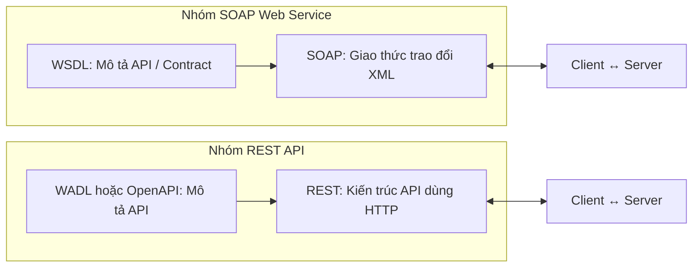

- [Mở đầu](#mở-đầu)
- [1. REST API là gì?](#1-rest-api-là-gì)
- [2. SOAP là gì?](#2-soap-là-gì)
- [3. WSDL là gì?](#3-wsdl-là-gì)
- [4. WADL là gì?](#4-wadl-là-gì)
- [5. So sánh REST, SOAP, WSDL và WADL](#5-so-sánh-rest-soap-wsdl-và-wadl)
- [6. Mối quan hệ giữa các công nghệ](#6-mối-quan-hệ-giữa-các-công-nghệ)
- [7. Nên dùng công nghệ nào hiện nay?](#7-nên-dùng-công-nghệ-nào-hiện-nay)

# Mở đầu

REST, SOAP, WSDL và WADL đều liên quan đến việc xây dựng, giao tiếp và mô tả Web Service/API. Tuy nhiên, chúng không cùng một loại công nghệ.

Điểm quan trọng cần phân biệt:

- **REST:** kiến trúc thiết kế API.
- **SOAP:** giao thức trao đổi dữ liệu.
- **WSDL:** ngôn ngữ mô tả Web Service, thường dùng với SOAP.
- **WADL:** ngôn ngữ mô tả Web API theo phong cách REST.

Bài này là phần 5 của series [API & Tích hợp]({{ site.baseurl }}/series/#api-tich-hop). Nếu muốn xem bức tranh toàn cảnh hơn, bạn có thể đọc [API và những kiến trúc API phổ biến]() và [Các thuật ngữ thường gặp khi thiết kế và tích hợp hệ thống API]().

# 1. REST API là gì?

Phổ biến hiện nay.

**REST (Representational State Transfer)** là một kiểu kiến trúc thiết kế API dựa trên giao thức HTTP. REST dùng các HTTP Method để thao tác trên tài nguyên.

Ví dụ API quản lý sản phẩm:

| HTTP Method | Endpoint            | Ý nghĩa                   |
| ----------- | ------------------- | ------------------------- |
| GET         | `/api/products`     | Lấy danh sách sản phẩm    |
| GET         | `/api/products/100` | Lấy sản phẩm ID 100       |
| POST        | `/api/products`     | Tạo sản phẩm              |
| PUT         | `/api/products/100` | Cập nhật toàn bộ sản phẩm |
| PATCH       | `/api/products/100` | Cập nhật một phần         |
| DELETE      | `/api/products/100` | Xóa sản phẩm              |

Ví dụ request:

```http
GET /api/products/100 HTTP/1.1
Host: example.com
Accept: application/json
```

Response:

```json
{
  "id": 100,
  "name": "Robot PUDU T300",
  "status": "Active"
}
```

**Đặc điểm:**

- Thường sử dụng JSON.
- Dễ tích hợp với React, Angular, Vue, Android, C#...
- Stateless: mỗi request cần chứa đủ thông tin để server xử lý.
- Dễ mở rộng và triển khai trên hệ thống phân tán.

# 2. SOAP là gì?

Giao thức Web Service.

**SOAP (Simple Object Access Protocol)** là giao thức trao đổi dữ liệu giữa các hệ thống thông qua cấu trúc XML. SOAP thường được dùng trong hệ thống doanh nghiệp, ngân hàng, ERP và các hệ thống tích hợp lâu năm.

Ví dụ request SOAP:

```xml
<?xml version="1.0" encoding="UTF-8"?>
<soap:Envelope xmlns:soap="http://schemas.xmlsoap.org/soap/envelope/">
  <soap:Body>
    <GetProduct>
      <ProductId>100</ProductId>
    </GetProduct>
  </soap:Body>
</soap:Envelope>
```

Response:

```xml
<soap:Envelope xmlns:soap="http://schemas.xmlsoap.org/soap/envelope/">
  <soap:Body>
    <GetProductResponse>
      <Id>100</Id>
      <Name>Robot PUDU T300</Name>
      <Status>Active</Status>
    </GetProductResponse>
  </soap:Body>
</soap:Envelope>
```

**Đặc điểm:**

- Sử dụng XML để trao đổi dữ liệu.
- Có quy định cấu trúc message rất chặt chẽ.
- Hỗ trợ các tiêu chuẩn bảo mật như WS-Security.
- Có thể dùng HTTP và một số giao thức truyền tải khác.
- Thường đi kèm WSDL để mô tả dịch vụ.

# 3. WSDL là gì?

**WSDL (Web Services Description Language)** là ngôn ngữ XML dùng để mô tả một Web Service. Có thể hình dung WSDL như một bản hợp đồng kỹ thuật (contract), giúp client biết cách gọi một SOAP Service.

WSDL mô tả:

- Service cung cấp những chức năng nào.
- Tên các operation/method.
- Request cần truyền những tham số nào.
- Response trả về cấu trúc dữ liệu gì.
- Endpoint của Web Service.
- Protocol và định dạng message.

Ví dụ:

```xml
<definitions>
  <message name="GetProductRequest">
    <part name="ProductId" type="xsd:int"/>
  </message>
  <message name="GetProductResponse">
    <part name="ProductName" type="xsd:string"/>
  </message>
  <portType name="ProductService">
    <operation name="GetProduct">
      <input message="GetProductRequest"/>
      <output message="GetProductResponse"/>
    </operation>
  </portType>
</definitions>
```

WSDL thường được cung cấp qua URL:

```text
https://example.com/ProductService.svc?wsdl
```

Từ WSDL, bạn có thể sinh proxy client tự động thay vì tự viết XML request/response. Ví dụ với C#:

```bash
dotnet tool install --global dotnet-svcutil
dotnet-svcutil https://example.com/ProductService.svc?wsdl
```

Công cụ sẽ tạo các class cần thiết để ứng dụng C# gọi SOAP Service.

# 4. WADL là gì?

**WADL (Web Application Description Language)** là ngôn ngữ XML dùng để mô tả Web API theo kiến trúc REST. WADL có vai trò tương tự WSDL nhưng hướng đến REST API.

Ví dụ WADL:

```xml
<application xmlns="http://wadl.dev.java.net/2009/02">
  <resources base="https://example.com/api">
    <resource path="/products">
      <method name="GET">
        <response>
          <representation mediaType="application/json"/>
        </response>
      </method>
    </resource>
  </resources>
</application>
```

WADL có thể mô tả:

- Các endpoint.
- HTTP Method.
- Request parameters.
- Response representation.
- Cấu trúc tài nguyên REST.

Hiện nay WADL ít phổ biến hơn các giải pháp như OpenAPI/Swagger.

# 5. So sánh REST, SOAP, WSDL và WADL

| Tiêu chí             | REST                       | SOAP                          | WSDL                            | WADL               |
| -------------------- | -------------------------- | ----------------------------- | ------------------------------- | ------------------ |
| Bản chất             | Kiến trúc                  | Giao thức                     | Ngôn ngữ mô tả                  | Ngôn ngữ mô tả     |
| Định dạng            | Thường JSON                | XML                           | XML                             | XML                |
| Sử dụng HTTP         | Có, phổ biến               | Có thể                        | Không phải giao thức truyền tải | Mô tả API HTTP     |
| Mô tả API            | OpenAPI                    | WSDL                          | Chính nó                        | Chính nó           |
| Độ phổ biến hiện nay | Rất cao                    | Cao trong hệ thống enterprise | Phổ biến với SOAP               | Thấp               |
| Ứng dụng             | Web, Mobile, Microservices | ERP, Banking, Enterprise      | SOAP Integration                | REST Documentation |

# 6. Mối quan hệ giữa các công nghệ



Lưu ý: WSDL không phải thành phần bắt buộc của SOAP, và WADL cũng không phải thành phần bắt buộc của REST.

# 7. Nên dùng công nghệ nào hiện nay?

Nếu xây dựng hệ thống mới bằng ASP.NET Core, React, Angular, Node.js hoặc Android, mình đề xuất:

| Nhu cầu                   | Công nghệ                  |
| ------------------------- | -------------------------- |
| Xây dựng API mới          | REST API                   |
| Định dạng dữ liệu         | JSON                       |
| Mô tả API                 | OpenAPI                    |
| Giao diện tài liệu API    | Swagger UI                 |
| Kiểm thử API              | Postman / Bruno            |
| Tích hợp hệ thống SOAP cũ | SOAP + WSDL                |
| Microservices             | REST hoặc gRPC tùy nhu cầu |

**OpenAPI / Swagger** là cách mô tả REST API phổ biến hiện nay, thay thế vai trò mà WADL từng hướng đến. ASP.NET Core thường cung cấp tài liệu API tại:

```text
https://localhost:7001/openapi/v1.json
```

Hoặc bạn có thể dùng Swagger UI để xem và thử nghiệm API.

**Kết luận:** nếu đang xây dựng hệ thống WCS/WMS, quản lý robot, tích hợp PLC, Android Scanner và các ứng dụng React/C# thì nên ưu tiên REST + JSON + OpenAPI. Tuy nhiên, vẫn nên biết SOAP/WSDL để tích hợp với các hệ thống ERP, MES hoặc thiết bị công nghiệp cũ.
