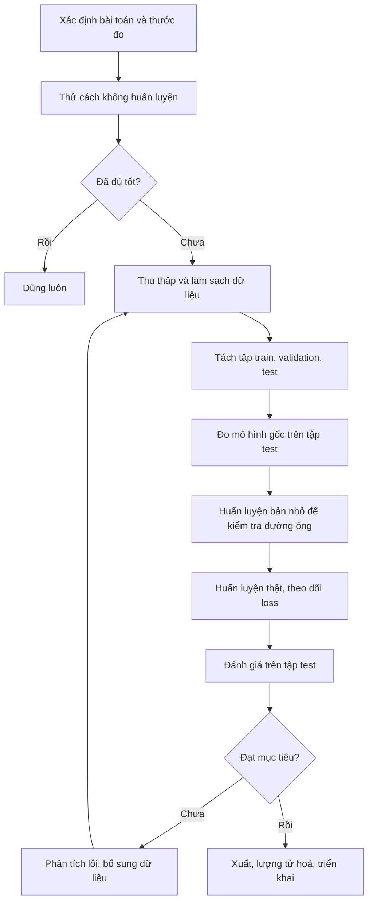

> Series 6 bài về việc tự huấn luyện các mô hình AI kích thước nhỏ trên máy cá nhân hoặc GPU miễn phí. Bài này là nền chung: khái niệm, phần cứng, môi trường, các kỹ thuật giảm VRAM và bảng tóm tắt 5 lĩnh vực. Năm bài sau đi vào từng lĩnh vực, mỗi bài có đủ hai đường: **fine-tune** từ mô hình mở có sẵn và **huấn luyện từ đầu**. Ví dụ ưu tiên tiếng Việt. Tên mô hình và phiên bản được tra cứu vào tháng 11/2026, lĩnh vực này đổi rất nhanh nên hãy kiểm tra lại trước khi dùng. Các đoạn code là khung cốt lõi, chưa được chạy kiểm chứng trên GPU thật, bạn sẽ cần chỉnh theo dữ liệu và phiên bản thư viện của mình.

- [Các bài trong series](#các-bài-trong-series)
- [Mô hình nhỏ là gì và vì sao tự huấn luyện](#mô-hình-nhỏ-là-gì-và-vì-sao-tự-huấn-luyện)
- [Sáu cách có được một mô hình theo ý mình](#sáu-cách-có-được-một-mô-hình-theo-ý-mình)
- [Fine-tune hay huấn luyện từ đầu](#fine-tune-hay-huấn-luyện-từ-đầu)
- [Phần cứng và các mốc VRAM](#phần-cứng-và-các-mốc-vram)
- [VRAM bị tiêu vào đâu và cách giảm](#vram-bị-tiêu-vào-đâu-và-cách-giảm)
- [Môi trường phần mềm chung](#môi-trường-phần-mềm-chung)
- [Quy trình chung cho mọi lĩnh vực](#quy-trình-chung-cho-mọi-lĩnh-vực)
- [Bảng tóm tắt năm lĩnh vực](#bảng-tóm-tắt-năm-lĩnh-vực)
- [Dữ liệu, giấy phép và đạo đức](#dữ-liệu-giấy-phép-và-đạo-đức)
- [Lộ trình đọc gợi ý](#lộ-trình-đọc-gợi-ý)
- [Nguồn tham khảo](#nguồn-tham-khảo)

## Các bài trong series

| Bài | Lĩnh vực | Liên kết |
|---|---|---|
| 1 | Tổng quan, phần cứng, kỹ thuật tiết kiệm VRAM | Bài này |
| 2 | Text-to-Speech, Voice Clone, ASR | [Bài 2](/2026/11/15/tu-huan-luyen-ai-nho-2-tts-voice-clone-asr/) |
| 3 | Nhận diện ký tự quang học (OCR) | [Bài 3](/2026/11/15/tu-huan-luyen-ai-nho-3-ocr/) |
| 4 | Mô hình ngôn ngữ nhỏ (SLM) | [Bài 4](/2026/11/15/tu-huan-luyen-ai-nho-4-mo-hinh-ngon-ngu-nho-slm/) |
| 5 | Tạo sinh hình ảnh | [Bài 5](/2026/11/15/tu-huan-luyen-ai-nho-5-tao-sinh-hinh-anh/) |
| 6 | Dữ liệu dạng bảng và chuỗi thời gian | [Bài 6](/2026/11/15/tu-huan-luyen-ai-nho-6-du-lieu-bang-va-chuoi-thoi-gian/) |

## Mô hình nhỏ là gì và vì sao tự huấn luyện

Trong series này, "mô hình nhỏ" là mô hình huấn luyện được trên **một GPU phổ thông từ 8 đến 16 GB VRAM** và chạy được trên máy cá nhân sau khi huấn luyện. Về số tham số, đó là khoảng vài triệu (OCR, dữ liệu bảng) đến vài tỷ (mô hình ngôn ngữ 1B đến 4B, mô hình ảnh 2B đến 6B).

Lý do tự huấn luyện thay vì gọi API của mô hình lớn:

- **Dữ liệu ở lại máy mình.** Hồ sơ khách hàng, hoá đơn, giọng nói nội bộ không phải gửi ra ngoài.
- **Chi phí cố định.** Chạy một triệu lượt OCR hoá đơn bằng mô hình 10 triệu tham số gần như miễn phí sau khi huấn luyện.
- **Chuyên một việc thì nhỏ vẫn giỏi.** Mô hình nhỏ được tinh chỉnh cho đúng một việc hẹp thường ngang hoặc hơn mô hình lớn dùng chung ở việc đó, và nhanh hơn nhiều.
- **Chạy ngoại tuyến**, trên máy trạm trong nhà xưởng, trên điện thoại.
- **Hiểu bản chất.** Huấn luyện từ đầu một mô hình bé là cách học nhanh nhất về cách các mô hình lớn hoạt động.

Khi **không** nên tự huấn luyện: bài toán cần kiến thức rộng và suy luận nhiều bước, dữ liệu của bạn dưới vài chục mẫu, hoặc một câu lệnh (prompt) tốt kèm tra cứu tài liệu (RAG) đã đủ dùng. Luôn thử cách không huấn luyện trước.

## Sáu cách có được một mô hình theo ý mình

Xếp theo độ khó tăng dần. Mỗi bài trong series đều có một bảng tương tự cho riêng lĩnh vực đó.

| # | Cách làm | Ý tưởng | Dữ liệu cần | VRAM điển hình |
|---|---|---|---|---|
| 1 | Dùng thẳng (zero-shot, in-context) | Tải mô hình mở về chạy, đưa ví dụ vào prompt hoặc ngữ cảnh | Không hoặc vài mẫu | 0 đến 8 GB |
| 2 | LoRA hoặc QLoRA | Đóng băng mô hình gốc, chỉ học thêm các ma trận nhỏ gắn vào | Vài chục đến vài nghìn mẫu | 4 đến 16 GB |
| 3 | Fine-tune một phần | Chỉ mở khoá vài lớp cuối hoặc một mô-đun (ví dụ bộ nhận dạng của OCR) | Vài nghìn mẫu | 4 đến 12 GB |
| 4 | Fine-tune toàn bộ | Cập nhật mọi tham số từ điểm xuất phát đã huấn luyện sẵn | Vài nghìn đến vài trăm nghìn mẫu | 8 đến 24 GB với mô hình nhỏ |
| 5 | Chưng cất (distillation) | Dùng mô hình lớn sinh nhãn hoặc dữ liệu, rồi dạy mô hình nhỏ | Dữ liệu chưa gán nhãn, càng nhiều càng tốt | Như cách 2 đến 4 |
| 6 | Huấn luyện từ đầu | Khởi tạo ngẫu nhiên, tự chọn kiến trúc và bộ từ vựng | Rất nhiều, trừ khi mô hình rất bé | 4 đến 16 GB với mô hình vài chục triệu tham số |

Vài thuật ngữ sẽ gặp lại trong cả series:

- **LoRA (Low-Rank Adaptation):** thay vì sửa ma trận trọng số lớn, học hai ma trận nhỏ có tích xấp xỉ phần thay đổi. Số tham số cần học thường dưới 1% mô hình. Kết quả là một tệp adapter vài chục MB.
- **QLoRA:** LoRA trên mô hình gốc đã lượng tử hoá 4-bit. VRAM giảm còn khoảng một phần ba, đổi lại một ít độ chính xác. Một số họ mô hình mới không hợp với 4-bit khi huấn luyện, khi đó tài liệu của mô hình sẽ khuyên dùng LoRA 16-bit.
- **Rank (r) và alpha:** r là kích thước ma trận LoRA (8 đến 64 là phổ biến). r lớn học được nhiều hơn nhưng dễ học vẹt. alpha là hệ số khuếch đại, thường đặt bằng r hoặc gấp đôi r.
- **Epoch, step, batch:** một step là một lần cập nhật trọng số trên một batch. Một epoch là một lượt đi hết tập dữ liệu.
- **Lượng tử hoá (quantization):** lưu trọng số bằng ít bit hơn (8-bit, 4-bit) để mô hình nhẹ hơn khi chạy. Định dạng phổ biến: GGUF (llama.cpp, Ollama), ONNX, CTranslate2.

## Fine-tune hay huấn luyện từ đầu

| Tiêu chí | Fine-tune | Huấn luyện từ đầu |
|---|---|---|
| Độ chính xác với cùng lượng dữ liệu | Cao hơn rõ rệt | Thấp hơn, trừ khi bài toán hẹp và dữ liệu rất nhiều |
| Dữ liệu cần | Ít | Nhiều gấp 10 đến 1000 lần |
| Thời gian | Vài chục phút đến vài giờ | Vài giờ đến vài tuần |
| Quyền kiểm soát | Bị ràng buộc bởi kiến trúc, bộ từ vựng và giấy phép của mô hình gốc | Toàn quyền, giấy phép là của bạn |
| Kích thước mô hình | Bằng mô hình gốc | Tuỳ chọn, có thể rất bé |
| Khi nào hợp | Hầu hết trường hợp thực tế | Học bản chất, thiết bị rất yếu, miền dữ liệu lạ (ký tự riêng, tín hiệu riêng), cần giấy phép sạch |

Ngoại lệ đáng nhớ: với **dữ liệu dạng bảng**, huấn luyện từ đầu (cây tăng cường gradient) vẫn là cách mặc định và thường thắng. Xem [bài 6](/2026/11/15/tu-huan-luyen-ai-nho-6-du-lieu-bang-va-chuoi-thoi-gian/).

## Phần cứng và các mốc VRAM

VRAM là giới hạn cứng: thiếu là báo lỗi hết bộ nhớ, không chạy chậm lại như RAM. Tốc độ GPU chỉ quyết định bạn chờ bao lâu.

| Mốc | Ví dụ | Làm được gì trong series này |
|---|---|---|
| CPU, không GPU | Laptop văn phòng | Dữ liệu bảng, dự báo chuỗi thời gian zero-shot, chạy suy luận các mô hình đã lượng tử hoá |
| 4 đến 6 GB | GTX 1660, RTX 3050 laptop | OCR dòng chữ, TTS kiểu VITS, mô hình ngôn ngữ dưới 1B, LoRA SDXL ở chế độ 4-bit |
| 8 GB | RTX 3060 Ti, 4060 | Mốc "bài toán dễ" của series: LoRA mô hình ngôn ngữ 2B, Whisper cỡ nhỏ đến vừa, OCR, huấn luyện từ đầu các mô hình vài chục triệu tham số |
| 12 đến 16 GB | RTX 3060 12GB, 4060 Ti 16GB, Colab T4 | Mốc "bài toán khó" của series: LoRA mô hình ngôn ngữ 4B, Whisper large-v3-turbo, F5-TTS, FLUX.2 klein 4B |
| 24 GB | RTX 3090, 4090 | LoRA mô hình 9B đến 12B, mô hình ảnh 9B, fine-tune toàn bộ các mô hình 1B đến 2B |

GPU miễn phí hoặc rẻ:

- **Google Colab bản miễn phí:** thường cấp T4 16 GB, phiên giới hạn thời gian và có thể bị ngắt. Lưu checkpoint ra Google Drive.
- **Kaggle Notebooks:** có hạn mức GPU hằng tuần, chạy nền được.
- **Thuê theo giờ** (RunPod, Vast.ai, Lambda và tương tự): hợp khi cần 24 GB trở lên trong vài giờ.

Các thành phần khác: RAM hệ thống nên từ 16 GB (32 GB nếu huấn luyện mô hình ảnh), SSD trống vài chục GB cho mô hình và bộ đệm, CPU 6 nhân trở lên để tiền xử lý dữ liệu không thành nút cổ chai.

## VRAM bị tiêu vào đâu và cách giảm

Khi huấn luyện, VRAM gồm bốn khoản: trọng số mô hình, giá trị kích hoạt được giữ lại để tính gradient (tỷ lệ với batch và độ dài chuỗi hoặc độ phân giải), gradient, và trạng thái của bộ tối ưu.

| Kỹ thuật | Giảm khoản nào | Cái giá |
|---|---|---|
| LoRA thay cho fine-tune toàn bộ | Gradient và trạng thái bộ tối ưu | Khả năng học bị giới hạn bởi rank |
| Nạp mô hình 4-bit (QLoRA) | Trọng số | Giảm nhẹ độ chính xác, một số mô hình không hợp |
| Mixed precision (fp16, bf16) | Kích hoạt và trọng số | Gần như không, đôi khi tràn số với fp16 |
| Gradient checkpointing | Kích hoạt | Chậm hơn khoảng 20 đến 30% |
| Batch nhỏ kèm gradient accumulation | Kích hoạt | Chậm hơn, kết quả gần tương đương batch lớn |
| Rút ngắn chuỗi hoặc giảm độ phân giải | Kích hoạt | Mất ngữ cảnh dài hoặc chi tiết ảnh |
| Bộ tối ưu 8-bit (AdamW 8-bit) | Trạng thái bộ tối ưu | Gần như không |
| Đệm sẵn latent và đầu ra của bộ mã hoá văn bản (mô hình ảnh) | Không phải nạp VAE và bộ mã hoá văn bản khi huấn luyện | Tốn đĩa, không dùng được tăng cường dữ liệu ngẫu nhiên trên ảnh |
| Đóng băng một phần mô hình | Gradient | Học được ít hơn |

Thứ tự thử khi gặp lỗi hết bộ nhớ: giảm batch xuống 1 và tăng gradient accumulation, bật gradient checkpointing, rút ngắn chuỗi hoặc giảm độ phân giải, chuyển sang 4-bit, cuối cùng mới đổi sang mô hình nhỏ hơn.

## Môi trường phần mềm chung

| Lớp | Lựa chọn dùng trong series |
|---|---|
| Hệ điều hành | Linux, hoặc Windows kèm WSL2 (Ubuntu). Nhiều công cụ huấn luyện chỉ được kiểm thử trên Linux |
| Driver | Driver NVIDIA mới, CUDA đi kèm bản PyTorch |
| Python | 3.10 đến 3.12, mỗi dự án một môi trường ảo riêng (uv hoặc conda) |
| Khung học sâu | PyTorch. Riêng PaddleOCR dùng PaddlePaddle |
| Hệ sinh thái Hugging Face | transformers, datasets, peft, trl, accelerate, diffusers, bitsandbytes |
| Công cụ chuyên cho từng lĩnh vực | Unsloth (mô hình ngôn ngữ và thị giác), AI-Toolkit và sd-scripts (mô hình ảnh), F5-TTS, Piper, NeMo (giọng nói), AutoGluon (bảng và chuỗi thời gian) |
| Theo dõi thí nghiệm | TensorBoard, Weights & Biases hoặc MLflow |
| Gán nhãn | Label Studio, PPOCRLabel, Audacity |
| Triển khai | Ollama và llama.cpp (GGUF), ONNX Runtime, faster-whisper (CTranslate2), ComfyUI |

Cài đặt khung chung trên Windows qua WSL2:

```bash
# Trong PowerShell (quyền Administrator), một lần duy nhất
wsl --install -d Ubuntu

# Trong Ubuntu
curl -LsSf https://astral.sh/uv/install.sh | sh
mkdir ~/ai-train && cd ~/ai-train
uv venv --python 3.11 && source .venv/bin/activate
uv pip install torch torchvision torchaudio
python -c "import torch; print(torch.cuda.is_available(), torch.cuda.get_device_name(0))"
nvidia-smi   # theo dõi VRAM trong lúc huấn luyện: watch -n 1 nvidia-smi
```

Mỗi lĩnh vực nên có môi trường ảo riêng vì các công cụ thường ghim phiên bản thư viện khác nhau.

## Quy trình chung cho mọi lĩnh vực



Những điểm hay bị bỏ qua:

1. **Viết ra thước đo trước khi huấn luyện.** Tỷ lệ lỗi từ (WER) cho ASR, tỷ lệ lỗi ký tự (CER) cho OCR, độ chính xác trên bộ câu hỏi riêng cho mô hình ngôn ngữ, MASE cho dự báo.
2. **Giữ riêng tập test và không bao giờ huấn luyện trên nó.** Với giọng nói, tách theo người nói. Với chuỗi thời gian, tách theo thời gian. Với tài liệu, tách theo tài liệu gốc.
3. **Đo mô hình gốc trước.** Không có con số này thì không biết huấn luyện có cải thiện gì không.
4. **Chạy thử trên 100 mẫu trong vài phút.** Loss phải giảm và mô hình phải học vẹt được 100 mẫu đó. Nếu không, đường ống dữ liệu đang sai.
5. **Chất lượng dữ liệu quan trọng hơn siêu tham số.** Một giờ sửa nhãn sai thường đáng giá hơn một ngày dò learning rate.
6. **Dừng sớm.** Khi loss trên tập validation ngừng giảm còn loss huấn luyện vẫn giảm, mô hình đang học vẹt.

## Bảng tóm tắt năm lĩnh vực

| Lĩnh vực | Cách chọn cho phần fine-tune | VRAM | Cách chọn cho phần huấn luyện từ đầu | VRAM |
|---|---|---|---|---|
| TTS và Voice Clone | Fine-tune F5-TTS bản tiếng Việt theo giọng riêng | 12 đến 16 GB | Piper (VITS) một giọng | 8 GB |
| ASR | LoRA trên Whisper large-v3-turbo, hoặc PhoWhisper cỡ vừa | 8 đến 12 GB | Conformer-CTC cỡ nhỏ bằng NeMo | 8 GB |
| OCR | LoRA trên mô hình thị giác ngôn ngữ nhỏ bằng Unsloth | 10 đến 12 GB | VietOCR (Transformer OCR) kèm dữ liệu tổng hợp | 6 đến 8 GB |
| SLM | QLoRA trên Gemma 4 E4B, hoặc E2B cho máy 8 GB | 8 đến 12 GB | GPT khoảng 30 triệu tham số với bộ tách từ tiếng Việt riêng | 6 đến 8 GB |
| Tạo sinh hình ảnh | LoRA trên FLUX.2 klein 4B bằng AI-Toolkit | 12 GB | Mô hình khuếch tán không điều kiện 64 px bằng diffusers | 8 GB |
| Dữ liệu bảng | TabPFN (học trong ngữ cảnh), lưu ý giấy phép | 8 GB | LightGBM kèm Optuna, hoặc AutoGluon | CPU |
| Chuỗi thời gian | Fine-tune Chronos-2 bằng AutoGluon | 8 GB | NHITS bằng NeuralForecast | 4 GB |

Các con số VRAM trong series là ước lượng ở cấu hình tiết kiệm (batch nhỏ, mixed precision, gradient checkpointing). Con số thực tế phụ thuộc độ dài mẫu, độ phân giải và phiên bản thư viện.

## Dữ liệu, giấy phép và đạo đức

- **Giấy phép mô hình gốc** quyết định bạn được làm gì với mô hình đã fine-tune. Apache 2.0 và MIT cho phép dùng thương mại. Nhiều mô hình tốt chỉ cho phép phi thương mại, ví dụ FLUX.2 klein 9B, trọng số TabPFN từ bản 2.5 trở đi, VieNeu-TTS bản 0.3B. Đọc trang mô hình trước khi đầu tư công sức.
- **Giấy phép dữ liệu** cũng vậy. Nhiều bộ dữ liệu giọng nói tiếng Việt lấy từ YouTube chỉ cho phép nghiên cứu.
- **Giọng nói là dữ liệu sinh trắc.** Chỉ nhân bản giọng của chính mình hoặc của người đã đồng ý bằng văn bản. Không dùng giọng nhân bản để mạo danh.
- **Dữ liệu cá nhân** trong hoá đơn, căn cước, hồ sơ phải được ẩn danh hoá hoặc được phép sử dụng. Mô hình có thể nhớ và lặp lại dữ liệu huấn luyện.
- **Ảnh của người thật và phong cách của hoạ sĩ còn sống** cần sự đồng ý khi huấn luyện LoRA.

## Lộ trình đọc gợi ý

- Chưa từng huấn luyện gì: đọc [bài 6](/2026/11/15/tu-huan-luyen-ai-nho-6-du-lieu-bang-va-chuoi-thoi-gian/) trước vì chạy được trên CPU, rồi [bài 4](/2026/11/15/tu-huan-luyen-ai-nho-4-mo-hinh-ngon-ngu-nho-slm/).
- Có GPU 8 GB: [bài 3](/2026/11/15/tu-huan-luyen-ai-nho-3-ocr/) và phần ASR của [bài 2](/2026/11/15/tu-huan-luyen-ai-nho-2-tts-voice-clone-asr/).
- Có GPU 12 đến 16 GB: thêm phần TTS của bài 2 và [bài 5](/2026/11/15/tu-huan-luyen-ai-nho-5-tao-sinh-hinh-anh/).

## Nguồn tham khảo

- [Unsloth: Gemma 4 Fine-tuning Guide](https://unsloth.ai/docs/models/gemma-4/train)
- [Unsloth: Qwen3.5 fine-tune](https://unsloth.ai/docs/zh/mo-xing/qwen3.5/fine-tune)
- [Black Forest Labs: FLUX.2 klein training](https://docs.bfl.ai/flux_2/flux2_klein_training)
- [AutoGluon: Forecasting with Chronos-2](https://auto.gluon.ai/dev/tutorials/timeseries/forecasting-chronos.html)
- [Prior Labs: danh sách mô hình TabPFN và giấy phép](https://docs.priorlabs.ai/models)
- [VieNeu-TTS trên PyPI](https://pypi.org/project/vieneu/1.2.4/)
