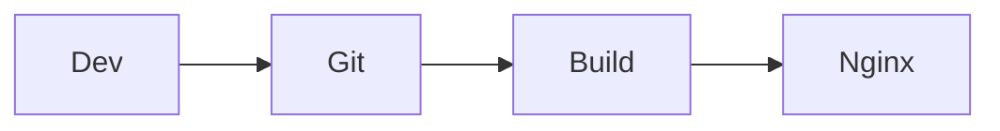

> Bài 2 của series. [Bài 1](/2026/11/15/website-tai-lieu-ky-thuat-doanh-nghiep-1-tong-quan/) đã so sánh tám cách triển khai và chọn cách dễ nhất mà vẫn giữ kín source: build tại máy, chỉ chép thư mục kết quả lên aaPanel, khóa bằng HTTP Basic Auth qua HTTPS. Bài này làm từng bước. Phần Docusaurus (cấu hình, component cột phải, build) và phần cấu hình Nginx đã được chạy thử với Docusaurus 3.10.2, Node 22 và Nginx trên Linux. Các thao tác trong giao diện aaPanel và cPanel được viết theo tài liệu, tên menu có thể khác theo phiên bản panel của bạn.

- [Kiến trúc của cách làm](#kiến-trúc-của-cách-làm)
- [Chuẩn bị](#chuẩn-bị)
- [Bước 1. Tạo dự án Docusaurus](#bước-1-tạo-dự-án-docusaurus)
- [Bước 2. Cấu hình site](#bước-2-cấu-hình-site)
- [Bước 3. Danh mục bên trái](#bước-3-danh-mục-bên-trái)
- [Bước 4. Thông tin phụ bên phải](#bước-4-thông-tin-phụ-bên-phải)
- [Bước 5. Viết nội dung: Markdown, ảnh, code, sơ đồ, PDF, MP4](#bước-5-viết-nội-dung-markdown-ảnh-code-sơ-đồ-pdf-mp4)
- [Bước 6. Build và xem thử](#bước-6-build-và-xem-thử)
- [Bước 7. Đưa source vào repo riêng tư](#bước-7-đưa-source-vào-repo-riêng-tư)
- [Bước 8. Tạo site trên aaPanel và bật HTTPS](#bước-8-tạo-site-trên-aapanel-và-bật-https)
- [Bước 9. Bật user/password](#bước-9-bật-userpassword)
- [Bước 10. Chép bản build lên server](#bước-10-chép-bản-build-lên-server)
- [Bước 11. Kiểm tra sau triển khai](#bước-11-kiểm-tra-sau-triển-khai)
- [Bước 12. Gia cố](#bước-12-gia-cố)
- [Tùy chọn: tự động hóa bằng CI](#tùy-chọn-tự-động-hóa-bằng-ci)
- [Nếu dùng cPanel](#nếu-dùng-cpanel)
- [Dùng lại bản build cho mạng nội bộ](#dùng-lại-bản-build-cho-mạng-nội-bộ)
- [Lỗi thường gặp](#lỗi-thường-gặp)
- [Nguồn tham khảo](#nguồn-tham-khảo)

## Kiến trúc của cách làm

```text
Trong công ty                                  VPS aaPanel (Internet)
+-----------------------------+                +---------------------------+
| Repo Git riêng tư           |                | Nginx                     |
|  docs/*.md, static/, config |                |  HTTPS (Let's Encrypt)    |
|            |                |                |  Basic Auth (.htpasswd)   |
|      npm run build          |   SCP / SFTP   |            |              |
|            v                | -------------> |  /www/wwwroot/docs.../    |
|  build/ (HTML, JS, media)   |  chỉ thư mục   |  chỉ có file đã build     |
+-----------------------------+     build      +---------------------------+
                                                           ^
                                           Người đọc nhập user/password
```

Server không có repo, không có Node, không có token Git. Nếu VPS bị xâm nhập, kẻ tấn công lấy được nội dung đã xuất bản nhưng không lấy được lịch sử commit, bản nháp hay cấu hình build.

## Chuẩn bị

- Máy lập trình viên: Node.js 20 trở lên, Git. Trên Windows 10 và 11 đã có sẵn `ssh`, `scp` và `tar`.
- Một VPS đã cài aaPanel với Nginx.
- Một tên miền con trỏ về IP của VPS, trong bài dùng `docs.example.com`.
- Quyền SSH vào VPS.

## Bước 1. Tạo dự án Docusaurus

```bash
npx create-docusaurus@latest docs-site classic --typescript
cd docs-site
npm install @docusaurus/theme-mermaid @easyops-cn/docusaurus-search-local docusaurus-plugin-image-zoom
```

Ba gói cài thêm lần lượt dùng cho sơ đồ Mermaid, tìm kiếm cục bộ và phóng to ảnh khi bấm.

Site chỉ có tài liệu nên xóa các phần mẫu không dùng:

```bash
# Git Bash, macOS, Linux
rm -rf blog docs/* src/pages/* src/components/HomepageFeatures
```

Cấu trúc sau khi dọn:

```text
docs-site/
├── docs/                  # Toàn bộ tài liệu Markdown
├── static/                # File phục vụ nguyên trạng: PDF, MP4, ảnh dùng chung
├── src/css/custom.css     # CSS tùy biến
├── docusaurus.config.ts   # Cấu hình site
└── sidebars.ts            # Cấu hình danh mục trái
```

## Bước 2. Cấu hình site

Thay nội dung `docusaurus.config.ts`:

File `docusaurus.config.ts`:

```ts
import {themes as prismThemes} from 'prism-react-renderer';
import type {Config} from '@docusaurus/types';
import type * as Preset from '@docusaurus/preset-classic';

const config: Config = {
  title: 'Tài liệu kỹ thuật',
  tagline: 'Tài liệu nội bộ',
  favicon: 'img/favicon.ico',

  url: 'https://docs.example.com',
  baseUrl: '/',
  trailingSlash: true,
  noIndex: true, // thêm thẻ noindex vào mọi trang

  onBrokenLinks: 'throw', // build thất bại nếu có liên kết hỏng

  i18n: {defaultLocale: 'vi', locales: ['vi']},

  markdown: {mermaid: true},
  themes: [
    '@docusaurus/theme-mermaid',
    [
      '@easyops-cn/docusaurus-search-local',
      {
        hashed: true,
        language: ['en', 'vi'],
        indexBlog: false,
        docsRouteBasePath: '/',
        highlightSearchTermsOnTargetPage: true,
      },
    ],
  ],
  plugins: ['docusaurus-plugin-image-zoom'],

  presets: [
    [
      'classic',
      {
        docs: {
          routeBasePath: '/', // tài liệu nằm ngay ở gốc site
          sidebarPath: './sidebars.ts',
          showLastUpdateTime: true,
          showLastUpdateAuthor: true,
        },
        blog: false,
        theme: {customCss: './src/css/custom.css'},
      } satisfies Preset.Options,
    ],
  ],

  themeConfig: {
    navbar: {
      title: 'Tài liệu kỹ thuật',
      items: [
        {type: 'docSidebar', sidebarId: 'docs', position: 'left', label: 'Tài liệu'},
      ],
    },
    docs: {sidebar: {hideable: true, autoCollapseCategories: true}},
    tableOfContents: {minHeadingLevel: 2, maxHeadingLevel: 4},
    prism: {
      theme: prismThemes.github,
      darkTheme: prismThemes.dracula,
      additionalLanguages: ['bash', 'csharp', 'java', 'php', 'nginx', 'ini', 'powershell', 'sql'],
    },
    zoom: {selector: '.markdown img'},
  } satisfies Preset.ThemeConfig,
};

export default config;
```

Ba điểm đáng chú ý:

- `routeBasePath: '/'` kèm `blog: false` biến site thành site chỉ có tài liệu, không có trang chủ quảng cáo.
- `showLastUpdateTime` và `showLastUpdateAuthor` lấy dữ liệu từ lịch sử Git. Thư mục dự án **phải là một repo Git đã có commit**, nếu không lệnh build sẽ báo lỗi `not a git repository`.
- Tìm kiếm cục bộ tạo file `search-index.json` nằm cùng site, không gửi nội dung ra dịch vụ nào bên ngoài.

## Bước 3. Danh mục bên trái

Để Docusaurus tự sinh danh mục từ cấu trúc thư mục:

File `sidebars.ts`:

```ts
import type {SidebarsConfig} from '@docusaurus/plugin-content-docs';

const sidebars: SidebarsConfig = {
  docs: [{type: 'autogenerated', dirName: '.'}],
};

export default sidebars;
```

Tổ chức thư mục `docs/` theo đúng cây danh mục mong muốn:

```text
docs/
├── index.md                  # Trang đầu
├── huong-dan/
│   ├── _category_.json       # Tên và thứ tự của nhóm
│   ├── cai-dat.mdx
│   └── cau-hinh.md
├── api/
└── van-hanh/
```

Trang đầu:

File `docs/index.md`:

```md
---
slug: /
sidebar_position: 1
title: Giới thiệu
---

# Giới thiệu

Đây là tài liệu kỹ thuật của công ty.
```

Tên hiển thị và thứ tự của một nhóm:

File `docs/huong-dan/_category_.json`:

```json
{
  "label": "Hướng dẫn",
  "position": 2,
  "link": {"type": "generated-index", "slug": "/huong-dan"}
}
```

Nên đặt `slug` không dấu như trên. Nếu bỏ qua, Docusaurus tạo đường dẫn từ nhãn và bạn sẽ có URL kiểu `/category/hướng-dẫn/`. Tương tự, đặt tên file và thư mục bằng chữ thường không dấu, nối bằng gạch ngang.

Thứ tự từng trang trong nhóm đặt bằng `sidebar_position` ở đầu file.

## Bước 4. Thông tin phụ bên phải

Cột phải mặc định là mục lục của trang, lấy từ các tiêu đề cấp 2 đến cấp 4 theo cấu hình `tableOfContents` ở bước 2. Cuối mỗi trang còn có thời điểm và người cập nhật cuối.

Để hiện thêm thông tin phụ riêng của doanh nghiệp (người phụ trách, phiên bản, ngày rà soát), bọc component mục lục bằng tính năng swizzle:

```bash
npm run swizzle @docusaurus/theme-classic TOC -- --wrap --typescript --danger
```

Cờ `--danger` là bắt buộc vì Docusaurus xếp component này vào nhóm có thể thay đổi giữa các phiên bản. Bọc ngoài (wrap) ít rủi ro hơn nhiều so với chép toàn bộ (eject), nhưng vẫn nên kiểm tra lại sau mỗi lần nâng cấp.

Thay nội dung file vừa sinh:

File `src/theme/TOC/index.tsx`:

```tsx
import React, {type ReactNode} from 'react';
import TOC from '@theme-original/TOC';
import type TOCType from '@theme/TOC';
import type {WrapperProps} from '@docusaurus/types';
import {useDoc} from '@docusaurus/plugin-content-docs/client';

type Props = WrapperProps<typeof TOCType>;

type ExtraFrontMatter = {
  owner?: string;
  doc_version?: string;
  reviewed?: string;
};

export default function TOCWrapper(props: Props): ReactNode {
  const {frontMatter} = useDoc();
  const {owner, doc_version, reviewed} = frontMatter as ExtraFrontMatter;
  const hasInfo = owner || doc_version || reviewed;

  return (
    <>
      {hasInfo && (
        <aside className="doc-info">
          <strong>Thông tin tài liệu</strong>
          <ul>
            {owner && <li>Phụ trách: {owner}</li>}
            {doc_version && <li>Phiên bản: {doc_version}</li>}
            {reviewed && <li>Rà soát: {reviewed}</li>}
          </ul>
        </aside>
      )}
      <TOC {...props} />
    </>
  );
}
```

Thêm vào cuối `src/css/custom.css`:

File `src/css/custom.css`:

```css
.doc-info {
  margin-bottom: 1rem;
  padding: 0.75rem 1rem;
  border: 1px solid var(--ifm-color-emphasis-300);
  border-radius: 8px;
  font-size: 0.85rem;
}

.doc-info ul {
  margin: 0.5rem 0 0;
  padding-left: 1rem;
}
```

Từ giờ trang nào khai báo các trường này ở đầu file sẽ có hộp thông tin phía trên mục lục:

```md
---
title: Cài đặt
owner: Nhóm Hạ tầng
doc_version: "1.2"
reviewed: "2026-11-15"
---
```

Đặt giá trị trong dấu nháy kép. Nếu không, YAML hiểu `1.2` là số và `2026-11-15` là kiểu ngày, hiển thị sẽ sai định dạng.

Hai giới hạn cần biết: cột phải chỉ xuất hiện khi trang có ít nhất một tiêu đề cấp 2, và trên màn hình hẹp Docusaurus thay cột phải bằng mục lục thu gọn nên hộp thông tin không hiện trên điện thoại.

## Bước 5. Viết nội dung: Markdown, ảnh, code, sơ đồ, PDF, MP4

Dùng đuôi `.md` cho trang thuần Markdown và `.mdx` khi cần nhúng thẻ HTML hoặc component.

**Hộp cảnh báo:**

```md
:::warning[Lưu ý]
Sao lưu cơ sở dữ liệu trước khi chạy lệnh này.
:::
```

Các loại có sẵn: `note`, `tip`, `info`, `warning`, `danger`.

**Ảnh:** đặt cạnh file Markdown và tham chiếu tương đối. Docusaurus tự thêm mã băm vào tên file để trình duyệt lưu đệm an toàn, plugin zoom cho phép bấm để phóng to.

```md

```

**Code block** có tiêu đề file, số dòng và tô sáng dòng:

````md
```bash title="install.sh" showLineNumbers
# highlight-next-line
sudo apt install nginx
sudo systemctl enable --now nginx
```
````

**Tab theo hệ điều hành hoặc ngôn ngữ** (cần file `.mdx`):

```mdx
import Tabs from '@theme/Tabs';
import TabItem from '@theme/TabItem';

<Tabs groupId="os">
  <TabItem value="win" label="Windows">winget install nginx</TabItem>
  <TabItem value="linux" label="Linux">sudo apt install nginx</TabItem>
</Tabs>
```

**Sơ đồ Mermaid:**

````md

````

**PDF:** đặt file vào `static/files/`, nhúng bằng `iframe` và luôn kèm liên kết tải vì trình duyệt điện thoại thường không hiển thị PDF nhúng.

```mdx
<iframe src="/files/so-do-he-thong.pdf" width="100%" height="700" title="Sơ đồ hệ thống"></iframe>

[Tải file PDF](pathname:///files/so-do-he-thong.pdf)
```

Tiền tố `pathname://` báo cho Docusaurus biết đây là file tĩnh, không phải một trang tài liệu, để bước kiểm tra liên kết hỏng không báo nhầm.

**Video MP4:** đặt file vào `static/video/`.

```mdx
<video controls preload="metadata" width="100%">
  <source src="/video/huong-dan-cai-dat.mp4" type="video/mp4" />
</video>
```

Mã hóa video bằng H.264 và AAC để chạy trên mọi trình duyệt. `preload="metadata"` giúp trang không tải cả video khi người đọc chưa bấm phát.

## Bước 6. Build và xem thử

```bash
git init
git add -A
git commit -m "Khởi tạo site tài liệu"

npm start          # chế độ viết bài, tự tải lại khi sửa file
npm run build      # tạo thư mục build/
npm run serve      # xem bản build tại http://localhost:3000
```

Tìm kiếm cục bộ chỉ hoạt động ở bản build (`npm run serve`), không hoạt động ở `npm start`.

Thư mục `build/` là toàn bộ những gì cần đưa lên server. Một site mẫu vài trang nặng khoảng 6 đến 7 MB, chưa tính media.

## Bước 7. Đưa source vào repo riêng tư

File `.gitignore` do Docusaurus tạo sẵn đã loại `node_modules`, `build` và `.docusaurus`.

- **Kín nhất:** repo trên Gitea hoặc Forgejo tự host trong mạng công ty, hoặc một bare repo trên máy chủ file nội bộ.
- **Tiện nhất:** repo private trên GitHub hoặc GitLab. Bật xác thực hai lớp cho mọi thành viên.

Với MP4 và PDF nặng, dùng Git LFS trước khi commit lần đầu:

```bash
git lfs install
git lfs track "static/video/*.mp4" "static/files/*.pdf"
git add .gitattributes
```

## Bước 8. Tạo site trên aaPanel và bật HTTPS

1. Vào **Website**, chọn **Add site**. Nhập tên miền `docs.example.com`, phần PHP chọn dạng tĩnh (static), không tạo cơ sở dữ liệu và FTP. aaPanel tạo thư mục gốc `/www/wwwroot/docs.example.com`.
2. Xóa các file mẫu aaPanel đặt sẵn trong thư mục gốc (`index.html`, `404.html`). Giữ nguyên `.user.ini`.
3. Mở cấu hình site, vào mục **SSL**, xin chứng chỉ **Let's Encrypt** và bật **Force HTTPS**.

Không triển khai tài liệu trước khi xong bước 9. Giữa hai bước này thư mục gốc nên để trống.

## Bước 9. Bật user/password

Có hai đường. Đường nào cũng phải qua bước kiểm tra ở bước 11.

### Đường A: dùng giao diện aaPanel

Trong cấu hình site có mục giới hạn truy cập bằng mật khẩu (tùy phiên bản mang tên như **Password access** hoặc **Access limit**). Thêm một quy tắc cho thư mục `/` với tên đăng nhập và mật khẩu. Nhanh, nhưng bạn không kiểm soát được chính xác đoạn cấu hình Nginx mà panel sinh ra, nên bước kiểm tra càng quan trọng.

### Đường B: cấu hình Nginx thủ công

SSH vào VPS và tạo file mật khẩu. Lệnh `openssl` sẽ hỏi mật khẩu hai lần, không để lại mật khẩu trong lịch sử lệnh:

```bash
mkdir -p /www/server/htpasswd
echo "kythuat:$(openssl passwd -apr1)" >> /www/server/htpasswd/docs.example.com
echo "kinhdoanh:$(openssl passwd -apr1)" >> /www/server/htpasswd/docs.example.com
chown root:www /www/server/htpasswd/docs.example.com
chmod 640 /www/server/htpasswd/docs.example.com
```

Mỗi dòng là một tài khoản. Nên tạo mỗi nhóm một tài khoản để sau này thu hồi được theo nhóm. File mật khẩu nằm ngoài thư mục gốc của site nên không thể bị tải về qua web.

Mở cấu hình site trong aaPanel, vào mục **Config** (file cấu hình Nginx), thêm các dòng sau vào trong khối `server` phục vụ HTTPS, ngay dưới dòng `root`:

```nginx
    # Khóa toàn bộ site
    auth_basic "Tai lieu noi bo";
    auth_basic_user_file /www/server/htpasswd/docs.example.com;

    # Không cho máy tìm kiếm lập chỉ mục
    add_header X-Robots-Tag "noindex, nofollow" always;

    # Trang 404 của Docusaurus
    error_page 404 /404.html;

    # Cho phép Let's Encrypt gia hạn chứng chỉ mà không cần mật khẩu
    location ^~ /.well-known/acme-challenge/ {
        auth_basic off;
        allow all;
    }
```

Lưu lại, aaPanel sẽ kiểm tra cú pháp và nạp lại Nginx.

**Vì sao đặt `auth_basic` ở cấp `server` chứ không đặt trong `location /`:** file cấu hình mặc định của aaPanel có sẵn các khối `location` dạng biểu thức chính quy cho ảnh và cho file `.js`, `.css` để đặt thời hạn lưu đệm. Nginx ưu tiên các khối này hơn `location /`. Khi chạy thử, đặt mật khẩu trong `location /` cho kết quả: trang HTML, PDF, MP4 trả về 401 đúng như mong đợi, nhưng file PNG và file JavaScript trả về 200 không cần đăng nhập. File JavaScript của Docusaurus chứa nội dung các trang, nên đó là rò rỉ thật sự. Đặt ở cấp `server` thì mọi `location` đều thừa hưởng.

**Vì sao cần khối `acme-challenge`:** chứng chỉ Let's Encrypt gia hạn bằng cách gọi một đường dẫn dưới `/.well-known/acme-challenge/`. Nếu đường dẫn này cũng đòi mật khẩu thì việc gia hạn thất bại và sau khoảng ba tháng site báo lỗi chứng chỉ. Nếu file cấu hình của bạn đã có sẵn một khối `location` cho `.well-known`, hãy thêm `auth_basic off;` vào chính khối đó thay vì tạo khối mới. Cách khác là xin chứng chỉ bằng xác minh DNS.

## Bước 10. Chép bản build lên server

**Cách đơn giản nhất** là nén thư mục `build`, tải lên bằng mục **Files** của aaPanel rồi giải nén vào thư mục gốc của site.

**Cách nên dùng lâu dài** là một tài khoản SSH riêng chỉ để triển khai, đăng nhập bằng khóa. Trên VPS:

```bash
useradd -m -s /bin/bash deploy
mkdir -p /home/deploy/.ssh
# dán khóa công khai của máy build vào file dưới đây
nano /home/deploy/.ssh/authorized_keys
chown -R deploy:deploy /home/deploy/.ssh
chmod 700 /home/deploy/.ssh && chmod 600 /home/deploy/.ssh/authorized_keys

# Cho deploy quyền ghi vào thư mục site, không đụng tới .user.ini
find /www/wwwroot/docs.example.com -mindepth 1 -not -name ".user.ini" -exec chown -R deploy:www {} +
chown deploy:www /www/wwwroot/docs.example.com
```

Trên máy build (PowerShell, Git Bash, macOS và Linux đều chạy được):

```bash
npm run build
tar -czf site.tar.gz -C build .
scp site.tar.gz deploy@docs.example.com:/tmp/site.tar.gz
ssh deploy@docs.example.com "rm -rf /www/wwwroot/docs.example.com/* && tar -xzf /tmp/site.tar.gz -C /www/wwwroot/docs.example.com && rm /tmp/site.tar.gz"
```

Ghi chú:

- `rm -rf .../*` không xóa file ẩn nên `.user.ini` của aaPanel vẫn còn. Việc xóa bản cũ là cần thiết vì mỗi lần build Docusaurus tạo file với mã băm mới, không dọn thì file cũ tích tụ dần.
- Site gián đoạn một hai giây trong lúc giải nén. Với tài liệu nội bộ thường chấp nhận được.
- Nếu SSH của VPS không chạy ở cổng 22, thêm `-P <cổng>` cho `scp` và `-p <cổng>` cho `ssh`.
- Trên Linux, macOS hoặc WSL có thể thay ba lệnh cuối bằng `rsync -az --delete --exclude ".user.ini" build/ deploy@docs.example.com:/www/wwwroot/docs.example.com/`, chỉ truyền phần thay đổi.

Gói bốn lệnh trên vào một file `deploy.ps1` hoặc `deploy.sh` để lần sau chỉ cần chạy một lệnh.

## Bước 11. Kiểm tra sau triển khai

Chạy từ một máy bên ngoài. Mọi dòng không có tài khoản phải trả về `401`:

```bash
# Thay tên file JS và ảnh bằng tên thật trong thư mục build của bạn
for p in / /huong-dan/cai-dat/ /search-index.json \
         /files/so-do-he-thong.pdf /video/huong-dan-cai-dat.mp4 \
         /img/logo.svg /assets/js/main.xxxxxxxx.js; do
  echo "$p -> $(curl -s -o /dev/null -w '%{http_code}' https://docs.example.com$p)"
done

# Có tài khoản thì phải trả về 200
curl -s -o /dev/null -w '%{http_code}\n' -u kythuat https://docs.example.com/

# HTTP phải chuyển hướng sang HTTPS (301 hoặc 308)
curl -s -o /dev/null -w '%{http_code}\n' http://docs.example.com/
```

Danh sách kiểm tra:

- Trang HTML, file JS, CSS, ảnh PNG và SVG, PDF, MP4 và `search-index.json` đều trả về 401 khi chưa đăng nhập.
- Đăng nhập bằng từng tài khoản đều vào được.
- Mở trình duyệt ở chế độ ẩn danh thì bị hỏi mật khẩu.
- HTTP tự chuyển sang HTTPS.
- Tìm kiếm ra kết quả, video tua được, PDF hiển thị, ảnh bấm phóng to được.
- Một đường dẫn không tồn tại hiện trang 404 của Docusaurus.
- Trong mục SSL của aaPanel, thử gia hạn chứng chỉ thành công.

## Bước 12. Gia cố

**Chặn dò mật khẩu bằng Fail2ban.** aaPanel có ứng dụng Fail2ban trong App Store. Bật bộ lọc `nginx-http-auth` và trỏ tới file log lỗi của site (thường là `/www/wwwlogs/docs.example.com.error.log`), ví dụ khóa IP một giờ sau 5 lần sai trong 10 phút.

**Giới hạn theo IP nếu công ty có IP tĩnh.** Đoạn sau cho IP công ty vào thẳng, các IP khác phải nhập mật khẩu:

```nginx
    satisfy any;
    allow 203.0.113.10;   # IP văn phòng
    deny all;
    auth_basic "Tai lieu noi bo";
    auth_basic_user_file /www/server/htpasswd/docs.example.com;
```

Muốn bắt buộc cả hai điều kiện thì đổi `satisfy any` thành `satisfy all`.

**Khóa cổng quản trị.** Đổi cổng và đường dẫn đăng nhập mặc định của aaPanel, bật xác thực hai lớp cho panel, chỉ cho SSH đăng nhập bằng khóa.

**Quy trình đổi mật khẩu.** Khi có người rời nhóm: xóa dòng tài khoản cũ trong file htpasswd, tạo dòng mới, thông báo mật khẩu mới qua kênh an toàn. Không cần nạp lại Nginx vì file được đọc ở mỗi yêu cầu.

**Không dùng CDN công khai lưu đệm phía trước** trừ khi bạn chắc chắn nó không lưu đệm phản hồi của các yêu cầu đã xác thực.

## Tùy chọn: tự động hóa bằng CI

Khi việc chạy script tay trở nên phiền, chuyển bước 10 vào CI. Ví dụ với GitHub Actions trên repo private, khóa SSH của tài khoản `deploy` lưu trong secrets:

File `.github/workflows/deploy.yml`:


```yaml
name: Deploy docs
on:
  push:
    branches: [main]

jobs:
  deploy:
    runs-on: ubuntu-latest
    steps:
      - uses: actions/checkout@v4
        with:
          fetch-depth: 0   # cần đủ lịch sử để tính ngày cập nhật cuối
          lfs: true
      - uses: actions/setup-node@v4
        with:
          node-version: 22
          cache: npm
      - run: npm ci
      - run: npm run build
      - name: Upload
        env:
          SSH_KEY: ${{ secrets.DEPLOY_SSH_KEY }}
          KNOWN_HOSTS: ${{ secrets.DEPLOY_KNOWN_HOSTS }}
        run: |
          mkdir -p ~/.ssh
          echo "$SSH_KEY" > ~/.ssh/id_ed25519 && chmod 600 ~/.ssh/id_ed25519
          echo "$KNOWN_HOSTS" > ~/.ssh/known_hosts
          rsync -az --delete --exclude ".user.ini" build/ \
            deploy@docs.example.com:/www/wwwroot/docs.example.com/
```


Đoạn workflow này là khung mẫu, chưa được chạy thử trên một repo thật. Nếu muốn source không rời công ty, dùng Gitea Actions tự host với cú pháp gần như giống hệt.

aaPanel cũng có **Git Manager** để server tự kéo repo và build khi nhận webhook. Cách đó tiện nhưng đặt toàn bộ source và một khóa đọc repo lên VPS, nên không được chọn ở đây.

## Nếu dùng cPanel

Phần Docusaurus giữ nguyên, chỉ khác phía server:

| Việc | aaPanel | cPanel |
|---|---|---|
| Tạo site | Website, Add site | **Domains**, tạo tên miền con, thư mục gốc ví dụ `public_html/docs` |
| HTTPS | SSL, Let's Encrypt | **SSL/TLS Status**, chạy AutoSSL. Bật **Force HTTPS Redirect** trong Domains |
| Mật khẩu | Cấu hình Nginx như bước 9 | **Directory Privacy**: chọn thư mục của site, bật bảo vệ, tạo user. cPanel tự ghi `.htaccess` và file mật khẩu nằm ngoài thư mục web |
| Tải file lên | SCP, rsync, Files | **File Manager** (tải file zip rồi Extract), FTP hoặc SFTP, hoặc SSH nếu gói hosting cho phép |
| Chặn máy tìm kiếm | `add_header` trong Nginx | Thêm `Header set X-Robots-Tag "noindex, nofollow"` vào `.htaccess` |
| Trang 404 | `error_page` trong Nginx | Thêm `ErrorDocument 404 /404.html` vào `.htaccess` |

Lưu ý riêng cho cPanel:

- Với Apache, quy tắc mật khẩu trong `.htaccess` áp dụng cho cả thư mục và mọi thư mục con, không gặp vấn đề `location` như Nginx. Vẫn phải chạy bước 11.
- Khi tải bản build mới, đừng xóa file `.htaccess` trong thư mục site, nếu không mật khẩu biến mất.
- Sau khi bật Directory Privacy, kiểm tra AutoSSL vẫn gia hạn được. Nếu thất bại, tham khảo tài liệu của nhà cung cấp hosting về việc miễn trừ thư mục `.well-known`.
- Shared hosting thường giới hạn dung lượng và băng thông, video nặng sẽ sớm chạm trần.

## Dùng lại bản build cho mạng nội bộ

Cùng thư mục `build/` đó chép vào bất kỳ web server nào trong LAN là chạy:

```nginx
server {
    listen 80;
    server_name docs.congty.lan;
    root /srv/docs;
    index index.html;
    error_page 404 /404.html;
}
```

Hoặc bằng Docker:

```bash
docker run -d --name docs -p 8080:80 -v /srv/docs:/usr/share/nginx/html:ro nginx:stable
```

Điều kiện duy nhất là site nội bộ cũng nằm ở gốc tên miền (`baseUrl: '/'`). Nếu phải đặt trong thư mục con, ví dụ `http://intranet/docs/`, cần build riêng một bản với `baseUrl: '/docs/'`.

Nếu muốn bản nội bộ đầy đủ còn bản online lược bớt, dùng biến môi trường trong `docusaurus.config.ts` để đổi tùy chọn `exclude` của plugin docs, rồi build hai lần ra hai thư mục bằng `npm run build -- --out-dir build-public`.

## Lỗi thường gặp

| Hiện tượng | Nguyên nhân | Cách xử lý |
|---|---|---|
| Build báo `not a git repository` | Bật `showLastUpdateTime` khi chưa có repo Git | `git init` và commit, hoặc tắt hai tùy chọn đó |
| Build báo liên kết hỏng tới file PDF | Docusaurus coi đường dẫn là trang tài liệu | Dùng tiền tố `pathname://` |
| Trang trắng, lỗi 404 với file JS và CSS | `baseUrl` không khớp vị trí thật của site | Sửa `baseUrl` rồi build lại |
| Ảnh hiện ở máy Windows nhưng mất trên server | Linux phân biệt chữ hoa chữ thường trong tên file | Đặt tên file toàn chữ thường |
| Chạy `npm start` thì không tìm kiếm được | Chỉ mục chỉ được tạo lúc build | Dùng `npm run build` rồi `npm run serve` |
| Video không tua được | Server hoặc proxy phía trước không hỗ trợ Range request | Nginx hỗ trợ sẵn, kiểm tra proxy hoặc CDN |
| Trang đòi mật khẩu nhưng ảnh và JS thì không | `auth_basic` đặt trong `location /` | Chuyển lên cấp `server` như bước 9 |
| Chứng chỉ không gia hạn được | Đường dẫn ACME bị đòi mật khẩu | Thêm `auth_basic off` cho `/.well-known/acme-challenge/` |
| Đổi mật khẩu rồi vẫn vào được | Trình duyệt nhớ thông tin đăng nhập cũ đến khi đóng hẳn | Đóng toàn bộ trình duyệt hoặc thử cửa sổ ẩn danh |
| Hộp thông tin cột phải hiện ngày dạng `Sun Nov 15` | YAML hiểu giá trị là kiểu ngày | Đặt giá trị trong dấu nháy kép |

Quay lại [bài 1](/2026/11/15/website-tai-lieu-ky-thuat-doanh-nghiep-1-tong-quan/) nếu sau này cần đổi hướng: tài khoản từng người, SSO, hoặc đặt site hoàn toàn trong công ty với Cloudflare Tunnel.

## Nguồn tham khảo

- [Docusaurus: Changelog](https://docusaurus.io/changelog)
- [aaPanel: Create a site from Git và Git Manager](https://www.aapanel.com/docs/Function/Tutorial/create_for_git.html)
- [NGINX: Restricting Access with HTTP Basic Authentication](https://docs.nginx.com/nginx/admin-guide/security-controls/configuring-http-basic-authentication/)
- [aaPanel Forum: Nginx password protect directory](https://www.aapanel.com/forum/d/224-nginx-password-protect-directory/12)
- [GitHub Docs: Changing the visibility of your GitHub Pages site](https://docs.github.com/en/enterprise-cloud@latest/pages/getting-started-with-github-pages/changing-the-visibility-of-your-github-pages-site)
